# 01Java基础概念与常识-Java入门--基础概念与常识
## 0. Java 是什么？
Java 是一种面向对象、静态类型、跨平台的编程语言。

Java 最初由 Sun Microsystems 开发，1995 年正式发布，后来 Sun 被 Oracle 收购。

Java 常用于：
- 企业级后端系统（Spring Boot、Spring Cloud）
- 金融与银行系统
- 大型分布式系统
- Android 开发（历史上广泛使用 Java，现在 Kotlin 也很常见）
- 大数据生态（Hadoop、Flink 等）
Java 有什么特点？

| 特点 | 解释 |
| --- | --- |
| 面向对象 | 支持封装、继承、多态 |
| 跨平台 | 字节码可以在不同平台的兼容 JVM 上运行 |
| 自动内存管理 | JVM 通过垃圾回收机制管理堆内存 |
| 静态类型 | 变量、表达式的类型在编译阶段受到检查 |
| 多线程 | 内置线程和并发编程支持 |
| 异常处理 | 使用 try、catch、finally 等机制 |
| 丰富生态 | Spring、MyBatis、Hibernate 等框架 |

> 面试题：Java 为什么能够跨平台？
> 因为 Java 源代码通常先通过 javac 编译成平台无关的字节码，再由对应平台的 JVM 执行。
> Java 不是直接将同一份机器码运行在所有操作系统上，而是通过不同平台上的 JVM 实现跨平台。

## 1.Java 基础概念与常识：Java SE、Java EE、Java ME、JVM、JRE、JDK
这六个概念经常一起出现在 Java 面试中，但实际上它们属于两个不同的知识体系：
- Java SE、Java EE、Java ME：表示 Java 平台的不同版本或应用领域。
- JVM、JRE、JDK：表示 Java 程序的执行环境、运行环境和开发工具。
一、Java SE vs Java EE vs Java ME
### 1.1 什么是 Java SE？
Java SE（Java Platform, Standard Edition），即 Java 平台标准版，是 Java 开发的基础平台。
它提供 Java 的核心语言特性、基础类库及运行 Java 程序所需要的相关组件。
例如，我们平时使用的以下功能都属于 Java SE 范畴：

```java
// 集合
List<String> list = new ArrayList<>();
// 多线程
Thread thread = new Thread();
// 文件操作
Files.readString(Path.of("test.txt"));
// 数据库连接（JDBC）
Connection connection = DriverManager.getConnection(url);
```

注意，Java SE 并不意味着只能开发简单程序。它同样可以构建复杂的服务器端应用。
### 1.2 什么是 Java EE？
Java EE（Java Platform, Enterprise Edition），即 Java 平台企业版。

Java EE 在 Java SE 的基础上提供企业级应用开发所需要的一系列标准规范和 API。

常见规范包括：

| 技术 | 作用 |
| --- | --- |
| Servlet | 处理 HTTP 请求和响应 |
| JSP | 在服务端生成动态网页 |
| EJB | 企业级业务组件 |
| JPA | 对象关系映射与持久化 |
| JTA | 事务管理 |
| JMS | 消息通信 |
| JavaMail | 邮件发送和接收 |

其中 JDBC 属于 Java SE 的标准 API，虽然在企业级应用中使用广泛，但并不专属于 Java EE。

另外，Java EE 已经移交给 Eclipse Foundation，后续发展为 Jakarta EE。

从 Jakarta EE 9 开始，很多相关 API 的包名从 javax.* 迁移到 jakarta.*。

例如：

```java
// 早期 Java EE
import javax.servlet.http.HttpServlet;
// Jakarta EE 9+
import jakarta.servlet.http.HttpServlet;
```
这也解释了为什么现代 Spring Boot 项目中经常会出现 jakarta.*。
### 1.3 什么是 Java ME？
Java ME（Java Platform, Micro Edition），即 Java 平台微型版。

主要针对资源受限的设备，例如早期功能手机、机顶盒及部分嵌入式设备。
它提供适合特定设备环境的 API 和运行配置。
现在 Java ME 在主流企业后端开发中已经比较少见，但并非完全消失。

### 1.4 三者对比表


| 比较项目 | Java SE | Java EE / Jakarta EE | Java ME |
| --- | --- | --- | --- |
| 全称 | Standard Edition | Enterprise Edition | Micro Edition |
| 中文 | 标准版 | 企业版 | 微型版 |
| 核心定位 | Java 基础平台 | 企业级开发规范 | 资源受限设备平台 |
| 主要功能 | 集合、IO、并发、网络、JDBC 等 | Servlet、JPA、JTA、JMS 等 | 精简类库与设备相关 API |
| 应用场景 | 通用程序、服务器程序 | Web 系统、企业级服务 | 嵌入式设备、早期手机 |
| 与 Java SE 的关系 | 基础平台 | 建立在 SE 基础上 | 针对受限设备的独立平台体系 |
| 现在使用情况 | 非常普遍 | 非常普遍 | 相对较少 |
| 面试重要性 | ⭐⭐⭐⭐⭐ | ⭐⭐⭐⭐ | ⭐ |

> 面试重点：Java EE 和 Spring Boot 是什么关系？<br>
> Java EE/Jakarta EE 主要是一套企业级 Java 标准规范，而 Spring Boot 是 Spring 生态中用于简化应用开发和配置的框架。
> 两者不是同一个东西。
> Spring Boot 可以使用 Jakarta Servlet、Jakarta Persistence 等规范，但 Spring Framework 也提供自己的依赖注入、事务管理等功能。

例如：
```java
@RestController
public class UserController {

    @GetMapping("/user")
    public String getUser() {
        return "Hello Java";
    }
}
```

在典型的 Spring Boot Web MVC 项目中：
- Java SE 提供 Java 基础运行能力。
- Spring Boot 负责自动配置与应用启动。
- Spring MVC 负责 Web 请求处理。
- 内嵌 Tomcat 提供 Servlet 容器，执行相关 Servlet API 规范。
因此，学习 Spring Boot 并不要求先学习所有 Java EE 规范，但理解 Servlet、JPA 和事务规范十分有帮助。

## 2、JVM vs JRE vs JDK
这三个概念分别对应不同的职责：

JVM 负责执行，JRE 提供运行环境，JDK 提供开发工具和运行能力。
### 2.1 JVM：Java 虚拟机
JVM（Java Virtual Machine）是 Java 虚拟机，负责加载、验证并执行 Java 字节码。

其核心功能包括：

| 功能 | 说明 |
| --- | --- |
| 类加载 | 加载 .class 字节码 |
| 字节码执行 | 解释执行或通过 JIT 编译后执行 |
| 内存管理 | 管理堆、线程栈等运行时内存区域 |
| 垃圾回收 | 自动回收不再使用的对象所占的堆内存 |
| JIT 编译 | 将热点字节码编译为本地机器码 |
| 异常处理 | 支持 Java 异常机制的运行时行为 |

JVM 为什么能够实现跨平台？
例如：

```java
public class Hello {
    public static void main(String[] args) {
        System.out.println("Hello Java");
    }
}
```

首先使用：
```bash
javac Hello.java
```
生成：
```
Hello.class
```

这个 .class 文件通常可以在 Windows、Linux 和 macOS 上的兼容 JVM 中执行。

但要注意，JVM 本身不是完全相同的程序。

Windows、Linux 和 macOS 分别需要对应平台的 JVM 实现。

因此，Java 跨平台的关键在于：

统一的字节码规范 + 不同操作系统上的 JVM 实现。

另外，JVM 并不是 Java 语言专用的。Kotlin、Scala、Groovy 等语言也可以编译成 JVM 字节码。
JVM 是否只有一种？
不是。

| JVM 实现 | 说明 |
| --- | --- |
| HotSpot | OpenJDK 中最常见的 JVM 实现 |
| Eclipse OpenJ9 | 另一种 JVM 实现，关注内存占用和启动等性能特征 |
| Azul Prime JVM | Azul 提供的商业 JVM 实现 |
| JRockit | 历史上的 JVM 实现，后来相关技术整合进 HotSpot |

只要遵循相应 JVM 规范，理论上不同组织都可以开发自己的 JVM。

### 2.2 JRE：Java 运行环境

JRE（Java Runtime Environment）主要提供运行 Java 程序所需要的组件。

传统的理解是：

$$
\text{JRE} = \text{JVM} + \text{Java 基础类库} + \text{运行支持组件}
$$

例如 Java 程序需要使用：
```java
System.out.println("Hello");
```

其中 System、PrintStream 等类来自 Java 标准类库。

JVM 负责执行字节码，而标准类库为程序提供 API。

只有 JVM 而没有程序需要的类库，通常无法运行正常的 Java 应用。
### 2.3 JDK：Java 开发工具包
JDK（Java Development Kit）是 Java 开发工具包。

传统概念中：

| **JDK = JRE + Java 开发工具** |
| --- |

常用工具如下：

| 工具 | 用途 | 示例 |
| --- | --- | --- |
| javac | 编译 Java 源码 | `javac Hello.java` |
| java | 启动 Java 程序 | `java Hello` |
| javap | 查看类结构及反汇编字节码 | `javap -c Hello` |
| jar | 打包和管理 JAR 文件 | `jar cf app.jar ...` |
| javadoc | 生成 API 文档 | `javadoc Hello.java` |
| jdb | 调试工具 | `jdb Hello` |
| jconsole | JVM 监控工具 | `jconsole` |
| jlink | 创建自定义运行时映像 | `jlink --add-modules ...` |

其中需要特别注意：

javap 不是将字节码完整还原为 Java 源代码的反编译器，主要用于查看类信息、方法签名和字节码指令。
### 2.4 JVM、JRE、JDK 对比表

| 对比项目 | JVM | JRE | JDK |
| --- | --- | --- | --- |
| 中文名称 | Java 虚拟机 | Java 运行环境 | Java 开发工具包 |
| 核心职责 | 执行字节码 | 提供运行环境 | 开发、编译、调试、运行 |
| 是否包含 JVM | 本身就是 JVM | 是 | 是 |
| 是否包含基础类库 | 不以完整类库为定义 | 是 | 是 |
| 是否提供 javac | 否 | 通常否 | 是 |
| 是否用于编译 | 否 | 否 | 是 |
| 是否可以运行 Java | 需要相关运行组件 | 是 | 是 |
| 面试重要性 | ⭐⭐⭐⭐⭐ | ⭐⭐⭐⭐ | ⭐⭐⭐⭐⭐ |


## 3. JDK 9 之后为什么不再强调 JRE？
在 Java 8 以及更早版本中，JDK 和独立 JRE 的区别比较明显。

但从 Java 9 开始，Java 引入了模块系统（Java Platform Module System，JPMS）。

原本大量集中在 Java 运行环境中的标准类库被组织为多个模块，例如：
java.base
java.sql
java.xml
java.desktop
java.logging


其中：
- java.base：最基础的 Java API。
- java.sql：JDBC 数据库访问。
- java.xml：XML 处理。
- java.desktop：桌面 GUI 等功能。
- java.logging：日志 API。
什么是 jlink？
假设开发一个服务器程序，不需要 GUI、打印等功能。

就可以使用 jlink 根据模块依赖生成定制的 Java 运行时映像。

例如：
```bash
jlink \
  --add-modules java.base,java.sql \
  --output my-runtime
```

这个命令生成包含指定模块及其所需依赖的运行时映像。

与完整 JDK 相比，它可以减少不需要的运行时模块。

但要注意：jlink 只处理 JDK 模块及相关模块依赖，并不会自动把 Spring Boot 应用及其所有第三方依赖都打包进去。
JDK 9 前后对比

| 项目 | JDK 8 及以前 | JDK 9 及以后 |
| --- | --- | --- |
| 标准类库组织 | 传统类库布局 | 模块化组织 |
| 运行环境 | 常见独立 JRE | 可使用定制运行时映像 |
| jlink | 不支持 | 支持 |
| 部署灵活性 | 相对有限 | 可以按模块裁剪 |
| JDK 与 JRE | 常见独立目录/安装包 | 不再必须采用传统包含关系 |

从 JDK 11 开始，Oracle 不再单独提供传统 JRE 下载。

不过 JRE 的概念没有消失。Java 程序仍然需要运行时环境，只是现代 Java 可以通过模块化方式构建它。

## 4. Java 程序完整执行流程
以最常见的 HotSpot JVM 为例：

第一阶段：开发和编译


这里最重要的区别是：

javac 是提前编译，把 .java 转换成 .class。

JIT 是运行时即时编译，把热点字节码转换成本地机器码。

两者不是同一个编译器，也不发生在同一个阶段。


> 面试官：请说一下 Java SE、Java EE、JVM、JRE、JDK 的区别。

> 可以这样回答：
> Java SE 是 Java 标准平台，提供核心语言特性和基础类库；Java EE 是在 Java SE 基础上提供企业级开发规范的平台，现在已经发展为 Jakarta EE。Java ME 则主要面向资源受限设备。

JVM 是 Java 虚拟机，负责执行 Java 字节码，并提供内存管理、垃圾回收和即时编译等能力。

JRE 是运行 Java 程序所需的运行环境，主要包括 JVM、标准类库和运行支持组件。

JDK 是 Java 开发工具包，除了运行 Java 程序，还提供 javac、javap、jar 等开发工具。

从 Java 9 开始，Java 引入模块化系统，可以通过 jlink 创建定制运行时映像，因此现代 Java 不再必须采用传统的独立 JRE 结构。

最后记住两个公式即可：

$$
\text{Jakarta EE} = \text{Java SE 基础} + \text{企业级规范}
$$

$$
\text{JDK} = \text{运行环境} + \text{开发工具}
$$

其中运行环境包含 JVM、标准类库等组件。

对于 Spring Boot 开发和 Java 面试来说，Java SE、JVM 和 JDK 是必须深入掌握的基础；Jakarta EE 重点理解 Servlet、JPA、JTA 等规范；Java ME 了解概念即可。

## 5. 什么是字节码？采用字节码的好处是什么？
### 5.1 什么是字节码（Bytecode）？
字节码（Bytecode）是 Java 编译器生成的一种中间指令形式，能够被 JVM 识别和执行。

在常见的 Java 开发流程中：
- 开发人员编写 .java 源代码文件。
- javac 编译器将源代码编译成 .class 文件。
- .class 文件中保存 JVM 类文件格式的数据，包括字节码指令。
- JVM 加载这些类文件，并执行其中的方法字节码。
例如：

```java
public class Hello {
    public static void main(String[] args) {
        int a = 10;
        int b = 20;
        int sum = a + b;

        System.out.println(sum);
    }
}
```

通过：
```bash
javac Hello.java
```

生成：
```bash
Hello.class
```

需要注意：.class 是类文件的扩展名，不是字节码本身的定义。
一个 .class 文件除了字节码指令，还包含<span style="color: red;">常量池、字段、方法、属性</span>等结构信息。

### 5.2 为什么不直接把 Java 编译成机器码？
先区分三个重要概念。
| 概念 | 英文 | 作用 | 示例 |
| --- | --- | --- | --- |
| 源代码 | Source Code | 程序员编写的代码 | `int a = 10;` |
| 字节码 | Bytecode | JVM 使用的中间指令 | `bipush 10` |
| 机器码 | Machine Code | CPU 可以执行的指令 | x86-64、ARM64 指令 |

以加法为例：
Java 源代码

$$
\text{int } c = a + b
$$

javac 编译
```text
JVM 字节码
iload_1
iload_2
iadd
istore_3
```


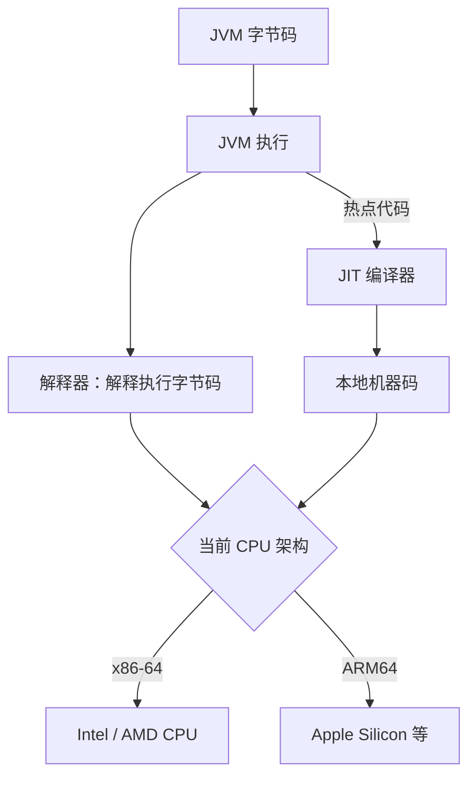


这里的 iload、iadd、istore 都是 JVM 指令，而不是 CPU 指令。

例如：
- iload_1：将局部变量槽位 1 中的 int 加载到操作数栈。
- iload_2：将局部变量槽位 2 中的 int 加载到操作数栈。
- iadd：取出栈顶两个整数并相加，再将结果压栈。
- istore_3：把结果保存到局部变量槽位 3。
这些指令不依赖于具体 CPU 的指令集，由 JVM 实现负责解释或者编译执行。

### 5.3 字节码有什么优点？
原文主要强调了两点：跨平台和执行效率。除此之外，字节码还具有便于验证、优化及工具处理等优点。
| 优点 | 具体解释 |
| --- | --- |
| 跨平台 | 同一个 `.class` 文件可以在兼容的不同平台 JVM 上运行 |
| 可移植性 | 通常不需要为每个 CPU 架构重新编译 Java 源码 |
| 运行时优化 | JVM 可以利用 JIT 对热点代码进行优化 |
| 安全性 | JVM 在类加载过程中进行字节码验证 |
| 语言互操作 | Kotlin、Scala 等语言也可以编译为 JVM 字节码 |
| 工具生态 | ASM、Byte Buddy 等工具可以分析或修改字节码 |

优点①：跨平台
假设我们在 Windows 上编译：

>javac Hello.java


然后把生成的 Hello.class 复制到 Linux 或 macOS。

如果目标环境中具有兼容的 Java 运行时，并且程序没有依赖不兼容的本地库或系统特性，通常可以直接运行：
> java Hello
这就是：

> Write Once, Run Anywhere（一次编写，到处运行）

更准确地说，是符合 JVM 规范的字节码具有跨平台能力，并不意味着所有 Java 应用在任何系统上都绝对没有兼容性问题。
优点②：支持 JIT 性能优化
Java 不必一直逐条解释同一段字节码。

对于频繁运行的方法，HotSpot JVM 可以将它们编译成本地机器码。

例如：
```java
public static long calculate() {
    long sum = 0;

    for (int i = 0; i < 1_000_000; i++) {
        sum += i;
    }

    return sum;
}
```

如果这个方法被频繁调用，JVM 可能将它识别为热点方法，并利用 JIT 进行优化。

需要注意：不是循环执行一百万次就必然触发 JIT，是否编译以及如何优化，取决于运行时统计数据、编译阈值和 JVM 配置。

### 5.4 为什么 JVM 可以执行不同编程语言？
因为 JVM 的执行对象是符合 JVM 规范的字节码，而不是 Java 源代码。

例如：
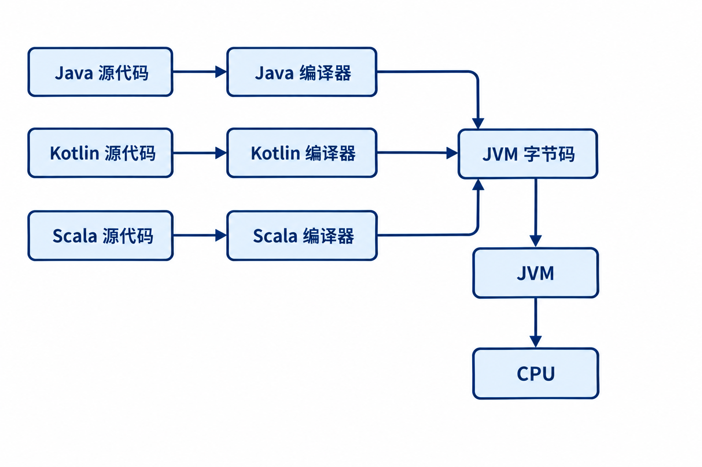

所以，Java 是编程语言，JVM 是运行平台，两者不能完全画等号。
### 5.5 字节码相关公式
关系式一：Java 典型编译流程
$$
\boxed{\text{Java 源码}\xrightarrow{\text{javac}}\text{JVM 字节码}}
$$

关系式二：字节码运行流程
$$
\boxed{\text{字节码}\xrightarrow{\text{JVM}}\text{执行效果}}
$$

关系式三：跨平台的核心条件
$$
\boxed{\text{统一字节码格式}+\text{兼容 JVM 实现}\Rightarrow\text{跨平台运行能力}}
$$


面试标准回答：

Java 字节码是 Java 源代码经过编译器编译后得到的中间指令形式。它不直接依赖具体的 CPU 指令集，而是由 JVM 负责执行。字节码让 Java 具备良好的跨平台能力，同时 JVM 可以通过解释器和 JIT 编译器执行及优化字节码，因此兼顾可移植性和运行效率。

因为 JVM 的执行对象是符合 JVM 规范的字节码，而不是 Java 源代码。


所以，Java 是编程语言，JVM 是运行平台，两者不能完全画等号。


## 6. 为什么说 Java 语言“编译与解释并存”？
这是上一节的延伸问题，面试时经常一起提问。
### 6.1 什么是编译型语言？
编译（Compilation）是将一种语言表示转换为另一种表示的过程，通常涉及语法分析、类型检查、优化及代码生成。

在传统的本地编译模式下，编译器会提前将源代码编译为目标平台的机器码。

例如 C++：
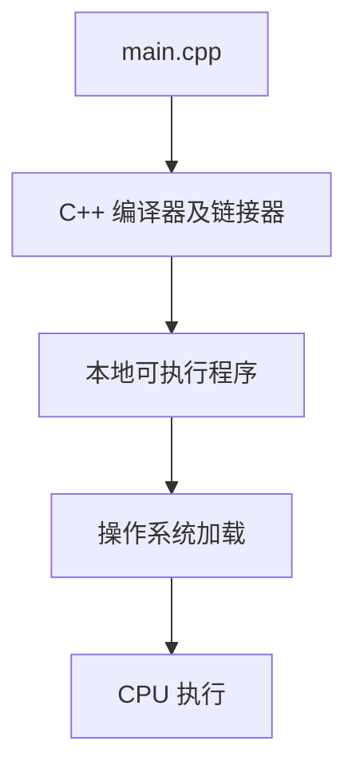


这种方式通常称为 Ahead-of-Time Compilation（AOT），即提前编译。
### 6.2. 什么是解释型语言？
解释执行（Interpretation）指解释器在运行时读取程序指令，并根据这些指令完成对应操作。

例如，经典的 JVM 字节码解释器可以逐条处理：
```bash
iload_1
iload_2
iadd
istore_3
```

解释器并不要求事先把整个方法都编译成本地机器码。

但需要注意：解释器本身也是运行在 CPU 上的程序，因此不能说解释执行完全不涉及机器码。

### 6.3 编译与解释有什么区别？
| 比较项目 | 传统提前编译 | 解释执行 |
| --- | --- | --- |
| 翻译时机 | 运行之前 | 运行过程中 |
| 执行形式 | 通常直接执行生成的本地代码 | 解释器执行程序指令 |
| 启动开销 | 主要编译成本已提前支付 | 运行时可能有解释开销 |
| 稳态性能 | 通常较高 | 逐条解释通常有额外开销 |
| 跨平台 | 通常需要针对目标平台构建 | 取决于解释器和中间表示 |
| 典型实现 | C++ 原生编译 | JVM 解释器、部分脚本语言解释器 |

这里需要纠正大家通常意义上理解中一种容易产生误解的说法：

<span style="color: red;">编译型不一定开发效率低，解释型也不一定执行速度慢。</span>

现代语言可以同时使用编译、解释和 JIT。性能取决于编译器、运行时、程序算法、内存行为和工作负载。

例如 JavaScript 引擎 V8 也使用 JIT；Python 也存在不同编译器与运行时实现。

### 6.4 为什么 Java 同时具备两种特征？
因为 Java 的典型执行过程分成两个阶段。

第一阶段：编译

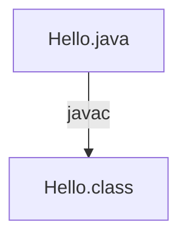

这一步属于编译。

第二阶段：执行

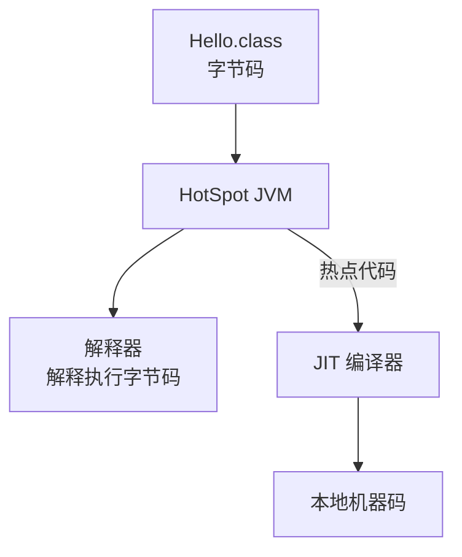

这就说明 Java 并不是严格意义上的“纯解释执行语言”。
### 6.5 JIT（即时编译）到底是什么？
JIT 全称：

Just-In-Time Compilation（即时编译）

它是一种在程序运行过程中执行的编译技术。

例如：
```java
public class JitExample {

    public static int add(int a, int b) {
        return a + b;
    }

    public static void main(String[] args) {

        long result = 0;

        for (int i = 0; i < 1_000_000; i++) {
            result += add(i, 1);
        }

        System.out.println(result);
    }
}
```

在常见的 HotSpot 默认配置下，JVM 可以收集运行时数据，识别值得编译的方法或循环，再使用 JIT 进行优化。

但编译并不是只看调用次数，也不保证每次运行这段示例都会发生相同的 JIT 行为。
### 6.6 JIT 如何让 Java 更快？
HotSpot JIT 可以进行多种优化。

| 优化技术 | 英文 | 作用 |
| --- | --- | --- |
| 方法内联 | Method Inlining | 将适合的方法调用展开，减少调用开销并提供更多优化机会 |
| 逃逸分析 | Escape Analysis | 分析对象是否可能被当前作用域外部访问 |
| 标量替换 | Scalar Replacement | 在合适情况下用标量值替代对象 |
| 循环优化 | Loop Optimization | 优化循环结构和执行成本 |
| 死代码消除 | Dead Code Elimination | 移除对可观察结果没有影响的计算 |
| 去虚拟化 | Devirtualization | 在具备足够类型信息时优化虚方法调用 |

例如：

```java
public static int square(int x) {
    return x * x;
}

public static int calculate(int value) {
    return square(value) + 10;
}
```

JIT 可能将 square() 内联到 calculate() 中，减少方法调用开销。

需要强调：这些都是可能执行的优化，不是 JVM 对所有代码作出的保证。
### 6.7 JIT 为什么需要预热（Warm-up）？
JVM 在应用运行的过程中可以收集方法执行频率和类型分布等信息。

因此，应用的性能可能随着运行过程发生变化。

这也是为什么 Java 性能测试经常需要预热。

示意关系如下：
$$
T_{\text{总执行}}\approx T_{\text{解释执行}}+T_{\text{JIT 编译}}+T_{\text{已编译代码执行}}+T_{\text{其他运行开销}}
$$

这里是将程序的主要执行成本进行概念性拆分，并不是说所有 Java 程序都必然经历每个阶段。

> 面试标准回答：

> Java 源代码首先通过 javac 编译为 JVM 字节码，这是编译过程。在常见的 HotSpot JVM 中，字节码可以由解释器执行；对于热点代码，JVM 还可以利用 JIT 在运行时编译成本地机器码，提高执行效率。因此，Java 通常被称为编译与解释并存的语言。

## 7. AOT 有什么优点？为什么不全部使用 AOT？
这一节是 Java 性能优化中比较重要的进阶知识，尤其与 Spring Boot、微服务、Docker 容器和云原生部署有关系。
### 7.1 什么是 AOT？
AOT 全称为：

Ahead-of-Time Compilation（提前编译）

其核心思想是：

在程序正式运行之前，就提前完成代码编译。

前面讲过 JIT（即时编译），两者最大的区别是编译发生的时间不同。
| 编译技术 | 英文全称 | 编译时机 | 主要特点 |
| --- | --- | --- | --- |
| JIT | Just-In-Time Compilation | 程序运行期间 | 根据运行时信息优化热点代码 |
| AOT | Ahead-of-Time Compilation | 程序执行之前 | 提前生成目标代码，减少运行时编译开销 |

### 7.2 JIT 和 AOT 的执行流程有什么不同？
JIT：常见的 HotSpot JVM 执行模式
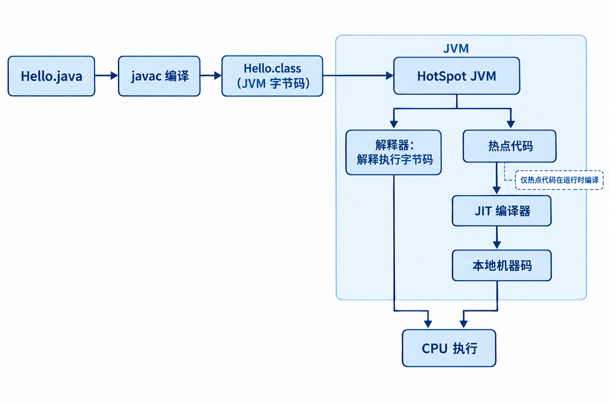

- **编译阶段：** `javac` 将 `Hello.java` 编译为 `Hello.class` 字节码。
- **解释执行：** HotSpot JVM 加载字节码后，可以由解释器解释执行。
- **JIT 编译：** JVM 根据运行时收集的信息识别热点代码，并可将其编译为本地机器码，再由 CPU 执行。
- **协同工作：** 解释器和 JIT 可以共同参与程序执行；是否触发 JIT 及采用哪些优化，由 JVM 根据运行情况决定，并非所有代码都会被 JIT 编译。

AOT：以 GraalVM Native Image 为例
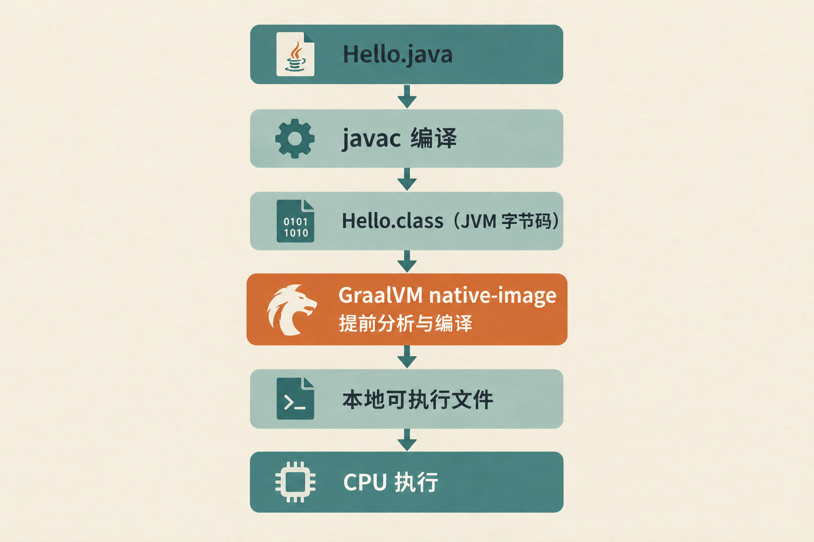

这里的 Native Image 是提前生成本地可执行文件的技术。

与常规 HotSpot JVM 模式相比，Native Image 产物通常不需要依赖外部安装的完整 JVM，且不会在运行时使用传统 HotSpot JIT 进行编译。

不过，生成的可执行文件仍然包含垃圾回收、线程调度等所需的运行时支持组件。

### 7.3 JIT 与 AOT 的完整对比

| 比较维度 | JIT 即时编译 | AOT 提前编译（以 Native Image 为例） |
| --- | --- | --- |
| 编译时间 | 程序运行期间 | 应用构建期间 |
| 编译输入 | JVM 字节码 | 应用字节码与依赖等 |
| 启动速度 | 可能需要更多启动及预热时间 | 通常启动更快 |
| 预热 | 通常存在 | 不需要传统 HotSpot JIT 预热 |
| 长期运行性能 | 可以持续利用运行时信息优化 | 取决于提前优化质量与构建配置 |
| 运行时内存 | 包含 JIT 编译器、代码缓存等开销 | 通常内存需求较低 |
| 构建速度 | 构建相对直接 | Native Image 构建通常更耗时 |
| 动态类加载 | 支持 | 受到较多限制 |
| 反射 | 运行时支持广泛 | 动态访问可能需要元数据 |
| Java Agent | 具有成熟支持 | 兼容性受限制 |
| 典型应用 | 长期运行的 Java 后端服务 | Serverless、CLI、快速扩容服务 |
| 部署产物 | 常见为 JAR / WAR | 本地可执行文件 |

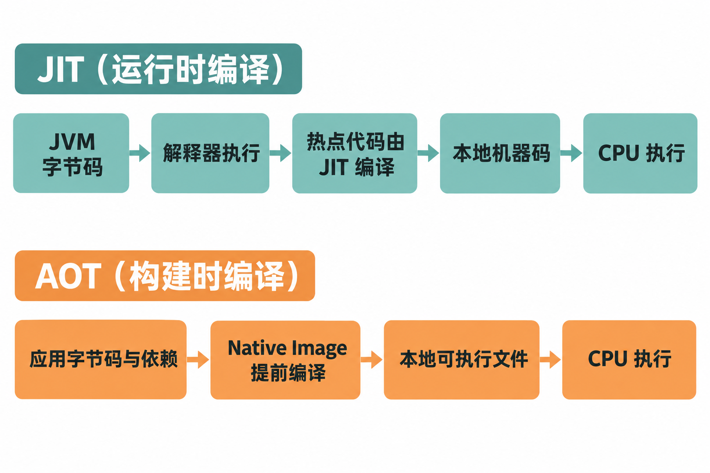

注意：这里对比的是HotSpot JIT 模式与 GraalVM Native Image，并不代表所有 AOT 技术都具有完全相同的特点。
### 7.4 AOT 为什么启动更快？
先看一个典型的 Spring Boot 应用。

使用普通 JVM 启动时，可能发生：

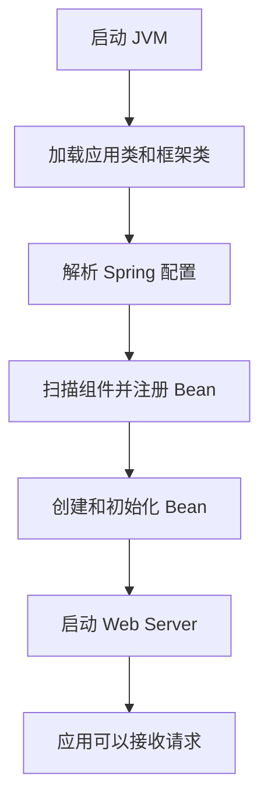

这只是简化模型，并非严格的逐阶段时间顺序。

在 Spring AOT + Native Image 模式下，部分框架分析、Bean 注册信息生成、代理类生成等工作可以提前在构建阶段完成。

这样可以减少应用启动时需要完成的工作。

用一个简化公式表示：
$$
T_{\text{启动}}=
T_{\text{运行时初始化}}+
T_{\text{框架初始化}}+
T_{\text{业务初始化}}
$$

AOT 的目标之一，是将部分能够提前完成的初始化和分析工作转移到构建阶段。

但是不能简单理解为：
$$
T_{\text{AOT 启动}}=0
$$

即使使用 AOT，程序依然需要初始化必要组件、建立连接、加载数据和启动服务。
### 7.5 为什么 AOT 不一定比 JIT 快？
假设存在一个长期运行的银行后端系统。

每天处理大量用户请求：
```java
public class TransactionService {

    public long calculateFee(long amount) {
        return amount * 3 / 1000;
    }
}
```

如果这个方法被大量调用，JIT 可以根据实际运行情况优化执行过程。

而 AOT 在编译阶段并不一定掌握完整的运行时信息。

所以：

AOT 通常更有利于减少启动和预热成本，JIT 则有机会在长期运行中获得更好的热点代码优化效果。

但这并不是绝对规律。不同 AOT 编译器、Profile-Guided Optimization（PGO）以及不同业务负载，都可能改变性能结果。

可以使用一个简化模型分析：
$$
T_{\text{总成本}}=
T_{\text{启动}}+
N\times T_{\text{单次请求}}
$$

其中：
- $T_{\text{启动}}$：应用从启动到可用所需时间。
- $N$：累计处理的请求数量。
- $T_{\text{单次请求}}$：请求平均处理时间，简化假设下视为固定值。
对于请求数量很少、实例频繁启动的场景，启动成本占比更高。

对于长期运行、处理海量请求的系统，稳定运行阶段的吞吐量与延迟通常更加重要。

因此，AOT 和 JIT 的选择需要结合实际工作负载进行基准测试。
### 7.6 什么是闭世界分析（Closed-World Analysis）？
这是原文中非常值得深入理解的概念。

闭世界分析可以理解为：编译器在构建阶段，根据已知程序及其配置，尽可能确定运行时会使用哪些类、方法和资源。

例如：

```java
public class Main {
    public static void main(String[] args) {
        UserService service = new UserService();
        service.sayHello();
    }
}

class UserService {
    public void sayHello() {
        System.out.println("Hello");
    }
}

```

这里 UserService 的使用关系十分明确。

AOT 编译器可以通过静态分析追踪：

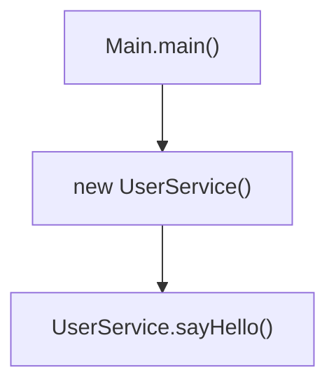

但反射就不同了。
### 7.7 为什么反射会影响 AOT？
先看下面这个完整示例。


```java
class UserService {
    public UserService() {
    }
    public void sayHello() {
        System.out.println("Hello");
    }
}

public class Main {
    public static void main(String[] args) throws Exception {
        // 运行时从命令行读取类名
        String className = args[0];
        // 使用反射加载类
        Class<?> clazz = Class.forName(className);
        // 使用反射创建实例
        Object instance = clazz.getDeclaredConstructor()
                               .newInstance();
        // 使用反射查找方法并调用
        clazz.getMethod("sayHello").invoke(instance);
    }
}

```

运行：
```bash
javac Main.java
java Main UserService
```

输出：
```bash
Hello
```

注意这里的关键代码：

```java
String className = args[0];
```

编译器仅仅分析代码，并不一定能够提前知道用户运行程序时会输入什么类名。

例如，用户可能输入：
```bash
UserService
OrderService
PaymentService
```

普通 JVM 可以根据运行时输入，尝试动态加载对应类。

但是在 GraalVM Native Image 中，如果某个类、构造方法或成员无法通过静态分析确定，又没有通过元数据保留下来，就可能发生运行时错误。

这就是为什么 Native Image 对某些反射操作需要额外配置。
graalvm.org+1

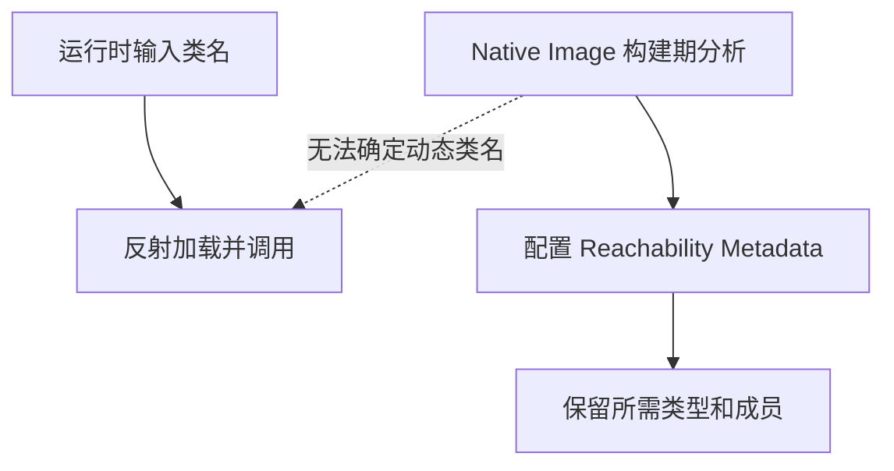

#### AOT 是否完全不能使用反射？

不是。

GraalVM Native Image 支持反射，但对于静态分析无法识别的动态访问，可能需要通过 Reachability Metadata（可达性元数据）进行配置。

例如在适用的 GraalVM 版本中，可以使用反射元数据声明需要保留的类型及成员。具体元数据格式和需要声明的成员类别取决于版本与实际操作。
### 7.8 Spring Boot 如何解决 AOT 与反射的问题？
Spring Boot 应用中经常使用：
```java
@Service
public class UserService {

    public String getName() {
        return "Tom";
    }
}


以及：
@RestController
public class UserController {

    private final UserService userService;

    public UserController(UserService userService) {
        this.userService = userService;
    }

    @GetMapping("/name")
    public String getName() {
        return userService.getName();
    }
}
```

普通 Spring 应用可以在运行时完成大量组件扫描、Bean 注册和元数据处理。

而 Spring AOT 则可以在构建阶段分析应用上下文，生成用于初始化 Bean 的代码，以及反射、代理、资源访问等所需要的信息。

例如，Spring 的 RuntimeHints 能用于声明 Native Image 运行时所需的反射、资源和代理支持。

Spring 官方还明确说明，AOT 处理不仅可以用于 Native Image，也可以在 JVM 模式下启用。
Spring 文档

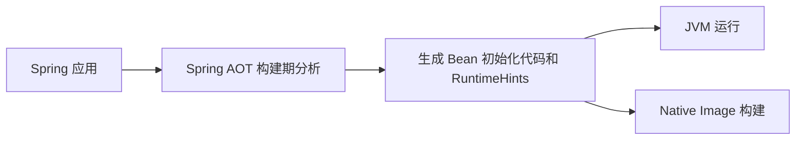

### 7.9 为什么没有全部使用 AOT？
核心原因可以总结为下表：

| 原因 | 详细解释 |
| --- | --- |
| 构建成本较高 | Native Image 构建通常需要更多时间与资源 |
| 动态特性适配 | 反射、代理、动态类加载可能需要额外处理 |
| 第三方依赖兼容性 | 部分框架和库需要专门提供 AOT 支持 |
| 长期运行性能 | 某些长期运行负载可能更适合 JIT |
| 开发调试成本 | 构建、调试及问题排查方式可能更复杂 |
| 运行时灵活性 | AOT 通常对运行时类路径及动态配置具有更多约束 |

另外，关于原文的历史背景：

JDK 9 曾通过 JEP 295 引入实验性的 jaotc AOT 编译工具，该工具后来已在 JDK 17 中移除。

不要把已经移除的 jaotc 与目前仍然使用的 GraalVM Native Image 混为一谈。
### 7.10 AOT 与 JIT 的关系公式
$$
\boxed{\text{JIT = 运行期间编译}}
$$

$$
\boxed{\text{AOT = 运行之前编译}}
$$

$$
\boxed{\text{Spring AOT}\neq\text{GraalVM Native Image}}
$$

最后一个关系特别重要：

Spring AOT 是 Spring 框架的构建期处理机制，而 GraalVM Native Image 是提前编译成本地可执行文件的工具链。两者可以结合使用，但不是同一个组件。

> 面试标准回答

>AOT 是提前编译技术，能够将一部分编译工作放在应用运行之前完成。以 GraalVM Native Image 为例，它通常可以改善启动速度、减少运行时内存需求，因此适合冷启动敏感、频繁扩缩容等场景。

>但 AOT 也存在构建成本较高、部分动态特性需要额外适配等限制。JIT 则能够根据真实运行时信息持续优化热点代码，因此长期运行的 Java 服务不一定适合全部改为 AOT。

## 8. Oracle JDK vs OpenJDK
这里首先要区分三个概念：

Java 语言规范、OpenJDK 开源项目、Oracle JDK 产品发行版。

它们不是同一个东西。
### 8.1 什么是 OpenJDK？
OpenJDK 是 Java SE 平台的重要开源实现项目。

其中包含：
- Java 编译器 javac
- HotSpot JVM
- Java 标准类库
- 大量开发、诊断和调试工具
OpenJDK 项目的源代码可以在 GitHub 查看：OpenJDK 官方源码仓库。许多常用的 JDK 发行版都是基于 OpenJDK 构建的。
### 8.2 什么是 Oracle JDK？
Oracle JDK 是 Oracle 发布和维护的 JDK 产品发行版。

现代 Oracle JDK 的核心技术与 OpenJDK 高度接近，但它具有独立的产品发布、许可、支持和维护策略。

因此，不应该简单理解为：

“OpenJDK 是功能不完整的免费版，Oracle JDK 才是功能完整的商业版。”

这种说法不准确。
### 8.3 Oracle JDK 和 OpenJDK 对比

| 对比项目 | OpenJDK | Oracle JDK |
| --- | --- | --- |
| 定位 | 开源 JDK 项目及其构建 | Oracle 的 JDK 产品发行版 |
| 主要维护方 | Oracle 及社区中的多家组织 | Oracle |
| 开源情况 | 项目源代码开放 | 主要基于 OpenJDK，产品构建和许可另有规定 |
| 核心功能 | 提供完整 Java SE 实现 | 提供完整 Java SE 实现 |
| JVM | 通常使用 HotSpot | 使用 HotSpot |
| 编译器 | javac | javac |
| 性能 | 取决于版本、构建与配置 | 取决于版本、构建与配置 |
| 许可证 | Oracle OpenJDK 构建采用 GPLv2 + Classpath Exception | 根据版本及更新批次，可能采用 NFTC 或 OTN |
| 商业支持 | 取决于发行商 | Oracle 提供商业支持 |
| 典型差异 | 构建、工具、支持周期可能不同 | 许可证、支持及部分工具可能不同 |

虽然 Oracle JDK 和 OpenJDK 的核心功能非常接近，但也不能说每个版本的二进制文件都完全一致。

例如 Oracle 的 JDK 24 发布说明列出了部分发行差异，包括安装包、使用情况日志，以及某些编译器功能。
Oracle

### 8.4 什么是 Java Flight Recorder（JFR）？
原文提到了：
Java Flight Recorder（JFR）是一种监控工具。

JFR 是 Java 的低开销事件记录和性能诊断机制。

它能够记录 JVM 和应用运行期间的事件，例如：

| 监控内容 | 作用 |
| --- | --- |
| CPU 相关事件 | 帮助分析性能瓶颈 |
| 对象分配 | 观察内存分配行为 |
| GC 事件 | 分析垃圾回收 |
| 线程事件 | 帮助分析线程状态 |
| 锁竞争 | 排查部分并发性能问题 |
| 方法采样 | 识别热点执行路径 |

例如，可以通过 JDK 的 jcmd 工具对正在运行的 JVM 发起 JFR 记录。

JFR 并非始终属于 Oracle JDK 的独占功能。它已经进入 OpenJDK，因此现代 OpenJDK 发行版同样可以使用 JFR。

Java Mission Control（JMC）则是用于分析 JFR 记录等信息的独立工具项目。

### 8.5 Oracle JDK 是否免费？

不能简单地回答“免费”或者“收费”。

因为 Oracle JDK 的许可证会随着版本、更新批次及使用方式发生变化。

这一点在 2026 年尤其重要。

Oracle 于 2026 年 10 月 20 日更新的官方许可 FAQ，明确区分了不同版本的许可方式。
Oracle

### 8.6 2026 年 Oracle JDK 许可对比
以下依据 Oracle 官方截至 2026 年 11 月的公开许可说明，具体使用仍应以对应软件包附带的许可证为准。

| JDK 发行版及版本 | 主要许可 | 商业生产使用 |
| --- | --- | --- |
| Oracle OpenJDK | GPLv2 + Classpath Exception | 可以，需遵守开源许可 |
| Oracle JDK 25 当前 NFTC 更新 | NFTC | 可以在许可条件内免费使用 |
| Oracle JDK 21.0.12 及更早的 NFTC 更新 | NFTC | 符合许可条件时可以 |
| Oracle JDK 21.0.13 及之后的更新 | OTN | 普通商业生产用途通常需要相应授权 |
| Oracle JDK 17、11、8 的当前后续更新 | OTN / 相关商业授权 | 需要按具体使用场景判断 |

特别需要注意：

从 2026 年 10 月发布的 JDK 21.0.13 开始，Oracle JDK 21 的后续更新已经转向 OTN 许可。 
Oracle+1

这不意味着此前已经按 NFTC 下载的 JDK 21 版本会自动改变许可，也不意味着所有个人开发活动都必须付费。

真正需要判断的是：你下载的是哪个发行版、哪个更新版本，以及你如何使用它。
### 8.7 什么是 GPLv2 + Classpath Exception？
GPLv2 是一种开源软件许可证。

Classpath Exception 是为 Java 类库链接等场景提供的重要例外条款。

可以简单理解为：

开发者可以基于 OpenJDK 开发商业 Java 应用，并不因为使用了 OpenJDK 标准类库，就必须把自己的业务源代码全部公开。

不过，如果修改、重新发布 OpenJDK 自身的组件，还需要遵守相应的许可证要求。

所以：
$$
\boxed{\text{使用 OpenJDK 开发商业软件}\neq\text{必须开源全部业务代码}}
$$

### 8.8 为什么还有 Amazon Corretto、Eclipse Temurin 等 JDK？
因为 OpenJDK 是开源项目，不同厂商可以基于 OpenJDK 源代码构建自己的 JDK 发行版，并提供不同的维护与支持方案。

| JDK 发行版 | 维护方 | 主要特点 |
| --- | --- | --- |
| Oracle JDK | Oracle | Oracle 产品、许可及商业支持体系 |
| Eclipse Temurin | Eclipse Adoptium | 常见的免费 OpenJDK 发行版 |
| Amazon Corretto | AWS | Amazon 维护，提供长期支持版本 |
| Microsoft Build of OpenJDK | Microsoft | Microsoft 维护的 OpenJDK 构建 |
| Azul Zulu | Azul | 提供免费构建和商业支持方案 |
| Alibaba Dragonwell | Alibaba | 基于 OpenJDK，侧重部分生产环境优化 |

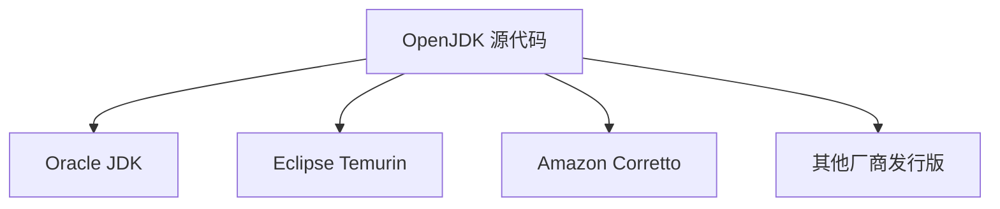

### 8.9 实际工作中如何选择？
对于 Java 21、Spring Boot、Gradle 和 MyBatis 项目，我更建议优先考虑一个维护周期清晰、更新及时且适合企业许可要求的 OpenJDK 发行版，例如 Eclipse Temurin 或 Amazon Corretto。

如果企业明确规定使用 Oracle JDK，则应遵循企业的许可证和维护策略。

尤其需要注意：JDK 是否能免费使用，与是否获得长期安全更新支持，是两个不同的问题。

可以用下面这个关系概括：
$$
\boxed{\text{JDK 选型}=\text{兼容性}+\text{安全更新}+\text{支持周期}+\text{许可成本}}
$$

这不是数学上的加法计算，而是企业选型时应考虑的四个主要维度。

> 面试标准回答

OpenJDK 是 Java SE 平台的开源实现项目，Oracle JDK 则是 Oracle 提供的 JDK 产品发行版。

现代 Oracle JDK 和 OpenJDK 的核心功能大体一致，主要区别通常体现在许可证、发布方式、维护周期、商业支持以及部分实现细节。

对于企业项目，应根据 Java 版本、长期支持需求及许可证条件选择合适的 JDK 发行版，而不能简单认为 Oracle JDK 一定比 OpenJDK 性能更好。

## 9. Java 和 C++ 的区别
Java 和 C++ 都支持面向对象编程，也都具有封装、继承和多态等特性。

但它们的语言设计、内存管理、编译模型和类型机制有明显区别。
### 9.1 Java 与 C++ 总体对比

| 比较项目 | Java | C++ |
| --- | --- | --- |
| 编程范式 | 主要支持面向对象，也支持函数式风格等 | 多范式：过程式、面向对象、泛型等 |
| 编译方式 | 常见流程是编译为 JVM 字节码 | 通常编译为本地机器码 |
| 运行环境 | 通常依赖 Java 运行时 | 通常直接作为本地程序运行 |
| 内存管理 | 自动垃圾回收为主 | RAII、智能指针、手动管理等 |
| 指针运算 | 不提供普通指针运算 | 支持指针和指针运算 |
| 类继承 | 单继承 | 支持多重继承 |
| 接口 | 支持 interface | 可通过抽象类等实现相似设计 |
| 方法重载 | 支持 | 支持 |
| 运算符重载 | 不支持用户自定义运算符重载 | 支持 |
| 泛型机制 | 泛型，主要基于类型擦除 | 模板，通常在编译期实例化 |
| 对象生命周期 | 通常由 GC 负责回收对象 | 可以通过确定性析构管理资源 |
| 跨平台 | JVM 字节码具有可移植性 | 通常针对不同目标平台编译 |

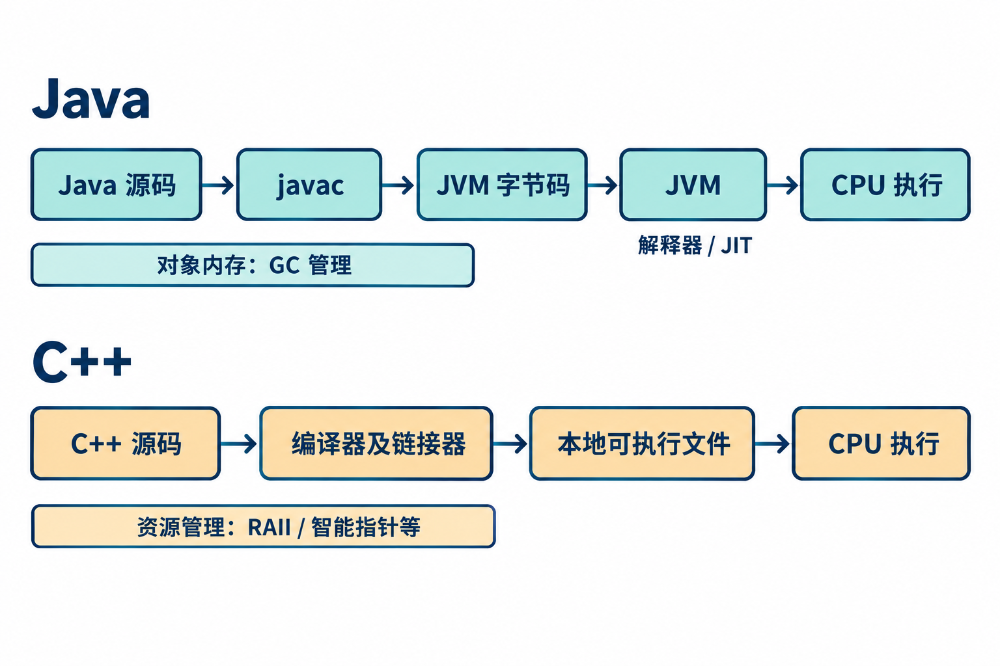

接下来深入解释其中最重要的四个区别。
### 9.2 Java 为什么不提供普通指针运算？
C++ 可以使用指针操作内存地址。

例如：

```cpp
#include <iostream>
using namespace std;

int main() {
    int number = 100;
    int* ptr = &number;
    cout << number << endl;
    cout << *ptr << endl;
    *ptr = 200;
    cout << number << endl;
    return 0;
}

```

```cpp
输出：
100
100
200
```

这里：
- &number：获取变量的内存地址。
- int* ptr：定义一个整数指针。
- *ptr：解引用指针，访问或修改它指向的整数。
而 Java 中不能使用这种普通指针语法。

但是 Java 可以通过对象引用操作对象。

```java
class Person {

    String name;

    Person(String name) {
        this.name = name;
    }
}

public class Main {
    public static void main(String[] args) {
        Person p1 = new Person("张三");
        Person p2 = p1;
        p2.name = "李四";
        System.out.println(p1.name);
        System.out.println(p2.name);
    }
}
```

```bash
输出：
李四
李四
```

原因是 p1 与 p2 引用了同一个 Person 对象。

可以这样理解：
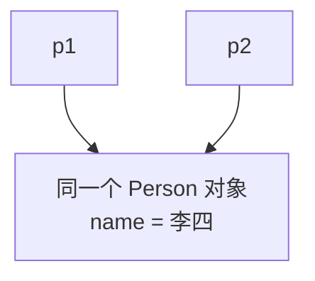

Java 的引用不是 C++ 指针的直接等价物。

Java 不允许通过普通引用进行任意内存地址运算，但 Java 并非绝对不可能访问本地内存。JNI、Foreign Function & Memory API 等机制可以提供受约束的本地互操作能力。
### 9.3 Java 和 C++ 的内存管理有什么不同？
这是两种语言非常重要的区别。

在 C++ 中，可以使用动态内存分配：
```cpp
Person* p = new Person();
// 使用对象
delete p;
```

如果忘记 delete，可能造成内存泄漏。

现代 C++ 通常推荐优先使用自动对象、RAII 和智能指针，而不是在业务代码中大量手写 new/delete。

例如：
```cpp
auto p = std::make_unique<Person>();
```

当 unique_ptr 结束生命周期时，通常会自动释放所管理的对象。

Java 则不同：
```java
Person p = new Person("张三");
```

Java 对象通常由 JVM 管理，其占用的堆内存在满足垃圾回收条件后，可以由 GC 回收。

但请注意：

Java 自动垃圾回收并不代表所有资源都会自动、及时释放。

例如：
```java
FileInputStream input =
        new FileInputStream("data.txt");
```

文件句柄属于需要及时关闭的资源。

在 Java 中更推荐使用：
```java
try (FileInputStream input =
         new FileInputStream("data.txt")) {
    // 读取文件
}
```

这叫 Try-with-resources，能够在退出代码块时自动调用 close()。
对比总结：

| 项目 | Java | C++ |
| --- | --- | --- |
| 常见堆内存管理 | GC | 智能指针或手动释放 |
| 内存回收时机 | 通常由 GC 决定 | 可以由对象生命周期决定 |
| 析构机制 | 没有 C++ 式确定性析构 | 支持析构函数 |
| 文件资源释放 | try-with-resources | RAII |
| 内存安全 | 避免普通悬空指针问题 | 需要正确管理对象和指针生命周期 |
| 常见风险 | 对象保留、资源未关闭等 | 悬空指针、重复释放、内存泄漏等 |

简化理解：
$$
\boxed{\text{Java：对象堆内存主要由 GC 管理}}
$$

$$
\boxed{\text{C++：资源主要通过生命周期和所有权管理}}
$$

### 9.4 Java 为什么不支持类多继承？
Java 的类只能直接继承一个父类。

例如：
```java
class Animal {
}

class Dog extends Animal {
}
```

但是不能这样写：
```java
class Dog extends Animal, Machine {
}
```

这是非法 Java 语法。

C++ 则允许：
```cpp
class Dog : public Animal, public Machine {
};
```

为什么 Java 不支持类多继承？

一个常见的设计考虑是多继承可能引入成员冲突和复杂的继承关系。

例如：
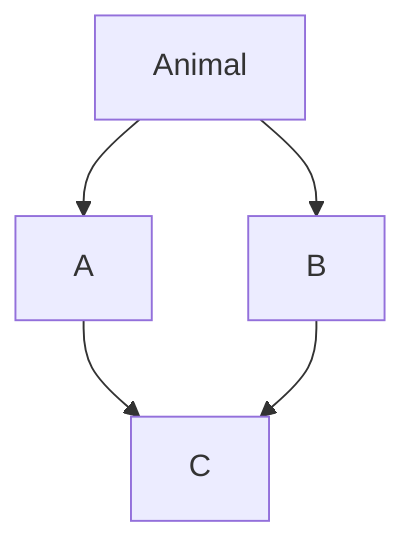

如果 A、B 都继承自 Animal，C 又同时继承 A、B，就可能涉及著名的菱形继承问题（Diamond Problem）。

C++ 具有虚继承等机制来处理相应问题。

Java 则采用另一种设计：类单继承，但一个类可以实现多个接口。
```java
interface Flyable {
    void fly();
}

interface Swimmable {
    void swim();
}

class Duck implements Flyable, Swimmable {

    @Override
    public void fly() {
        System.out.println("飞行");
    }

    @Override
    public void swim() {
        System.out.println("游泳");
    }
}
```

这说明：
$$
\boxed{\text{Java 类：单继承 + 多接口实现}}
$$

注意，Java 8 开始接口支持 default 方法。如果多个接口提供冲突的默认方法，实现类需要按照 Java 的规则解决冲突，通常需要显式重写。
### 9.5 Java 和 C++ 的泛型有什么不同？
这是面试中比较深入的知识点。

Java 使用 Generics（泛型）。
```java
List<String> names = new ArrayList<>();
```

C++ 使用 Templates（模板）。
```cpp
std::vector<std::string> names;
```

表面上看很相似，但底层机制不同。
| 比较项目 | Java 泛型 | C++ 模板 |
| --- | --- | --- |
| 主要实现方式 | 类型擦除 | 编译期实例化 |
| 编译期检查 | 支持 | 支持 |
| 能否使用基本类型作为类型实参 | 通常不能直接使用 | 可以 |
| 运行时类型信息 | 通常不保留具体泛型实参 | 具体实例化类型通常不同 |
| 代码生成 | 多种泛型实参通常共享擦除后的实现 | 不同实例化可能生成不同代码 |
| 典型问题 | 类型擦除、桥方法 | 模板实例化、代码膨胀 |

例如 Java：
```java
List<String> a = new ArrayList<>();
List<Integer> b = new ArrayList<>();
System.out.println(a.getClass() == b.getClass());
```
输出：
> true


因为运行时它们对应的是同一个 ArrayList 类。

但是 C++：
```cpp
std::vector<int>
std::vector<double>
```

是不同的模板实例化类型。

这里需要注意：Java 泛型并非完全没有类型信息，例如字段和方法声明的泛型签名可以保存在类文件元数据中，并能通过反射读取。

所谓类型擦除，主要是指普通对象在运行时不会为每一种泛型参数实例化单独生成一个类。
### 9.6 Java 为什么不支持用户自定义运算符重载？
C++ 支持通过 operator 为自定义类型定义运算符行为。

例如：

```java
class Point {
public:
    int x;

    Point(int value) : x(value) {}

    Point operator+(const Point& other) const {
        return Point(x + other.x);
    }
};
```

这样可以执行：
```java
Point a(10);
Point b(20);

Point c = a + b;
```

Java 不支持开发者自定义这种 + 运算符。

通常需要写成：
```java
class Point {
    private final int x;
    Point(int x) {
        this.x = x;
    }
    public Point add(Point other) {
        return new Point(this.x + other.x);
    }
}

```
调用：

```java
Point a = new Point(10);
Point b = new Point(20);

Point c = a.add(b);
```

Java 的设计倾向于使用明确的方法来表达用户自定义类型的操作。

不过，Java 语言本身对字符串拼接等场景有特殊的 + 运算规则，这不属于用户自定义运算符重载。
### 9.7 Java 和 C++ 的性能谁更好？
不能简单认为 C++ 一定比 Java 快。

C++ 在直接控制内存、减少运行时抽象开销等方面具有优势。

但现代 Java JVM 可以利用 JIT、逃逸分析、方法内联等技术获得较高性能。

还需要考虑：

| 维度 | 主要影响因素 |
| --- | --- |
| CPU 性能 | 算法、编译优化、指令执行效率 |
| 内存性能 | 分配方式、数据布局、缓存命中率 |
| 延迟 | GC、锁竞争、系统调用、调度 |
| 吞吐量 | 并发模型、数据库、网络、线程池 |
| 启动时间 | 类加载、框架初始化、运行时构建方式 |
| 开发成本 | 语言安全性、工具生态、团队维护能力 |

在银行业务系统中，一个接口可能需要执行数据库查询：

```java
public User getUser(Long id) {
    return userMapper.selectById(id);
}
```

这个接口的整体响应时间，很可能主要花费在 SQL 查询、网络通信和数据库锁等待上，而不是 Java 与 C++ 之间的机器指令差异。

因此评价语言性能时，必须明确测试环境和具体工作负载。