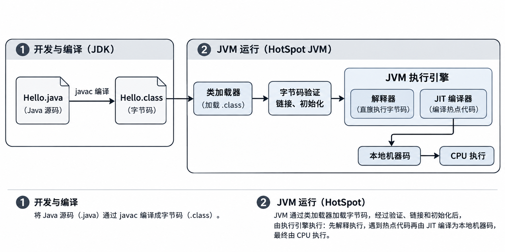

# 基础概念与常识
## Java 是什么？
Java 是一种面向对象、静态类型、跨平台的编程语言。

Java 最初由 Sun Microsystems 开发，1995 年正式发布，后来 Sun 被 Oracle 收购。

Java 常用于：
- 企业级后端系统（Spring Boot、Spring Cloud）
- 金融与银行系统
- 大型分布式系统
- Android 开发（历史上广泛使用 Java，现在 Kotlin 也很常见）
- 大数据生态（Hadoop、Flink 等）
Java 有什么特点？

| 特点 | 解释 |
| --- | --- |
| 面向对象 | 支持封装、继承、多态 |
| 跨平台 | 字节码可以在不同平台的兼容 JVM 上运行 |
| 自动内存管理 | JVM 通过垃圾回收机制管理堆内存 |
| 静态类型 | 变量、表达式的类型在编译阶段受到检查 |
| 多线程 | 内置线程和并发编程支持 |
| 异常处理 | 使用 try、catch、finally 等机制 |
| 丰富生态 | Spring、MyBatis、Hibernate 等框架 |

> 面试题：Java 为什么能够跨平台？
> 因为 Java 源代码通常先通过 javac 编译成平台无关的字节码，再由对应平台的 JVM 执行。
> Java 不是直接将同一份机器码运行在所有操作系统上，而是通过不同平台上的 JVM 实现跨平台。

## Java 基础概念与常识：Java SE、Java EE、Java ME、JVM、JRE、JDK
这六个概念经常一起出现在 Java 面试中，但实际上它们属于两个不同的知识体系：
- Java SE、Java EE、Java ME：表示 Java 平台的不同版本或应用领域。
- JVM、JRE、JDK：表示 Java 程序的执行环境、运行环境和开发工具。
一、Java SE vs Java EE vs Java ME
### 1. 什么是 Java SE？
Java SE（Java Platform, Standard Edition），即 Java 平台标准版，是 Java 开发的基础平台。
它提供 Java 的核心语言特性、基础类库及运行 Java 程序所需要的相关组件。
例如，我们平时使用的以下功能都属于 Java SE 范畴：

```java
// 集合
List<String> list = new ArrayList<>();
// 多线程
Thread thread = new Thread();
// 文件操作
Files.readString(Path.of("test.txt"));
// 数据库连接（JDBC）
Connection connection = DriverManager.getConnection(url);
```

注意，Java SE 并不意味着只能开发简单程序。它同样可以构建复杂的服务器端应用。
### 2. 什么是 Java EE？
Java EE（Java Platform, Enterprise Edition），即 Java 平台企业版。

Java EE 在 Java SE 的基础上提供企业级应用开发所需要的一系列标准规范和 API。

常见规范包括：

| 技术 | 作用 |
| --- | --- |
| Servlet | 处理 HTTP 请求和响应 |
| JSP | 在服务端生成动态网页 |
| EJB | 企业级业务组件 |
| JPA | 对象关系映射与持久化 |
| JTA | 事务管理 |
| JMS | 消息通信 |
| JavaMail | 邮件发送和接收 |

其中 JDBC 属于 Java SE 的标准 API，虽然在企业级应用中使用广泛，但并不专属于 Java EE。

另外，Java EE 已经移交给 Eclipse Foundation，后续发展为 Jakarta EE。

从 Jakarta EE 9 开始，很多相关 API 的包名从 javax.* 迁移到 jakarta.*。

例如：

```java
// 早期 Java EE
import javax.servlet.http.HttpServlet;
// Jakarta EE 9+
import jakarta.servlet.http.HttpServlet;
```
这也解释了为什么现代 Spring Boot 项目中经常会出现 jakarta.*。
### 3. 什么是 Java ME？
Java ME（Java Platform, Micro Edition），即 Java 平台微型版。

主要针对资源受限的设备，例如早期功能手机、机顶盒及部分嵌入式设备。
它提供适合特定设备环境的 API 和运行配置。
现在 Java ME 在主流企业后端开发中已经比较少见，但并非完全消失。

### 4. 三者对比表


| 比较项目 | Java SE | Java EE / Jakarta EE | Java ME |
| --- | --- | --- | --- |
| 全称 | Standard Edition | Enterprise Edition | Micro Edition |
| 中文 | 标准版 | 企业版 | 微型版 |
| 核心定位 | Java 基础平台 | 企业级开发规范 | 资源受限设备平台 |
| 主要功能 | 集合、IO、并发、网络、JDBC 等 | Servlet、JPA、JTA、JMS 等 | 精简类库与设备相关 API |
| 应用场景 | 通用程序、服务器程序 | Web 系统、企业级服务 | 嵌入式设备、早期手机 |
| 与 Java SE 的关系 | 基础平台 | 建立在 SE 基础上 | 针对受限设备的独立平台体系 |
| 现在使用情况 | 非常普遍 | 非常普遍 | 相对较少 |
| 面试重要性 | ⭐⭐⭐⭐⭐ | ⭐⭐⭐⭐ | ⭐ |

> 面试重点：Java EE 和 Spring Boot 是什么关系？<br>
> Java EE/Jakarta EE 主要是一套企业级 Java 标准规范，而 Spring Boot 是 Spring 生态中用于简化应用开发和配置的框架。
> 两者不是同一个东西。
> Spring Boot 可以使用 Jakarta Servlet、Jakarta Persistence 等规范，但 Spring Framework 也提供自己的依赖注入、事务管理等功能。

例如：
```java
@RestController
public class UserController {

    @GetMapping("/user")
    public String getUser() {
        return "Hello Java";
    }
}
```

在典型的 Spring Boot Web MVC 项目中：
- Java SE 提供 Java 基础运行能力。
- Spring Boot 负责自动配置与应用启动。
- Spring MVC 负责 Web 请求处理。
- 内嵌 Tomcat 提供 Servlet 容器，执行相关 Servlet API 规范。
因此，学习 Spring Boot 并不要求先学习所有 Java EE 规范，但理解 Servlet、JPA 和事务规范十分有帮助。

## 二、JVM vs JRE vs JDK
这三个概念分别对应不同的职责：

JVM 负责执行，JRE 提供运行环境，JDK 提供开发工具和运行能力。
### 1. JVM：Java 虚拟机
JVM（Java Virtual Machine）是 Java 虚拟机，负责加载、验证并执行 Java 字节码。

其核心功能包括：

| 功能 | 说明 |
| --- | --- |
| 类加载 | 加载 .class 字节码 |
| 字节码执行 | 解释执行或通过 JIT 编译后执行 |
| 内存管理 | 管理堆、线程栈等运行时内存区域 |
| 垃圾回收 | 自动回收不再使用的对象所占的堆内存 |
| JIT 编译 | 将热点字节码编译为本地机器码 |
| 异常处理 | 支持 Java 异常机制的运行时行为 |

JVM 为什么能够实现跨平台？
例如：

```java
public class Hello {
    public static void main(String[] args) {
        System.out.println("Hello Java");
    }
}
```

首先使用：
javac Hello.java

生成：
Hello.class


这个 .class 文件通常可以在 Windows、Linux 和 macOS 上的兼容 JVM 中执行。

但要注意，JVM 本身不是完全相同的程序。

Windows、Linux 和 macOS 分别需要对应平台的 JVM 实现。

因此，Java 跨平台的关键在于：

统一的字节码规范 + 不同操作系统上的 JVM 实现。

另外，JVM 并不是 Java 语言专用的。Kotlin、Scala、Groovy 等语言也可以编译成 JVM 字节码。
JVM 是否只有一种？
不是。

| JVM 实现 | 说明 |
| --- | --- |
| HotSpot | OpenJDK 中最常见的 JVM 实现 |
| Eclipse OpenJ9 | 另一种 JVM 实现，关注内存占用和启动等性能特征 |
| Azul Prime JVM | Azul 提供的商业 JVM 实现 |
| JRockit | 历史上的 JVM 实现，后来相关技术整合进 HotSpot |

只要遵循相应 JVM 规范，理论上不同组织都可以开发自己的 JVM。

### 2. JRE：Java 运行环境

JRE（Java Runtime Environment）主要提供运行 Java 程序所需要的组件。

传统的理解是：

$$
\text{JRE} = \text{JVM} + \text{Java 基础类库} + \text{运行支持组件}
$$

例如 Java 程序需要使用：
```java
System.out.println("Hello");
```

其中 System、PrintStream 等类来自 Java 标准类库。

JVM 负责执行字节码，而标准类库为程序提供 API。

只有 JVM 而没有程序需要的类库，通常无法运行正常的 Java 应用。
### 3. JDK：Java 开发工具包
JDK（Java Development Kit）是 Java 开发工具包。

传统概念中：

| **JDK = JRE + Java 开发工具** |
| --- |

常用工具如下：

| 工具 | 用途 | 示例 |
| --- | --- | --- |
| javac | 编译 Java 源码 | `javac Hello.java` |
| java | 启动 Java 程序 | `java Hello` |
| javap | 查看类结构及反汇编字节码 | `javap -c Hello` |
| jar | 打包和管理 JAR 文件 | `jar cf app.jar ...` |
| javadoc | 生成 API 文档 | `javadoc Hello.java` |
| jdb | 调试工具 | `jdb Hello` |
| jconsole | JVM 监控工具 | `jconsole` |
| jlink | 创建自定义运行时映像 | `jlink --add-modules ...` |

其中需要特别注意：

javap 不是将字节码完整还原为 Java 源代码的反编译器，主要用于查看类信息、方法签名和字节码指令。
### 4. JVM、JRE、JDK 对比表

| 对比项目 | JVM | JRE | JDK |
| --- | --- | --- | --- |
| 中文名称 | Java 虚拟机 | Java 运行环境 | Java 开发工具包 |
| 核心职责 | 执行字节码 | 提供运行环境 | 开发、编译、调试、运行 |
| 是否包含 JVM | 本身就是 JVM | 是 | 是 |
| 是否包含基础类库 | 不以完整类库为定义 | 是 | 是 |
| 是否提供 javac | 否 | 通常否 | 是 |
| 是否用于编译 | 否 | 否 | 是 |
| 是否可以运行 Java | 需要相关运行组件 | 是 | 是 |
| 面试重要性 | ⭐⭐⭐⭐⭐ | ⭐⭐⭐⭐ | ⭐⭐⭐⭐⭐ |


## 三、JDK 9 之后为什么不再强调 JRE？
在 Java 8 以及更早版本中，JDK 和独立 JRE 的区别比较明显。

但从 Java 9 开始，Java 引入了模块系统（Java Platform Module System，JPMS）。

原本大量集中在 Java 运行环境中的标准类库被组织为多个模块，例如：
java.base
java.sql
java.xml
java.desktop
java.logging


其中：
- java.base：最基础的 Java API。
- java.sql：JDBC 数据库访问。
- java.xml：XML 处理。
- java.desktop：桌面 GUI 等功能。
- java.logging：日志 API。
什么是 jlink？
假设开发一个服务器程序，不需要 GUI、打印等功能。

就可以使用 jlink 根据模块依赖生成定制的 Java 运行时映像。

例如：
```bash
jlink \
  --add-modules java.base,java.sql \
  --output my-runtime
```

这个命令生成包含指定模块及其所需依赖的运行时映像。

与完整 JDK 相比，它可以减少不需要的运行时模块。

但要注意：jlink 只处理 JDK 模块及相关模块依赖，并不会自动把 Spring Boot 应用及其所有第三方依赖都打包进去。
JDK 9 前后对比

| 项目 | JDK 8 及以前 | JDK 9 及以后 |
| --- | --- | --- |
| 标准类库组织 | 传统类库布局 | 模块化组织 |
| 运行环境 | 常见独立 JRE | 可使用定制运行时映像 |
| jlink | 不支持 | 支持 |
| 部署灵活性 | 相对有限 | 可以按模块裁剪 |
| JDK 与 JRE | 常见独立目录/安装包 | 不再必须采用传统包含关系 |

从 JDK 11 开始，Oracle 不再单独提供传统 JRE 下载。

不过 JRE 的概念没有消失。Java 程序仍然需要运行时环境，只是现代 Java 可以通过模块化方式构建它。

## 四、Java 程序完整执行流程
以最常见的 HotSpot JVM 为例：

第一阶段：开发和编译



这里最重要的区别是：

javac 是提前编译，把 .java 转换成 .class。

JIT 是运行时即时编译，把热点字节码转换成本地机器码。

两者不是同一个编译器，也不发生在同一个阶段。

## 五、Java 面试标准回答
面试官：请说一下 Java SE、Java EE、JVM、JRE、JDK 的区别。

可以这样回答：
Java SE 是 Java 标准平台，提供核心语言特性和基础类库；Java EE 是在 Java SE 基础上提供企业级开发规范的平台，现在已经发展为 Jakarta EE。Java ME 则主要面向资源受限设备。

JVM 是 Java 虚拟机，负责执行 Java 字节码，并提供内存管理、垃圾回收和即时编译等能力。

JRE 是运行 Java 程序所需的运行环境，主要包括 JVM、标准类库和运行支持组件。

JDK 是 Java 开发工具包，除了运行 Java 程序，还提供 javac、javap、jar 等开发工具。

从 Java 9 开始，Java 引入模块化系统，可以通过 jlink 创建定制运行时映像，因此现代 Java 不再必须采用传统的独立 JRE 结构。

最后记住两个公式即可：

$$
\text{Jakarta EE} = \text{Java SE 基础} + \text{企业级规范}
$$

$$
\text{JDK} = \text{运行环境} + \text{开发工具}
$$

其中运行环境包含 JVM、标准类库等组件。

对于 Spring Boot 开发和 Java 面试来说，Java SE、JVM 和 JDK 是必须深入掌握的基础；Jakarta EE 重点理解 Servlet、JPA、JTA 等规范；Java ME 了解概念即可。

## 六，什么是字节码？采用字节码的好处是什么？
> 什么是字节码（Bytecode）？
字节码（Bytecode）是 Java 编译器生成的一种中间指令形式，能够被 JVM 识别和执行。

在常见的 Java 开发流程中：
- 开发人员编写 .java 源代码文件。
- javac 编译器将源代码编译成 .class 文件。
- .class 文件中保存 JVM 类文件格式的数据，包括字节码指令。
- JVM 加载这些类文件，并执行其中的方法字节码。
例如：

```java
public class Hello {
    public static void main(String[] args) {
        int a = 10;
        int b = 20;
        int sum = a + b;

        System.out.println(sum);
    }
}
```

通过：
```bash
javac Hello.java
```

生成：
```bash
Hello.class
```

需要注意：.class 是类文件的扩展名，不是字节码本身的定义。
一个 .class 文件除了字节码指令，还包含<span style="color: red;">常量池、字段、方法、属性</span>等结构信息。