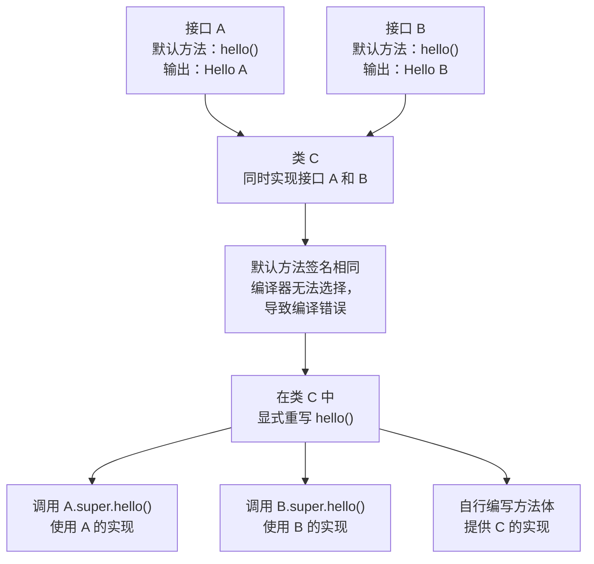
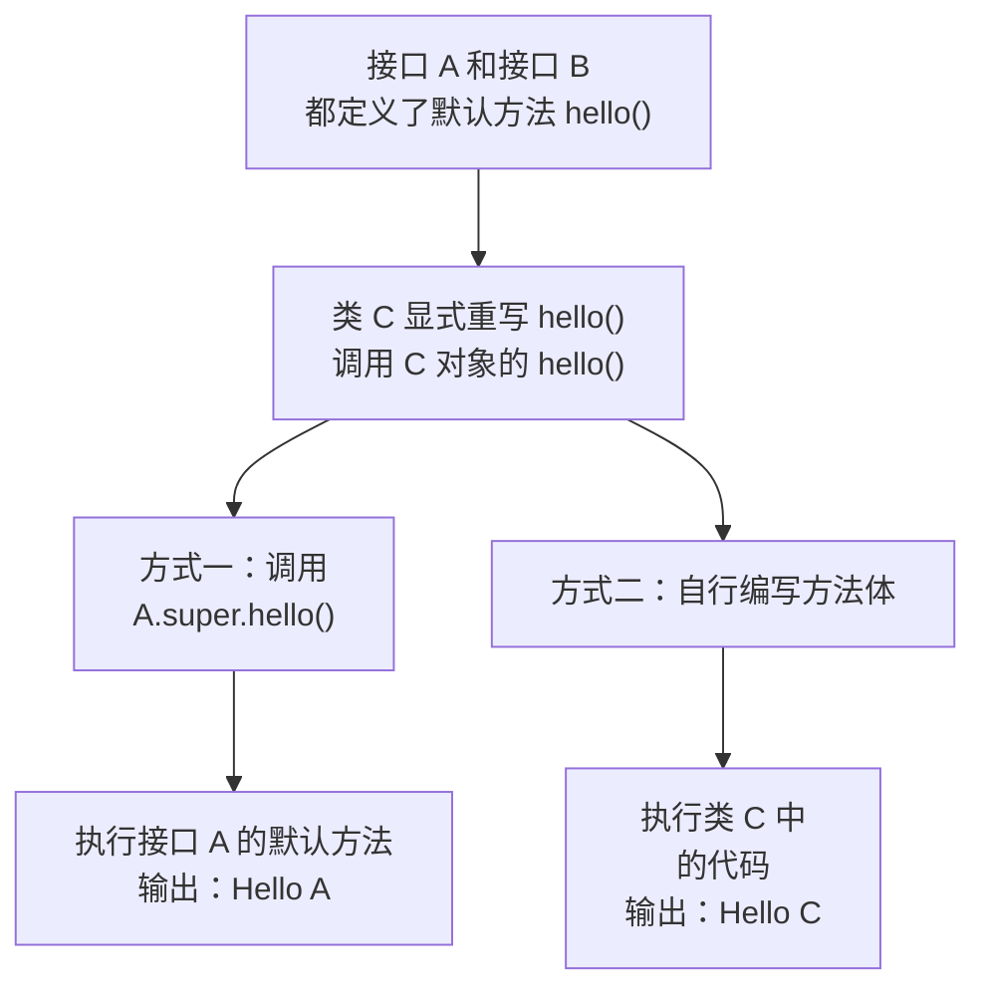
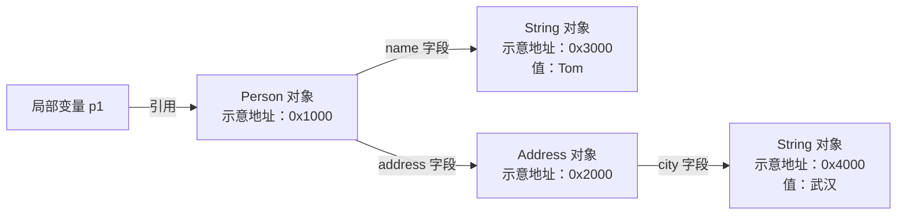
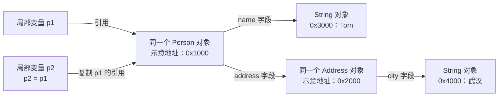
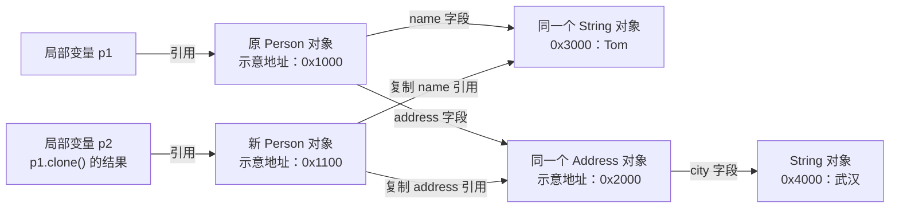
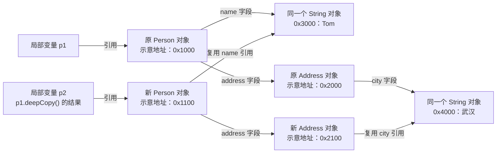

# 02 Java基础概念与常识-面向对象基础（OOP）

## 1. 面向对象和面向过程的区别
面向过程（POP）和面向对象（OOP）是两种不同的编程范式，核心区别在于程序如何组织数据和行为。
### 1.1 什么是面向过程（POP）？
面向过程（Procedural-Oriented Programming）主要关注 如何一步一步完成任务。

通常把程序拆成多个函数或方法，按照一定的执行顺序完成业务逻辑。

例如：计算圆的面积和周长。

```java
public class Main {
    public static void main(String[] args) {

        double radius = 3.0;

        // 计算面积
        double area = Math.PI * radius * radius;

        // 计算周长
        double perimeter = 2 * Math.PI * radius;

        System.out.println("面积：" + area);
        System.out.println("周长：" + perimeter);
    }
}
```


特点：
- 重点关注具体的处理步骤。
- 数据与处理逻辑通常分开组织。
- 对于简单任务，代码直观、实现成本低。
### 1.2 什么是面向对象（OOP）？
面向对象（Object-Oriented Programming）主要关注 有哪些对象，以及对象具有哪些属性和行为。

例如，我们将圆抽象为 Circle 类：
```java
public class Circle {

    // 属性：半径
    private double radius;

    // 构造方法
    public Circle(double radius) {
        this.radius = radius;
    }

    // 行为：计算面积
    public double getArea() {
        return Math.PI * radius * radius;
    }

    // 行为：计算周长
    public double getPerimeter() {
        return 2 * Math.PI * radius;
    }

    public static void main(String[] args) {

        // 创建 Circle 对象
        Circle circle = new Circle(3.0);

        // 通过对象调用方法
        System.out.println(circle.getArea());
        System.out.println(circle.getPerimeter());
    }
}
```


这里：
- Circle：类（Class），定义圆的数据和行为。
- radius：属性（Field），表示圆的半径。
- getArea()：方法（Method），表示计算面积的行为。
- circle：引用变量（Reference Variable），指向创建的对象。
- new Circle(3.0)：创建对象实例。
### 1.3 POP 与 OOP 对比
| 对比项 | 面向过程（POP） | 面向对象（OOP） |
| --- | --- | --- |
| 核心思想 | 关注处理步骤 | 关注对象及其职责 |
| 组织方式 | 函数、方法、过程 | 类、对象、接口 |
| 数据与行为 | 通常分开组织 | 可以封装在同一对象中 |
| 代码复用 | 函数复用、模块复用 | 组合、继承、多态等 |
| 可维护性 | 取决于模块设计 | 良好设计下通常容易维护 |
| 适用场景 | 简单任务、算法处理 | 复杂业务系统、领域建模 |
| 性能 | 不一定更快 | 不一定更慢 |

###  1.4 重点
1. OOP 的三个核心特征是 封装、继承、多态。
2. POP 不代表性能更好，OOP 也不代表一定更容易维护。
3. Java 是以面向对象为主要设计思想的语言，但也可以采用面向过程的方式组织部分代码。
4. 实际 Spring Boot 开发经常将 OOP、过程式代码与函数式编程结合使用。

## 2. 对象实例与对象引用有什么区别？
### 2.1 什么是对象实例？
使用 new 关键字通常可以创建 Java 对象实例。
```java
Person person = new Person();
```

将其拆开理解：
```java
Person person;       // 声明引用变量
person = new Person(); // 创建对象并将引用赋值给 person
```

- Person：类，定义对象的结构和行为。
- person：引用变量。
- new Person()：创建一个 Person 对象实例，并调用构造方法。
### 2.2 一个对象可以被多个引用指向
```java
Person p1 = new Person();

Person p2 = p1;
Person p3 = p1;
```

p1、p2、p3 是三个引用变量，但都指向同一个 Person 对象。
因此：
```java
System.out.println(p1 == p2); // true
System.out.println(p2 == p3); // true
```

### 2.3 引用也可以不指向任何对象
```java
Person p1 = null;
```

此时：
- p1 是一个引用变量。
- null 表示没有引用任何对象。
- 对 p1 直接调用实例方法会抛出 NullPointerException。

### 2.4 重点
- 一个引用变量在某个时刻最多指向一个对象，也可以为 null。
- 一个对象可以同时被多个引用指向。
- Java 对象和数组通常分配在 JVM 堆中，但 JIT 可能进行逃逸分析等优化。
- 引用值可以位于局部变量、对象字段、静态字段或数组元素中，不能简单理解为“引用永远在栈中”。

## 3. 对象相等与引用相等的区别
这是 Java 基础中非常重要的知识点，也是后面理解 equals() 和 hashCode() 的基础。
### 3.1 `==` 与 `equals()` 的区别
| 比较方式 | 作用 |
| --- | --- |
| `==` | 基本类型比较值；引用类型比较是否指向同一个对象 |
| `equals()` | 比较对象是否逻辑相等，具体规则由类的实现决定 |

注意：

Object 默认的 equals() 实现与引用相等具有相同的判断效果。

只有类重写了 equals()，才可能使用属性、内容等规则判断逻辑相等。
### 3.2 String 示例
```java
public class Main {
    public static void main(String[] args) {

        String str1 = "hello";
        String str2 = new String("hello");
        String str3 = "hello";

        System.out.println(str1 == str2);// false
        System.out.println(str1 == str3);// true

        System.out.println(str1.equals(str2));// true
        System.out.println(str1.equals(str3));// true
    }
}
```

输出：
```text
false
true
true
true
```

### 3.3 为什么得到这样的结果？

- str1 和 str3 引用字符串常量池中的同一个对象。
- str2 使用 new String() 创建了不同的对象。
- 三个字符串的内容都是 "hello"。

因此：
```java
str1 == str2       // false：不同对象
str1 == str3       // true：同一个对象
str1.equals(str2)  // true：内容相等
```

> 面试重点：使用 equals() 比较业务对象时，必须关注该类是否正确重写了这个方法。

<span style="color: red;">对于需要放入 HashMap 或 HashSet 的自定义对象，通常还需要一起正确重写 hashCode()。</span>

## 4. 构造方法（Constructor）
构造方法用于在创建对象时执行初始化逻辑。
### 4.1 没有声明构造方法，可以创建对象吗？
可以。
```java
public class Person {

    private String name;
    private int age;
}
```

对于这样的普通类，编译器会自动提供一个默认的无参构造方法。

从效果上可以理解为：
```java
public class Person {

    private String name;
    private int age;

    public Person() {
        super();
    }
}
```

不过，编译器生成的默认构造方法，其访问权限取决于类的声明情况，不一定都是 public。

### 4.2 自己声明构造方法之后会发生什么？
```java
public class Person {

    private String name;

    public Person(String name) {
        this.name = name;
    }
}
```

此时：
```java
Person p1 = new Person("Tom"); // 正确

Person p2 = new Person();      // 编译错误
```

原因：

一旦类显式声明了构造方法，编译器就不会再自动生成默认无参构造方法。

如果确实需要两种创建方式，就要手动重载：
```java
public class Person {

    private String name;

    // 无参构造
    public Person() {
        this("Unknown");
    }

    // 有参构造
    public Person(String name) {
        this.name = name;
    }
}
```

这里 this("Unknown") 表示调用本类的另一个构造方法。

注意：并不是所有类都必须提供无参构造方法。 如果业务要求对象创建时必须指定名称，就可以只提供有参构造方法。
### 4.3 构造方法的特点
| 特点 | 说明 |
| --- | --- |
| 方法名称 | 必须与类名相同 |
| 返回类型 | 没有返回类型，也不能写 `void` |
| 执行时机 | 创建实例时执行 |
| 重载（Overload） | 支持 |
| 重写（Override） | 不支持 |
| 继承 | 构造方法不被子类继承 |
| 主要作用 | 初始化对象 |

例如，构造方法重载：
```java
public class Student {

    private String name;
    private int age;

    public Student() {
        this("Unknown", 0);
    }

    public Student(String name) {
        this(name, 0);
    }

    public Student(String name, int age) {
        this.name = name;
        this.age = age;
    }
}
```

三个构造方法名称相同，但参数列表不同，属于 <span style="color: blue;">Overload（重载）。</span>

## 5. 面向对象三大特征
Java 面向对象的三大特征是：
| 特征 | 英文 | 核心含义 |
| --- | --- | --- |
| 封装 | Encapsulation | 隐藏内部实现 |
| 继承 | Inheritance | 复用和扩展行为 |
| 多态 | Polymorphism | 统一接口，不同实现 |

### 5.1 封装（Encapsulation）
封装就是将对象内部的状态和实现细节隐藏起来，通过受控的公开方法与外界交互。
完整代码及运行示例：[点击查看 Student 封装示例](../../../../../BackEnd/Java/JavaBasic/02Encapsulation.java)。

例如：
```java
public class Student {

    // private 隐藏对象状态，避免外部直接修改字段
    private String name;
    private int age;

    // 通过 public 方法向外提供受控的读取入口
    public String getName() {
        return name;
    }

    // 通过公开方法集中控制字段修改
    public void setName(String name) {
        this.name = name;
    }

    public int getAge() {
        return age;
    }

    public void setAge(int age) {
        // 先校验输入，避免对象进入非法状态
        if (age < 0) {
            throw new IllegalArgumentException(
                "年龄不能为负数"
            );
        }
        // 校验通过后再更新对象状态
        this.age = age;
    }
}
```

使用：

```java
Student student = new Student();

student.setName("Tom");
student.setAge(20);

System.out.println(student.getAge()); // 20
```

这里：
- private：禁止外部直接访问字段。
- public：向外提供可访问的方法。
- setAge()：控制字段修改，并校验数据是否合法。
封装的真正目的不只是把属性改成 private，而是保护对象状态，维持业务规则。

因此，并不是每个字段都必须提供 setter。

例如银行账户的余额，不应允许任意设置：
```java
public class BankAccount {

    private int balance;

    public int getBalance() {
        return balance;
    }

    public void deposit(int amount) {
        if (amount <= 0) {
            throw new IllegalArgumentException(
                "存款金额必须大于0"
            );
        }

        balance += amount;
    }
}
```

相比 setBalance()，deposit() 更能表达业务含义，并保护数据完整性。

### 5.2 继承（Inheritance）

继承是通过现有类定义新类的机制。

完整代码及运行示例：[点击查看继承示例](../../../../../BackEnd/Java/JavaBasic/02Inheritance.java)。

Java 使用 extends 表示类继承。
```java
class Animal {
    protected String name;
    public void eat() {
        System.out.println(name + "正在吃东西");
    }
}

class Dog extends Animal {
    public void bark() {
        System.out.println(name + "正在汪汪叫");
    }
}
```

使用：
```java
Dog dog = new Dog();

dog.name = "小黑";

dog.eat();  // 小黑正在吃东西
dog.bark(); // 小黑正在汪汪叫
```

继承的三个重要特征：
1. 子类可以复用父类可继承的成员与行为。
2. 子类可以增加自己的属性和方法。
3. 子类可以重写符合条件的父类实例方法，改变行为。
需要注意：
- Java 类只支持单继承，即一个类最多只有一个直接父类。
- 父类的 private 成员不能被子类直接访问，也不作为子类可继承的成员；但父类中的私有实例状态依然可以存在于子类对象中。
- 构造方法不会被继承，创建子类对象时仍需要执行父类构造过程。
- 继承应当表达合理的 is-a（是一种） 关系，不应只为了复用几行代码就滥用继承。

### 5.3 多态（Polymorphism）

多态是指：同一种方法调用，可以根据对象的实际类型表现出不同的行为。

这里最值得记住的是：

父类引用可以指向子类对象。
示例：`Animal`、`Dog`、`Cat`
```java
class Animal {
    public void speak() {
        System.out.println("动物发出声音");
    }
}

class Dog extends Animal {
    // 重写父类 Animal 的 speak()，提供 Dog 的具体行为
    @Override
    public void speak() {
        System.out.println("汪汪");
    }
    // Dog 新增的方法，父类中没有对应定义，因此不是重写
    public void fetch() {
        System.out.println("捡球");
    }
}

class Cat extends Animal {
    @Override
    public void speak() {
        System.out.println("喵喵");
    }
}

public class Main {

    public static void main(String[] args) {

        Animal a1 = new Dog();
        Animal a2 = new Cat();

        a1.speak();
        a2.speak();
    }
}
```

输出：
```text
汪汪
喵喵
```

虽然两个变量都声明为 Animal 类型，但执行结果不同。

原因：

Java 对可重写的实例方法采用 动态分派（Dynamic Dispatch），根据对象实际的运行时类型决定执行哪个实现。

多态的一个重要限制
```java
Animal animal = new Dog();

animal.speak(); // 正确

animal.fetch(); // 编译错误
```

为什么 fetch() 不能直接调用？

因为：
- animal 的声明类型是 Animal。
- 编译器首先根据声明类型检查能够访问哪些方法。
- Animal 中没有 fetch() 方法。
可以通过类型检查后进行向下转型：

```java
if (animal instanceof Dog) {
    Dog dog = (Dog) animal;
    dog.fetch();
}
```

Java 16+ 还可以使用模式匹配简化：
```java
if (animal instanceof Dog dog) {
    dog.fetch();
}
```

#### 多态四个关键点
| 判断项 | 规则 |
| --- | --- |
| 能调用哪些方法？ | 首先看引用变量的编译时类型 |
| 实际执行哪个重写方法？ | 看运行时对象类型 |
| 子类特有的方法能直接调用吗？ | 不能，通常需要类型转换 |
| `static` 方法能被动态重写吗？ | 不能，静态方法是隐藏而非重写 |

额外注意：并不是所有方法调用都属于动态分派。 <span style="color: blue;">static、private 方法以及构造方法不采用普通实例方法重写的动态分派机制。</span>

<details>
<summary><span style="color: yellow;">查看动态分派的说明</span></summary>

调用这些成员时，不会像重写的普通实例方法那样，根据对象的实际类型选择实现。

- `static` 方法属于类，由声明类型决定调用哪个方法。
- `private` 方法不能被子类重写。
- 构造方法不能被继承或重写，创建对象时按构造过程执行。

例如，`Animal a = new Dog();` 调用被重写的 `a.speak()` 时，执行的是 Dog 的实现；这就是动态分派。

</details>


## 6. 接口与抽象类的共同点和区别
接口（Interface）和抽象类（Abstract Class）都是 Java 抽象设计的重要工具，但两者的定位不同。

它们都可以让调用方依赖较抽象的类型，而不必针对每个具体实现编写一套调用逻辑。例如，代码可以使用 `Animal` 引用调用不同动物的 `speak()`，也可以使用 `Flyable` 引用调用不同对象的 `fly()`。

### 6.1 什么是抽象类？
抽象类用于描述一类相关对象的共同特征。它可以保存共同状态、提供可复用的实现，也可以声明抽象方法，要求具体子类补充各自的行为。

<details>
<summary><span style="color: yellow;">抽象类描述一类相关对象的共同特征的详细解释</span></summary>

可以把抽象类理解为相关类共同使用的基础定义。例如，`Dog` 和 `Cat` 都是动物，可以通过继承 `Animal` 共享以下内容：

- **共同状态**：`Animal` 中的 `name` 字段表示名字；每个动物对象有自己的名字。
- **可复用的实现**：`Animal` 可以实现 `sleep()`，子类可以继承并使用这个方法。
- **需要子类补充的行为**：`Animal` 可以声明抽象方法 `speak()`，只规定动物可以发出声音，不指定具体叫声；具体子类需要实现它，例如狗叫“汪汪”、猫叫“喵喵”。

因此，抽象类既能集中相同的部分，也能为不同的行为留下由子类实现的空间。抽象类本身不能直接创建对象。

</details>
<br/>
例如，动物都有名字，也可能有相同的睡觉行为，但狗和猫的叫声不同。可以把名字和睡觉行为放在抽象类 `Animal` 中，让具体子类分别实现 `speak()`。

抽象类适合相关类型需要共享状态或基础实现的场景。它不能直接实例化，但可以作为引用类型，让调用方通过同一类型使用不同子类对象。

使用 `abstract` 声明抽象类：
```java
abstract class Animal {

    protected String name;

    public Animal(String name) {
        this.name = name;
    }

    // 抽象方法：只有声明
    public abstract void speak();

    // 普通方法：有具体实现
    public void sleep() {
        System.out.println(name + "正在睡觉");
    }
}
```

抽象类可以同时包含：
- 普通成员变量。
- 构造方法。
- 抽象方法。
- 已经实现的普通方法。
  
子类可以通过 extends 继承：

```java
class Dog extends Animal {

    public Dog(String name) {
        super(name);
    }

    @Override
    public void speak() {
        System.out.println("汪汪");
    }
}
```

抽象类本身不能直接实例化：
```java
Animal animal = new Animal("Tom"); // 编译错误
```

但可以声明抽象类引用：
```java
Animal animal = new Dog("小黑");

animal.speak(); // 汪汪
```

### 6.2 什么是接口？
接口用于定义一组行为规范，让不同的类可以提供各自的实现。调用方只需要知道对象遵守什么契约，不必依赖某个具体类，从而更容易替换实现或扩展新的类型。

例如，鸟和飞机不是同一种事物，但都具有飞行能力。它们可以分别实现 `Flyable` 接口，让使用方通过 `Flyable` 引用调用 `fly()`。

接口适合为不同类型定义统一能力或协作方式；一个类可以实现多个接口。接口也可以提供 `default` 等方法实现，但不能保存每个对象各自的实例字段。

使用 `interface` 声明接口：
```java
interface Flyable {
    void fly();
}
```

实现接口：
```java
class Bird implements Flyable {
    @Override
    public void fly() {
        System.out.println("鸟在飞");
    }
}

class Airplane implements Flyable {
    @Override
    public void fly() {
        System.out.println("飞机在飞");
    }
}
```

使用接口实现多态：
```java
Flyable f1 = new Bird();
Flyable f2 = new Airplane();

f1.fly(); // 鸟在飞
f2.fly(); // 飞机在飞
```

此处不需要 Bird 和 Airplane 拥有相同的父类，只需要实现同一个接口即可。
### 6.3 接口与抽象类的区别
| 对比项 | 抽象类（abstract class） | 接口（interface） |
| --- | --- | --- |
| 核心目的 | 抽象共同特征、共享状态与实现 | 定义行为契约 |
| 关键字 | `abstract class` | `interface` |
| 继承方式 | `extends` | `implements` |
| 多继承 | 一个类最多继承一个父类 | 一个类可以实现多个接口 |
| 实例化 | 不能直接实例化 | 不能直接实例化 |
| 构造方法 | 可以有 | 不可以有 |
| 实例字段 | 可以有 | 不可以有 |
| 字段规则 | 可声明普通成员变量 | 字段隐式为 `public static final` |
| 抽象方法 | 支持 | 支持 |
| 普通实例方法 | 支持 | 支持 `default` 方法 |
| 静态方法 | 支持 | Java 8 起支持 |
| 私有方法 | 支持 | Java 9 起支持 |
| 使用场景 | 存在共同状态和基础实现 | 不同类型需要遵守统一行为规范 |

**记忆：**
- 抽象类强调 is-a（是什么） 关系，以及共同状态与实现。
- 接口强调 can-do（能做什么） 的行为能力。
例如：
```java
abstract class Animal {
    // 动物的共同特征
}

interface Flyable {
    void fly();
}

class Bird extends Animal implements Flyable {

    @Override
    public void fly() {
        System.out.println("Flying");
    }
}
```

Bird 是一种 Animal，同时具有 Flyable 所定义的飞行能力。

## 7. Java 8、Java 9 接口方法的新特性
Java 接口的方法规则随着 JDK 版本逐步扩展。
| JDK 版本 | 接口支持的主要方法 |
| --- | --- |
| Java 7 及之前 | `public abstract` |
| Java 8 | 新增 `default`、`static` |
| Java 9 | 新增 `private`、`private static` |

### 7.1 Java 8：`default` 方法
default 方法允许接口为某个行为提供默认实现。
```java
interface Animal {

    void eat();

    default void sleep() {
        System.out.println("动物正在睡觉");
    }
}
```

实现类：
```java
class Dog implements Animal {

    @Override
    public void eat() {
        System.out.println("狗正在吃东西");
    }
}
```

调用：
```java
Dog dog = new Dog();

dog.eat();   // 狗正在吃东西
dog.sleep(); // 动物正在睡觉
```

Dog 没有实现 sleep()，但仍然可以使用接口提供的默认行为。

> `default` 的重要意义：有助于在扩展已有接口时减少对现有实现类的修改，但不是所有新增默认方法都绝对兼容，例如多个接口之间可能产生默认方法冲突。
### 7.2 Java 8：`static` 方法
接口允许定义静态方法。
```java
interface MathUtils {

    static int add(int a, int b) {
        return a + b;
    }
}
```

调用方式：
```java
int result = MathUtils.add(10, 20);

System.out.println(result); // 30
```

静态接口方法需要通过接口名调用。
```java
// 正确
MathUtils.add(10, 20);
```

接口中的静态方法不会作为实例方法被实现类继承，也不能作为实例方法进行重写。

### 7.3 Java 9：`private` 方法

Java 9 允许接口拥有私有方法，用来复用接口内部的实现逻辑。
```java
interface MyInterface {

    // 默认方法
    default void defaultMethod() {
        commonMethod();
        instanceCommonMethod();
    }

    // 静态方法
    static void staticMethod() {
        commonMethod();
    }

    // 私有静态方法
    private static void commonMethod() {
        System.out.println("公共处理逻辑");
    }

    // 私有实例方法
    private void instanceCommonMethod() {
        System.out.println("实例内部处理");
    }
}
```

注意：

- private static 方法可以被接口内的静态方法和实例方法调用。
- private 实例方法需要实例上下文，不能直接从 static 方法调用。
- 私有接口方法不对实现类开放，也不能被实现类重写。
 
## 8. 接口 `default` 方法的冲突问题（补充重点）
这是理解 Java 接口与多态时容易遇到的一个问题。

假设两个接口都定义了相同签名的默认方法：
```java
interface A {

    default void hello() {
        System.out.println("Hello A");
    }
}

interface B {

    default void hello() {
        System.out.println("Hello B");
    }
}
```

如果一个类同时实现两个接口：
```java
class C implements A, B {

}
```



会发生编译错误，因为编译器无法直接选择这两个冲突的默认实现。

<details>
<summary><span style="color: yellow;">查看两个默认实现为什么会冲突</span></summary>

这里的“两个默认实现”是指：

- 接口 `A` 的 `default hello()`：方法体打印 `Hello A`。
- 接口 `B` 的 `default hello()`：方法体打印 `Hello B`。

它们的方法名和参数列表相同，都是 `hello()`，但分别提供了自己的方法体。`C` 同时实现了 `A` 和 `B`，如果 `C` 不重写 `hello()`，编译器就无法确定应该使用哪一个接口的默认方法。

Java 不会按照 `implements A, B` 的先后顺序自动选择。在这个例子中，即使还没有调用 `hello()`，类 `C` 的声明也会因为冲突而编译失败。

解决办法是在 `C` 中重写 `hello()`，明确指定行为：

1. 调用 `A.super.hello()`，使用 `A` 的默认实现，输出 `Hello A`。
2. 调用 `B.super.hello()`，使用 `B` 的默认实现，输出 `Hello B`。
3. 不调用接口的默认方法，在 `C` 中编写自己的方法体，例如输出 `Hello C`。

这三种是不同的实现选择；确定其中一种之后，调用 `new C().hello()` 就会执行 `C` 中重写的方法。若接口之间存在继承关系，或父类已提供相应方法，还需要结合 Java 的方法优先级规则判断，不一定会出现这里的冲突。

</details>

解决方法是显式重写：
```java
class C implements A, B {

    @Override
    public void hello() {
        A.super.hello();
    }
}
```

也可以自行提供完整实现：
```java
class C implements A, B {

    @Override
    public void hello() {
        System.out.println("Hello C");
    }
}
```



这说明：

<span style="color: blue;">Java 虽然允许一个类实现多个接口，但遇到同签名默认方法冲突时，仍然需要通过明确的规则或显式重写消除歧义。</span>

以上按照原文顺序整理了面向对象的核心概念。理解这一章时，最需要区分的是三个关系：
- 类与对象：类是定义，对象是实例，引用用于访问对象。
- 继承与多态：继承建立类型关系，多态让统一的方法调用执行不同实现。
- 接口与抽象类：接口主要描述行为契约，抽象类则可以同时提供共同状态和基础实现。

这些概念在 Spring Boot 中同样重要，例如 @Service 业务类的封装、接口与实现类的分离，以及 Spring 依赖注入所依赖的多态机制。


## 9. 深拷贝、浅拷贝与引用拷贝
Java 中的对象拷贝主要涉及三种情况：
- 引用拷贝（Reference Copy）：不创建新对象，只复制引用，两个变量指向同一个对象。
- 浅拷贝（Shallow Copy）：创建一个新对象，但内部引用类型的字段仍指向原来的对象。
- 深拷贝（Deep Copy）：创建新对象，并复制需要独立的内部可变对象，使副本和原对象互不影响。

<span style="color: blue;">引用拷贝共享原对象，浅拷贝只复制外层对象，深拷贝还会复制需要独立的内部可变对象。</span>

### 9.1 三种拷贝方式的区别
| 对比项 | 引用拷贝 | 浅拷贝 | 深拷贝 |
| --- | --- | --- | --- |
| 创建新的外层对象 | ❌ | ✅ | ✅ |
| 复制基本类型字段的值 | 无新对象，直接共享 | ✅ | ✅ |
| 复制内部引用对象 | 共享 | 共享 | 通常创建独立副本 |
| 修改原对象的普通字段 | 影响同一个对象 | 不影响副本 | 不影响副本 |
| 修改内部可变对象 | 相互影响 | 相互影响 | 通常互不影响 |
| 内存开销 | 最低 | 较低 | 通常较高 |


下面的三个小例子共用以下类：`Address` 保存可修改的城市，`Person` 持有一个地址。`clone()` 实现浅拷贝，`deepCopy()` 则同时复制地址。

完整可运行示例：[查看三种拷贝的 Java 代码](../../../../../BackEnd/Java/JavaBasic/02copy.java)。

```java
class Address {
    private String city;

    public Address(String city) {
        this.city = city;
    }

    public String getCity() {
        return city;
    }

    public void setCity(String city) {
        this.city = city;
    }
}

class Person implements Cloneable {
    private String name;
    private Address address;

    public Person(String name, Address address) {
        this.name = name;
        this.address = address;
    }

    public Address getAddress() {
        return address;
    }

    @Override
    public Person clone() {
        try {
            return (Person) super.clone();
        } catch (CloneNotSupportedException e) {
            throw new AssertionError(e);
        }
    }

    public Person deepCopy() {
        Address copiedAddress = address == null
                ? null
                : new Address(address.getCity());
        return new Person(name, copiedAddress);
    }
}
```

下面三种拷贝的代码分别为独立示例，可以分别放在 `main()` 方法中运行。第 9.2 节会再次给出完整的浅拷贝程序。

#### 9.1.1 引用拷贝
```java
Person p1 = new Person("Tom", new Address("武汉"));
Person p2 = p1;
System.out.println(p1 == p2); // true

p2.getAddress().setCity("东京");
System.out.println(p1.getAddress().getCity()); // 东京
```

p1 和 p2 指向同一个 Person 对象，并没有创建新对象。通过 p2 修改地址，也会影响通过 p1 看到的地址。

重点：引用拷贝本质上只是引用值的赋值，不是真正复制对象。

#### 9.1.2 浅拷贝
```java
Person p1 = new Person("Tom", new Address("武汉"));
Person p2 = p1.clone(); // 浅拷贝
System.out.println(p1 == p2); // false：Person 是两个不同对象
System.out.println(p1.getAddress() == p2.getAddress()); // true：共享 Address

p2.getAddress().setCity("东京");
System.out.println(p1.getAddress().getCity()); // 东京
```

创建了两个不同的 Person 对象，但它们的 address 指向同一个 Address 对象，所以通过 p2 修改地址时，p1 看到的地址也会变化。

重点：浅拷贝只复制外层对象，内部引用类型字段默认共享原来的对象。

#### 9.1.3 深拷贝
```java
Person p1 = new Person("Tom", new Address("武汉"));
Person p2 = p1.deepCopy();
```

Person 和内部 Address 都分别创建新对象，不再共享 Address。

```java
System.out.println(p1 == p2);
// false

System.out.println(
    p1.getAddress() == p2.getAddress()
);
// false
```

重点：深拷贝不仅复制外层对象，也复制内部需要独立的可变对象。 对于复杂对象图，深拷贝还需要考虑循环引用、共享关系以及哪些对象本来就可以安全共享。

#### 三种拷贝的内存引用图

下面的 `0x1000` 等地址只是为了区分对象而使用的**示意标签，不是真实 JVM 内存地址**。Java 引用不能当作可直接读取的内存地址，对象位置也可能因垃圾回收等原因变化。三个示例分别独立运行；图中展示的是复制完成、调用 `setCity()` **之前**的指向。

图中实线表示引用指向。`p1`、`p2` 是局部引用变量；`name`、`address` 是 `Person` 的字段，`city` 是 `Address` 的字段。方法属于类的行为，图中不把方法画成每个对象单独拥有的内存副本。

**共同起点：创建原对象**

代码：`Person p1 = new Person("Tom", new Address("武汉"));`



`new Address("武汉")` 创建地址对象；`new Person("Tom", ...)` 创建人物对象，并将地址引用保存到 `address` 字段。

**1. 引用拷贝：`Person p2 = p1`**



- 执行赋值后，`p1` 和 `p2` 指向同一个 `Person`；没有创建新的 `Person` 或 `Address`。
- `p1 == p2` 为 `true`。通过任一引用调用 `getAddress()`，得到的都是同一个地址对象。

**2. 浅拷贝：`Person p2 = p1.clone()`**



- `Person.clone()` 调用 `super.clone()`，创建新的外层 `Person`，并复制字段值；其中 `name` 和 `address` 的字段值都是引用。
- `p1 == p2` 为 `false`，但 `p1.getAddress() == p2.getAddress()` 为 `true`：两个 `Person` 共用同一个 `Address`。

**3. 深拷贝：`Person p2 = p1.deepCopy()`**



- `Person.deepCopy()` 通过 `address.getCity()` 读取城市，再用 `new Address(...)` 创建新地址，最后用 `new Person(...)` 创建新人物。
- `p1 == p2` 和 `p1.getAddress() == p2.getAddress()` 都为 `false`。两个 `Address` 独立，但 `name` 和初始 `city` 引用仍可指向同一个不可变的 `String` 对象。
- 代码中如果原来的 `address` 为 `null`，副本的 `address` 也为 `null`，不会创建新的 `Address`。

**调用方法后，指向如何变化？**

执行 `p2.getAddress().setCity("东京")` 时，`getAddress()` 返回 `p2` 所指人物的地址对象；`setCity()` 将该地址对象的 `city` 字段改为引用字符串 `"东京"`，并不会修改原来的 `"武汉"` 字符串。

| 拷贝方式 | 被修改的 `Address` | `p1.getAddress().getCity()` | `p2.getAddress().getCity()` |
| --- | --- | --- | --- |
| 引用拷贝 | `p1` 和 `p2` 共用的 `0x2000` | 东京 | 东京 |
| 浅拷贝 | 两个 `Person` 共用的 `0x2000` | 东京 | 东京 |
| 深拷贝 | 只有 `p2` 使用的新地址 `0x2100` | 武汉 | 东京 |

最后一行是在深拷贝示例中**额外执行**该 `setCity()` 调用后的结果。

### 9.2 Java 浅拷贝完整代码
下面使用 Cloneable 和 Object.clone() 实现。
```java
class Address {
    private String city;
    
    public Address(String city) {
        this.city = city;
    }
    public String getCity() {
        return city;
    }
    public void setCity(String city) {
        this.city = city;
    }
}

class Person implements Cloneable {

    private String name;
    private Address address;

    public Person(String name, Address address) {
        this.name = name;
        this.address = address;
    }

    public Address getAddress() {
        return address;
    }

    @Override
    public Person clone() {
        try {
            return (Person) super.clone();
        } catch (CloneNotSupportedException e) {
            throw new AssertionError(e);
        }
    }
}

public class Main {

    public static void main(String[] args) {

        Person p1 = new Person(
            "Tom", new Address("武汉")
        );

        // 浅拷贝
        Person p2 = p1.clone();

        System.out.println(p1 == p2);
        System.out.println(
            p1.getAddress() == p2.getAddress()
        );

        // 修改 p2 内部的 Address
        p2.getAddress().setCity("东京");

        System.out.println(
            "p1 地址：" + p1.getAddress().getCity()
        );

        System.out.println(
            "p2 地址：" + p2.getAddress().getCity()
        );
    }
}
```

输出：
```text
false
true
p1 地址：东京
p2 地址：东京
```

为什么修改 p2，p1 也发生变化？

因为 super.clone() 默认执行的是字段级浅拷贝：
- name 字段的引用被复制，指向同一个不可变 String 对象。
- address 字段的引用被复制，指向同一个可变 Address 对象。
- 两个 Person 对象本身是不同的。

因此，修改共享的 Address 对象，会影响两个 Person 观察到的地址。

### 9.3 Java 深拷贝实现
这里沿用上面的 Address 和 Person 类，只修改 Person 的 clone() 方法。

首先，让 Address 也支持克隆：
```java
class Address implements Cloneable {

    private String city;

    public Address(String city) {
        this.city = city;
    }

    public String getCity() {
        return city;
    }

    public void setCity(String city) {
        this.city = city;
    }

    @Override
    public Address clone() {
        try {
            return (Address) super.clone();
        } catch (CloneNotSupportedException e) {
            throw new AssertionError(e);
        }
    }
}
```

然后修改 Person.clone()：
```java
@Override
public Person clone() {
    try {
        // 第一步：浅拷贝 Person
        Person copy = (Person) super.clone();

        // 第二步：复制内部 Address
        copy.address = this.address == null
                ? null
                : this.address.clone();

        return copy;

    } catch (CloneNotSupportedException e) {
        throw new AssertionError(e);
    }
}
```

测试：
```java
Person p1 = new Person(
    "Tom", new Address("武汉")
);

Person p2 = p1.clone();

p2.getAddress().setCity("东京");

System.out.println(p1 == p2);
System.out.println(
    p1.getAddress() == p2.getAddress()
);

System.out.println(p1.getAddress().getCity());
System.out.println(p2.getAddress().getCity());
```

输出：
```text
false
false
武汉
东京
```

说明两个 Person 及其内部的 Address 都已经相互独立。

这里的深拷贝成立，是因为当前对象结构简单，Address 中只有不可变的 String 字段。如果内部还有 List、其他可变对象等，也需要根据需求继续复制。

### 9.4 `clone()` 与 `Cloneable` 的关系
前面代码中有两个容易混淆的地方。

#### 9.4.1 Cloneable 是什么？
Cloneable 是 Java 的标记接口（Marker Interface）。
```java
public interface Cloneable {
}
```

它没有声明任何方法。

它的作用是告诉 Object.clone()：当前对象允许使用这种克隆机制。

如果没有实现 Cloneable，调用 Object.clone() 通常会抛出 CloneNotSupportedException。

#### 9.4.2 为什么还需要重写 `clone()`？
因为 Object 中的 clone() 方法是 protected，普通外部代码不能直接对任意对象调用。

我们可以通过重写把它暴露为 public：
```java
@Override
public Person clone() {
    try {
        return (Person) super.clone();
    } catch (CloneNotSupportedException e) {
        throw new AssertionError(e);
    }
}
```

其中 super.clone() 会创建当前对象的浅拷贝。

不过，实际项目不一定推荐使用 Cloneable 和 clone()。它们的语义和异常处理存在一些历史设计问题。

对于一般业务对象，通常可以使用复制构造方法实现更清晰的拷贝逻辑。

例如：
```java
public Person(Person other) {
    this.name = other.name;

    this.address = other.address == null
            ? null
            : new Address(other.address.getCity());
}
```

调用：
```java
Person p2 = new Person(p1);
```

这样不需要实现 Cloneable，也更容易明确哪些字段应该复制、哪些可以共享。

### 9.5 浅拷贝中最容易忽略的问题：String
为什么浅拷贝共享 Address 会产生问题，但是共享 String 通常不会？

因为 String 是不可变对象（Immutable Object）。
```java
String a = "武汉";
String b = a;

b = "东京";

System.out.println(a); // 武汉
System.out.println(b); // 东京
```

这里执行：
```java
b = "东京";
```

并不是修改原来 "武汉" 对象的内容，而是让 b 指向另一个字符串对象。

因此，对于不可变对象，例如 String，深拷贝时通常无需重新创建对象，可以安全共享。

但对 Address、ArrayList、自定义可变对象等，如果希望副本完全独立，则应根据对象结构进行相应复制。

### 9.6 三种拷贝的实际使用场景
| 方式 | 常见场景 |
| --- | --- |
| 引用拷贝 | 变量赋值、向方法传递对象引用 |
| 浅拷贝 | 对象字段级复制、部分集合复制 |
| 深拷贝 | 需要隔离可变状态的业务对象、快照、复杂数据复制 |

例如，Java 集合中：
```java
List<Person> list1 = new ArrayList<>();

List<Person> list2 = list1;
```

这是引用拷贝，两个变量指向同一个 ArrayList。

而：
```java
List<Person> list2 = new ArrayList<>(list1);
```

这是对集合结构的浅拷贝。
- list1 和 list2 是两个不同的列表对象。
- 列表中的 Person 元素仍然是原来的对象引用。
- 修改列表结构通常互不影响，但修改共享的 Person 对象会在两个列表中体现。

如果希望内部每一个 Person 也独立，则必须进一步复制元素及其需要隔离的可变字段。

最终要理解的核心区别是：引用拷贝不创建对象；浅拷贝创建外层对象；深拷贝进一步隔离内部可变对象。