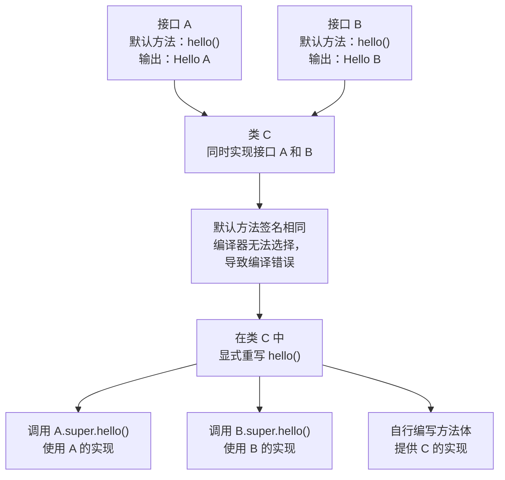
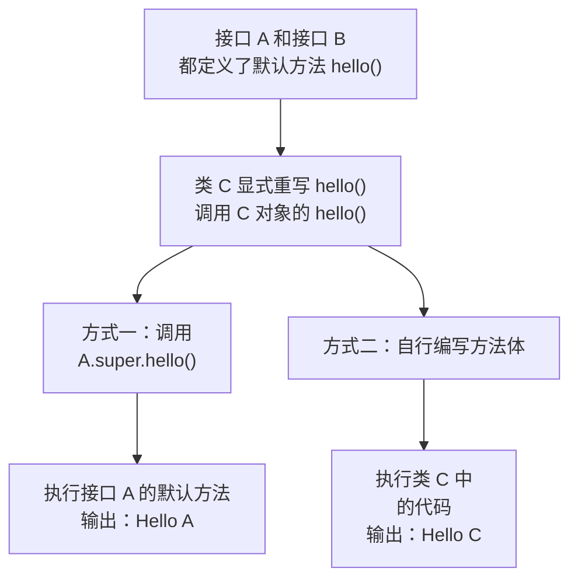
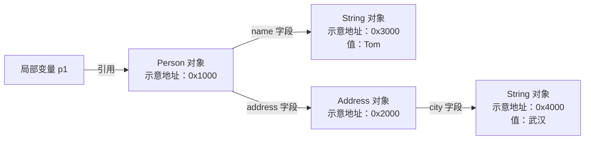
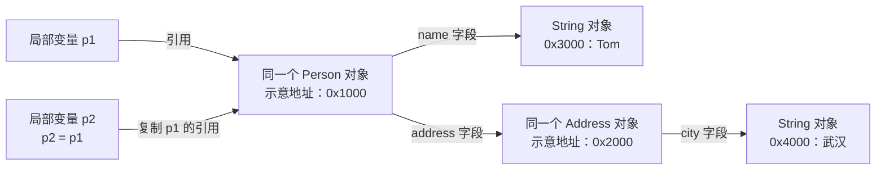
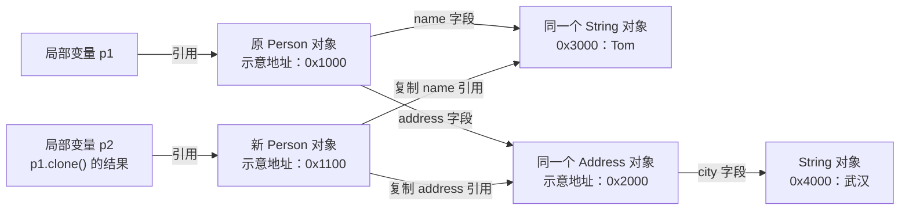
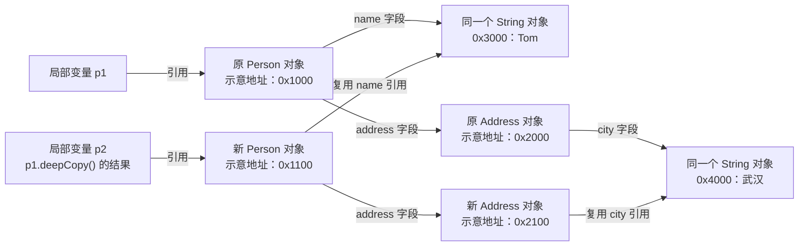
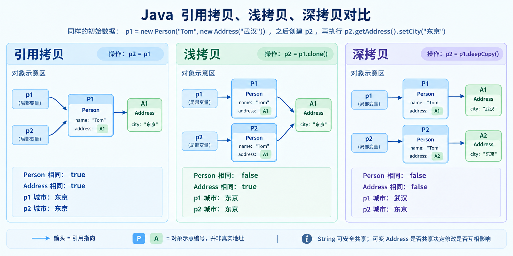
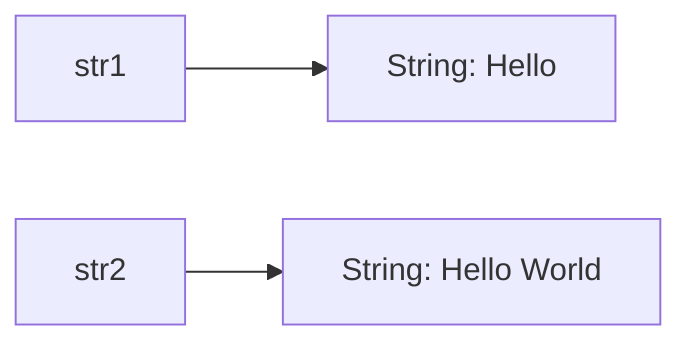
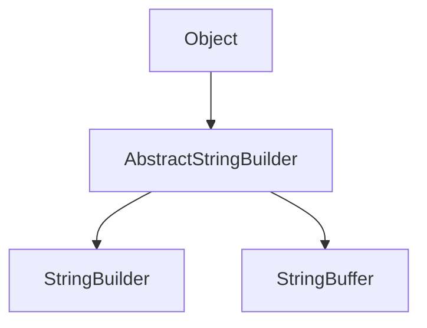

# 02 Java基础概念与常识-面向对象基础（OOP）

## 1. 面向对象和面向过程的区别
面向过程（POP）和面向对象（OOP）是两种不同的编程范式，核心区别在于程序如何组织数据和行为。
### 1.1 什么是面向过程（POP）？
面向过程（Procedural-Oriented Programming）主要关注 如何一步一步完成任务。

通常把程序拆成多个函数或方法，按照一定的执行顺序完成业务逻辑。

例如：计算圆的面积和周长。

```java
public class Main {
    public static void main(String[] args) {

        double radius = 3.0;

        // 计算面积
        double area = Math.PI * radius * radius;

        // 计算周长
        double perimeter = 2 * Math.PI * radius;

        System.out.println("面积：" + area);
        System.out.println("周长：" + perimeter);
    }
}
```


特点：
- 重点关注具体的处理步骤。
- 数据与处理逻辑通常分开组织。
- 对于简单任务，代码直观、实现成本低。
### 1.2 什么是面向对象（OOP）？
面向对象（Object-Oriented Programming）主要关注 有哪些对象，以及对象具有哪些属性和行为。

例如，我们将圆抽象为 Circle 类：
```java
public class Circle {

    // 属性：半径
    private double radius;

    // 构造方法
    public Circle(double radius) {
        this.radius = radius;
    }

    // 行为：计算面积
    public double getArea() {
        return Math.PI * radius * radius;
    }

    // 行为：计算周长
    public double getPerimeter() {
        return 2 * Math.PI * radius;
    }

    public static void main(String[] args) {

        // 创建 Circle 对象
        Circle circle = new Circle(3.0);

        // 通过对象调用方法
        System.out.println(circle.getArea());
        System.out.println(circle.getPerimeter());
    }
}
```


这里：
- Circle：类（Class），定义圆的数据和行为。
- radius：属性（Field），表示圆的半径。
- getArea()：方法（Method），表示计算面积的行为。
- circle：引用变量（Reference Variable），指向创建的对象。
- new Circle(3.0)：创建对象实例。
### 1.3 POP 与 OOP 对比
| 对比项 | 面向过程（POP） | 面向对象（OOP） |
| --- | --- | --- |
| 核心思想 | 关注处理步骤 | 关注对象及其职责 |
| 组织方式 | 函数、方法、过程 | 类、对象、接口 |
| 数据与行为 | 通常分开组织 | 可以封装在同一对象中 |
| 代码复用 | 函数复用、模块复用 | 组合、继承、多态等 |
| 可维护性 | 取决于模块设计 | 良好设计下通常容易维护 |
| 适用场景 | 简单任务、算法处理 | 复杂业务系统、领域建模 |
| 性能 | 不一定更快 | 不一定更慢 |

###  1.4 重点
1. OOP 的三个核心特征是 封装、继承、多态。
2. POP 不代表性能更好，OOP 也不代表一定更容易维护。
3. Java 是以面向对象为主要设计思想的语言，但也可以采用面向过程的方式组织部分代码。
4. 实际 Spring Boot 开发经常将 OOP、过程式代码与函数式编程结合使用。

## 2. 对象实例与对象引用有什么区别？
### 2.1 什么是对象实例？
使用 new 关键字通常可以创建 Java 对象实例。
```java
Person person = new Person();
```

将其拆开理解：
```java
Person person;       // 声明引用变量
person = new Person(); // 创建对象并将引用赋值给 person
```

- Person：类，定义对象的结构和行为。
- person：引用变量。
- new Person()：创建一个 Person 对象实例，并调用构造方法。
### 2.2 一个对象可以被多个引用指向
```java
Person p1 = new Person();

Person p2 = p1;
Person p3 = p1;
```

p1、p2、p3 是三个引用变量，但都指向同一个 Person 对象。
因此：
```java
System.out.println(p1 == p2); // true
System.out.println(p2 == p3); // true
```

### 2.3 引用也可以不指向任何对象
```java
Person p1 = null;
```

此时：
- p1 是一个引用变量。
- null 表示没有引用任何对象。
- 对 p1 直接调用实例方法会抛出 NullPointerException。

### 2.4 重点
- 一个引用变量在某个时刻最多指向一个对象，也可以为 null。
- 一个对象可以同时被多个引用指向。
- Java 对象和数组通常分配在 JVM 堆中，但 JIT 可能进行逃逸分析等优化。
- 引用值可以位于局部变量、对象字段、静态字段或数组元素中，不能简单理解为“引用永远在栈中”。

## 3. 对象相等与引用相等的区别
这是 Java 基础中非常重要的知识点，也是后面理解 equals() 和 hashCode() 的基础。
### 3.1 `==` 与 `equals()` 的区别
| 比较方式 | 作用 |
| --- | --- |
| `==` | 基本类型比较值；引用类型比较是否指向同一个对象 |
| `equals()` | 比较对象是否逻辑相等，具体规则由类的实现决定 |

注意：

Object 默认的 equals() 实现与引用相等具有相同的判断效果。

只有类重写了 equals()，才可能使用属性、内容等规则判断逻辑相等。
### 3.2 String 示例
```java
public class Main {
    public static void main(String[] args) {

        String str1 = "hello";
        String str2 = new String("hello");
        String str3 = "hello";

        System.out.println(str1 == str2);// false
        System.out.println(str1 == str3);// true

        System.out.println(str1.equals(str2));// true
        System.out.println(str1.equals(str3));// true
    }
}
```

输出：
```text
false
true
true
true
```

### 3.3 为什么得到这样的结果？

- str1 和 str3 引用字符串常量池中的同一个对象。
- str2 使用 new String() 创建了不同的对象。
- 三个字符串的内容都是 "hello"。

因此：
```java
str1 == str2       // false：不同对象
str1 == str3       // true：同一个对象
str1.equals(str2)  // true：内容相等
```

> 面试重点：使用 equals() 比较业务对象时，必须关注该类是否正确重写了这个方法。

> [!CAUTION]
> 对于需要放入 HashMap 或 HashSet 的自定义对象，通常还需要一起正确重写 `hashCode()`。

## 4. 构造方法（Constructor）
构造方法用于在创建对象时执行初始化逻辑。
### 4.1 没有声明构造方法，可以创建对象吗？
可以。
```java
public class Person {

    private String name;
    private int age;
}
```

对于这样的普通类，编译器会自动提供一个默认的无参构造方法。

从效果上可以理解为：
```java
public class Person {

    private String name;
    private int age;

    public Person() {
        super();
    }
}
```

不过，编译器生成的默认构造方法，其访问权限取决于类的声明情况，不一定都是 public。

### 4.2 自己声明构造方法之后会发生什么？
```java
public class Person {

    private String name;

    public Person(String name) {
        this.name = name;
    }
}
```

此时：
```java
Person p1 = new Person("Tom"); // 正确

Person p2 = new Person();      // 编译错误
```

原因：

一旦类显式声明了构造方法，编译器就不会再自动生成默认无参构造方法。

如果确实需要两种创建方式，就要手动重载：
```java
public class Person {

    private String name;

    // 无参构造
    public Person() {
        this("Unknown");
    }

    // 有参构造
    public Person(String name) {
        this.name = name;
    }
}
```

这里 this("Unknown") 表示调用本类的另一个构造方法。

注意：并不是所有类都必须提供无参构造方法。 如果业务要求对象创建时必须指定名称，就可以只提供有参构造方法。
### 4.3 构造方法的特点
| 特点 | 说明 |
| --- | --- |
| 方法名称 | 必须与类名相同 |
| 返回类型 | 没有返回类型，也不能写 `void` |
| 执行时机 | 创建实例时执行 |
| 重载（Overload） | 支持 |
| 重写（Override） | 不支持 |
| 继承 | 构造方法不被子类继承 |
| 主要作用 | 初始化对象 |

例如，构造方法重载：
```java
public class Student {

    private String name;
    private int age;

    public Student() {
        this("Unknown", 0);
    }

    public Student(String name) {
        this(name, 0);
    }

    public Student(String name, int age) {
        this.name = name;
        this.age = age;
    }
}
```

> [!NOTE]
> 三个构造方法名称相同，但参数列表不同，属于 Overload（重载）。

## 5. 面向对象三大特征
Java 面向对象的三大特征是：
| 特征 | 英文 | 核心含义 |
| --- | --- | --- |
| 封装 | Encapsulation | 隐藏内部实现 |
| 继承 | Inheritance | 复用和扩展行为 |
| 多态 | Polymorphism | 统一接口，不同实现 |

### 5.1 封装（Encapsulation）
封装就是将对象内部的状态和实现细节隐藏起来，通过受控的公开方法与外界交互。
完整代码及运行示例：[点击查看 Student 封装示例](../../../../../BackEnd/Java/JavaBasic/02Encapsulation.java)。

例如：
```java
public class Student {

    // private 隐藏对象状态，避免外部直接修改字段
    private String name;
    private int age;

    // 通过 public 方法向外提供受控的读取入口
    public String getName() {
        return name;
    }

    // 通过公开方法集中控制字段修改
    public void setName(String name) {
        this.name = name;
    }

    public int getAge() {
        return age;
    }

    public void setAge(int age) {
        // 先校验输入，避免对象进入非法状态
        if (age < 0) {
            throw new IllegalArgumentException(
                "年龄不能为负数"
            );
        }
        // 校验通过后再更新对象状态
        this.age = age;
    }
}
```

使用：

```java
Student student = new Student();

student.setName("Tom");
student.setAge(20);

System.out.println(student.getAge()); // 20
```

这里：
- private：禁止外部直接访问字段。
- public：向外提供可访问的方法。
- setAge()：控制字段修改，并校验数据是否合法。
封装的真正目的不只是把属性改成 private，而是保护对象状态，维持业务规则。

因此，并不是每个字段都必须提供 setter。

例如银行账户的余额，不应允许任意设置：
```java
public class BankAccount {

    private int balance;

    public int getBalance() {
        return balance;
    }

    public void deposit(int amount) {
        if (amount <= 0) {
            throw new IllegalArgumentException(
                "存款金额必须大于0"
            );
        }

        balance += amount;
    }
}
```

相比 setBalance()，deposit() 更能表达业务含义，并保护数据完整性。

### 5.2 继承（Inheritance）

继承是通过现有类定义新类的机制。

完整代码及运行示例：[点击查看继承示例](../../../../../BackEnd/Java/JavaBasic/02Inheritance.java)。

Java 使用 extends 表示类继承。
```java
class Animal {
    protected String name;
    public void eat() {
        System.out.println(name + "正在吃东西");
    }
}

class Dog extends Animal {
    public void bark() {
        System.out.println(name + "正在汪汪叫");
    }
}
```

使用：
```java
Dog dog = new Dog();

dog.name = "小黑";

dog.eat();  // 小黑正在吃东西
dog.bark(); // 小黑正在汪汪叫
```

继承的三个重要特征：
1. 子类可以复用父类可继承的成员与行为。
2. 子类可以增加自己的属性和方法。
3. 子类可以重写符合条件的父类实例方法，改变行为。
需要注意：
- Java 类只支持单继承，即一个类最多只有一个直接父类。
- 父类的 private 成员不能被子类直接访问，也不作为子类可继承的成员；但父类中的私有实例状态依然可以存在于子类对象中。
- 构造方法不会被继承，创建子类对象时仍需要执行父类构造过程。
- 继承应当表达合理的 is-a（是一种） 关系，不应只为了复用几行代码就滥用继承。

### 5.3 多态（Polymorphism）

多态是指：同一种方法调用，可以根据对象的实际类型表现出不同的行为。

这里最值得记住的是：

父类引用可以指向子类对象。
示例：`Animal`、`Dog`、`Cat`
```java
class Animal {
    public void speak() {
        System.out.println("动物发出声音");
    }
}

class Dog extends Animal {
    // 重写父类 Animal 的 speak()，提供 Dog 的具体行为
    @Override
    public void speak() {
        System.out.println("汪汪");
    }
    // Dog 新增的方法，父类中没有对应定义，因此不是重写
    public void fetch() {
        System.out.println("捡球");
    }
}

class Cat extends Animal {
    @Override
    public void speak() {
        System.out.println("喵喵");
    }
}

public class Main {

    public static void main(String[] args) {

        Animal a1 = new Dog();
        Animal a2 = new Cat();

        a1.speak();
        a2.speak();
    }
}
```

输出：
```text
汪汪
喵喵
```

虽然两个变量都声明为 Animal 类型，但执行结果不同。

原因：

Java 对可重写的实例方法采用 动态分派（Dynamic Dispatch），根据对象实际的运行时类型决定执行哪个实现。

多态的一个重要限制
```java
Animal animal = new Dog();

animal.speak(); // 正确

animal.fetch(); // 编译错误
```

为什么 fetch() 不能直接调用？

因为：
- animal 的声明类型是 Animal。
- 编译器首先根据声明类型检查能够访问哪些方法。
- Animal 中没有 fetch() 方法。
可以通过类型检查后进行向下转型：

```java
if (animal instanceof Dog) {
    Dog dog = (Dog) animal;
    dog.fetch();
}
```

Java 16+ 还可以使用模式匹配简化：
```java
if (animal instanceof Dog dog) {
    dog.fetch();
}
```

#### 多态四个关键点
| 判断项 | 规则 |
| --- | --- |
| 能调用哪些方法？ | 首先看引用变量的编译时类型 |
| 实际执行哪个重写方法？ | 看运行时对象类型 |
| 子类特有的方法能直接调用吗？ | 不能，通常需要类型转换 |
| `static` 方法能被动态重写吗？ | 不能，静态方法是隐藏而非重写 |

> [!NOTE]
> 并不是所有方法调用都属于动态分派。`static`、`private` 方法以及构造方法不采用普通实例方法重写的动态分派机制。

<details>
<summary><strong>🟨 查看动态分派的说明</strong></summary>

调用这些成员时，不会像重写的普通实例方法那样，根据对象的实际类型选择实现。

- `static` 方法属于类，由声明类型决定调用哪个方法。
- `private` 方法不能被子类重写。
- 构造方法不能被继承或重写，创建对象时按构造过程执行。

例如，`Animal a = new Dog();` 调用被重写的 `a.speak()` 时，执行的是 Dog 的实现；这就是动态分派。

</details>


## 6. 接口与抽象类的共同点和区别
接口（Interface）和抽象类（Abstract Class）都是 Java 抽象设计的重要工具，但两者的定位不同。

它们都可以让调用方依赖较抽象的类型，而不必针对每个具体实现编写一套调用逻辑。例如，代码可以使用 `Animal` 引用调用不同动物的 `speak()`，也可以使用 `Flyable` 引用调用不同对象的 `fly()`。

### 6.1 什么是抽象类？
抽象类用于描述一类相关对象的共同特征。它可以保存共同状态、提供可复用的实现，也可以声明抽象方法，要求具体子类补充各自的行为。

<details>
<summary><strong>🟨 抽象类描述一类相关对象的共同特征的详细解释</strong></summary>

可以把抽象类理解为相关类共同使用的基础定义。例如，`Dog` 和 `Cat` 都是动物，可以通过继承 `Animal` 共享以下内容：

- **共同状态**：`Animal` 中的 `name` 字段表示名字；每个动物对象有自己的名字。
- **可复用的实现**：`Animal` 可以实现 `sleep()`，子类可以继承并使用这个方法。
- **需要子类补充的行为**：`Animal` 可以声明抽象方法 `speak()`，只规定动物可以发出声音，不指定具体叫声；具体子类需要实现它，例如狗叫“汪汪”、猫叫“喵喵”。

因此，抽象类既能集中相同的部分，也能为不同的行为留下由子类实现的空间。抽象类本身不能直接创建对象。

</details>
<br/>
例如，动物都有名字，也可能有相同的睡觉行为，但狗和猫的叫声不同。可以把名字和睡觉行为放在抽象类 `Animal` 中，让具体子类分别实现 `speak()`。

抽象类适合相关类型需要共享状态或基础实现的场景。它不能直接实例化，但可以作为引用类型，让调用方通过同一类型使用不同子类对象。

使用 `abstract` 声明抽象类：
```java
abstract class Animal {

    protected String name;

    public Animal(String name) {
        this.name = name;
    }

    // 抽象方法：只有声明
    public abstract void speak();

    // 普通方法：有具体实现
    public void sleep() {
        System.out.println(name + "正在睡觉");
    }
}
```

抽象类可以同时包含：
- 普通成员变量。
- 构造方法。
- 抽象方法。
- 已经实现的普通方法。
  
子类可以通过 extends 继承：

```java
class Dog extends Animal {

    public Dog(String name) {
        super(name);
    }

    @Override
    public void speak() {
        System.out.println("汪汪");
    }
}
```

抽象类本身不能直接实例化：
```java
Animal animal = new Animal("Tom"); // 编译错误
```

但可以声明抽象类引用：
```java
Animal animal = new Dog("小黑");

animal.speak(); // 汪汪
```

### 6.2 什么是接口？
接口用于定义一组行为规范，让不同的类可以提供各自的实现。调用方只需要知道对象遵守什么契约，不必依赖某个具体类，从而更容易替换实现或扩展新的类型。

例如，鸟和飞机不是同一种事物，但都具有飞行能力。它们可以分别实现 `Flyable` 接口，让使用方通过 `Flyable` 引用调用 `fly()`。

接口适合为不同类型定义统一能力或协作方式；一个类可以实现多个接口。接口也可以提供 `default` 等方法实现，但不能保存每个对象各自的实例字段。

使用 `interface` 声明接口：
```java
interface Flyable {
    void fly();
}
```

实现接口：
```java
class Bird implements Flyable {
    @Override
    public void fly() {
        System.out.println("鸟在飞");
    }
}

class Airplane implements Flyable {
    @Override
    public void fly() {
        System.out.println("飞机在飞");
    }
}
```

使用接口实现多态：
```java
Flyable f1 = new Bird();
Flyable f2 = new Airplane();

f1.fly(); // 鸟在飞
f2.fly(); // 飞机在飞
```

此处不需要 Bird 和 Airplane 拥有相同的父类，只需要实现同一个接口即可。
### 6.3 接口与抽象类的区别
| 对比项 | 抽象类（abstract class） | 接口（interface） |
| --- | --- | --- |
| 核心目的 | 抽象共同特征、共享状态与实现 | 定义行为契约 |
| 关键字 | `abstract class` | `interface` |
| 继承方式 | `extends` | `implements` |
| 多继承 | 一个类最多继承一个父类 | 一个类可以实现多个接口 |
| 实例化 | 不能直接实例化 | 不能直接实例化 |
| 构造方法 | 可以有 | 不可以有 |
| 实例字段 | 可以有 | 不可以有 |
| 字段规则 | 可声明普通成员变量 | 字段隐式为 `public static final` |
| 抽象方法 | 支持 | 支持 |
| 普通实例方法 | 支持 | 支持 `default` 方法 |
| 静态方法 | 支持 | Java 8 起支持 |
| 私有方法 | 支持 | Java 9 起支持 |
| 使用场景 | 存在共同状态和基础实现 | 不同类型需要遵守统一行为规范 |

**记忆：**
- 抽象类强调 is-a（是什么） 关系，以及共同状态与实现。
- 接口强调 can-do（能做什么） 的行为能力。
例如：
```java
abstract class Animal {
    // 动物的共同特征
}

interface Flyable {
    void fly();
}

class Bird extends Animal implements Flyable {

    @Override
    public void fly() {
        System.out.println("Flying");
    }
}
```

Bird 是一种 Animal，同时具有 Flyable 所定义的飞行能力。

## 7. Java 8、Java 9 接口方法的新特性
Java 接口的方法规则随着 JDK 版本逐步扩展。
| JDK 版本 | 接口支持的主要方法 |
| --- | --- |
| Java 7 及之前 | `public abstract` |
| Java 8 | 新增 `default`、`static` |
| Java 9 | 新增 `private`、`private static` |

### 7.1 Java 8：`default` 方法
default 方法允许接口为某个行为提供默认实现。
```java
interface Animal {

    void eat();

    default void sleep() {
        System.out.println("动物正在睡觉");
    }
}
```

实现类：
```java
class Dog implements Animal {

    @Override
    public void eat() {
        System.out.println("狗正在吃东西");
    }
}
```

调用：
```java
Dog dog = new Dog();

dog.eat();   // 狗正在吃东西
dog.sleep(); // 动物正在睡觉
```

Dog 没有实现 sleep()，但仍然可以使用接口提供的默认行为。

> `default` 的重要意义：有助于在扩展已有接口时减少对现有实现类的修改，但不是所有新增默认方法都绝对兼容，例如多个接口之间可能产生默认方法冲突。
### 7.2 Java 8：`static` 方法
接口允许定义静态方法。
```java
interface MathUtils {

    static int add(int a, int b) {
        return a + b;
    }
}
```

调用方式：
```java
int result = MathUtils.add(10, 20);

System.out.println(result); // 30
```

静态接口方法需要通过接口名调用。
```java
// 正确
MathUtils.add(10, 20);
```

接口中的静态方法不会作为实例方法被实现类继承，也不能作为实例方法进行重写。

### 7.3 Java 9：`private` 方法

Java 9 允许接口拥有私有方法，用来复用接口内部的实现逻辑。
```java
interface MyInterface {

    // 默认方法
    default void defaultMethod() {
        commonMethod();
        instanceCommonMethod();
    }

    // 静态方法
    static void staticMethod() {
        commonMethod();
    }

    // 私有静态方法
    private static void commonMethod() {
        System.out.println("公共处理逻辑");
    }

    // 私有实例方法
    private void instanceCommonMethod() {
        System.out.println("实例内部处理");
    }
}
```

注意：

- private static 方法可以被接口内的静态方法和实例方法调用。
- private 实例方法需要实例上下文，不能直接从 static 方法调用。
- 私有接口方法不对实现类开放，也不能被实现类重写。
 
## 8. 接口 `default` 方法的冲突问题（补充重点）
这是理解 Java 接口与多态时容易遇到的一个问题。

假设两个接口都定义了相同签名的默认方法：
```java
interface A {

    default void hello() {
        System.out.println("Hello A");
    }
}

interface B {

    default void hello() {
        System.out.println("Hello B");
    }
}
```

如果一个类同时实现两个接口：
```java
class C implements A, B {

}
```



会发生编译错误，因为编译器无法直接选择这两个冲突的默认实现。

<details>
<summary><strong>🟨 查看两个默认实现为什么会冲突</strong></summary>

这里的“两个默认实现”是指：

- 接口 `A` 的 `default hello()`：方法体打印 `Hello A`。
- 接口 `B` 的 `default hello()`：方法体打印 `Hello B`。

它们的方法名和参数列表相同，都是 `hello()`，但分别提供了自己的方法体。`C` 同时实现了 `A` 和 `B`，如果 `C` 不重写 `hello()`，编译器就无法确定应该使用哪一个接口的默认方法。

Java 不会按照 `implements A, B` 的先后顺序自动选择。在这个例子中，即使还没有调用 `hello()`，类 `C` 的声明也会因为冲突而编译失败。

解决办法是在 `C` 中重写 `hello()`，明确指定行为：

1. 调用 `A.super.hello()`，使用 `A` 的默认实现，输出 `Hello A`。
2. 调用 `B.super.hello()`，使用 `B` 的默认实现，输出 `Hello B`。
3. 不调用接口的默认方法，在 `C` 中编写自己的方法体，例如输出 `Hello C`。

这三种是不同的实现选择；确定其中一种之后，调用 `new C().hello()` 就会执行 `C` 中重写的方法。若接口之间存在继承关系，或父类已提供相应方法，还需要结合 Java 的方法优先级规则判断，不一定会出现这里的冲突。

</details>

解决方法是显式重写：
```java
class C implements A, B {

    @Override
    public void hello() {
        A.super.hello();
    }
}
```

也可以自行提供完整实现：
```java
class C implements A, B {

    @Override
    public void hello() {
        System.out.println("Hello C");
    }
}
```



这说明：

> [!NOTE]
> Java 虽然允许一个类实现多个接口，但遇到同签名默认方法冲突时，仍然需要通过明确的规则或显式重写消除歧义。

以上按照原文顺序整理了面向对象的核心概念。理解这一章时，最需要区分的是三个关系：
- 类与对象：类是定义，对象是实例，引用用于访问对象。
- 继承与多态：继承建立类型关系，多态让统一的方法调用执行不同实现。
- 接口与抽象类：接口主要描述行为契约，抽象类则可以同时提供共同状态和基础实现。

这些概念在 Spring Boot 中同样重要，例如 @Service 业务类的封装、接口与实现类的分离，以及 Spring 依赖注入所依赖的多态机制。


## 9. 深拷贝、浅拷贝与引用拷贝
Java 中的对象拷贝主要涉及三种情况：
- 引用拷贝（Reference Copy）：不创建新对象，只复制引用，两个变量指向同一个对象。
- 浅拷贝（Shallow Copy）：创建一个新对象，但内部引用类型的字段仍指向原来的对象。
- 深拷贝（Deep Copy）：创建新对象，并复制需要独立的内部可变对象，使副本和原对象互不影响。

> [!NOTE]
> 引用拷贝共享原对象，浅拷贝只复制外层对象，深拷贝还会复制需要独立的内部可变对象。

### 9.1 三种拷贝方式的区别
| 对比项 | 引用拷贝 | 浅拷贝 | 深拷贝 |
| --- | --- | --- | --- |
| 创建新的外层对象 | ❌ | ✅ | ✅ |
| 复制基本类型字段的值 | 无新对象，直接共享 | ✅ | ✅ |
| 复制内部引用对象 | 共享 | 共享 | 通常创建独立副本 |
| 修改原对象的普通字段 | 影响同一个对象 | 不影响副本 | 不影响副本 |
| 修改内部可变对象 | 相互影响 | 相互影响 | 通常互不影响 |
| 内存开销 | 最低 | 较低 | 通常较高 |


下面的三个小例子共用以下类：`Address` 保存可修改的城市，`Person` 持有一个地址。`clone()` 实现浅拷贝，`deepCopy()` 则同时复制地址。

完整可运行示例：[查看三种拷贝的 Java 代码](../../../../../BackEnd/Java/JavaBasic/02copy.java)。


```java
class Address {
    private String city;

    public Address(String city) {
        this.city = city;
    }

    public String getCity() {
        return city;
    }

    public void setCity(String city) {
        this.city = city;
    }
}

class Person implements Cloneable {
    private String name;
    private Address address;

    public Person(String name, Address address) {
        this.name = name;
        this.address = address;
    }

    public Address getAddress() {
        return address;
    }

    @Override
    public Person clone() {
        try {
            return (Person) super.clone();
        } catch (CloneNotSupportedException e) {
            throw new AssertionError(e);
        }
    }

    public Person deepCopy() {
        Address copiedAddress = address == null
                ? null
                : new Address(address.getCity());
        return new Person(name, copiedAddress);
    }
}
```

下面三种拷贝的代码分别为独立示例，可以分别放在 `main()` 方法中运行。第 9.2 节会再次给出完整的浅拷贝程序。

#### 9.1.1 引用拷贝
```java
Person p1 = new Person("Tom", new Address("武汉"));
Person p2 = p1;
System.out.println(p1 == p2); // true

p2.getAddress().setCity("东京");
System.out.println(p1.getAddress().getCity()); // 东京
```

p1 和 p2 指向同一个 Person 对象，并没有创建新对象。通过 p2 修改地址，也会影响通过 p1 看到的地址。

重点：引用拷贝本质上只是引用值的赋值，不是真正复制对象。

#### 9.1.2 浅拷贝

```java
Person p1 = new Person("Tom", new Address("武汉"));
Person p2 = p1.clone(); // 浅拷贝
System.out.println(p1 == p2); // false：Person 是两个不同对象
System.out.println(p1.getAddress() == p2.getAddress()); // true：共享 Address

p2.getAddress().setCity("东京");
System.out.println(p1.getAddress().getCity()); // 东京
```

创建了两个不同的 Person 对象，但它们的 address 指向同一个 Address 对象，所以通过 p2 修改地址时，p1 看到的地址也会变化。

重点：浅拷贝只复制外层对象，内部引用类型字段默认共享原来的对象。

#### 9.1.3 深拷贝

```java
Person p1 = new Person("Tom", new Address("武汉"));
Person p2 = p1.deepCopy();
```

Person 和内部 Address 都分别创建新对象，不再共享 Address。

```java
System.out.println(p1 == p2);
// false

System.out.println(
    p1.getAddress() == p2.getAddress()
);
// false
```

重点：深拷贝不仅复制外层对象，也复制内部需要独立的可变对象。 对于复杂对象图，深拷贝还需要考虑循环引用、共享关系以及哪些对象本来就可以安全共享。

#### 三种拷贝的内存引用图

下面的 `0x1000` 等地址只是为了区分对象而使用的**示意标签，不是真实 JVM 内存地址**。Java 引用不能当作可直接读取的内存地址，对象位置也可能因垃圾回收等原因变化。三个示例分别独立运行；图中展示的是复制完成、调用 `setCity()` **之前**的指向。

图中实线表示引用指向。`p1`、`p2` 是局部引用变量；`name`、`address` 是 `Person` 的字段，`city` 是 `Address` 的字段。方法属于类的行为，图中不把方法画成每个对象单独拥有的内存副本。

**共同起点：创建原对象**

代码：`Person p1 = new Person("Tom", new Address("武汉"));`



`new Address("武汉")` 创建地址对象；`new Person("Tom", ...)` 创建人物对象，并将地址引用保存到 `address` 字段。

**1. 引用拷贝：`Person p2 = p1`**



- 执行赋值后，`p1` 和 `p2` 指向同一个 `Person`；没有创建新的 `Person` 或 `Address`。
- `p1 == p2` 为 `true`。通过任一引用调用 `getAddress()`，得到的都是同一个地址对象。

**2. 浅拷贝：`Person p2 = p1.clone()`**



- `Person.clone()` 调用 `super.clone()`，创建新的外层 `Person`，并复制字段值；其中 `name` 和 `address` 的字段值都是引用。
- `p1 == p2` 为 `false`，但 `p1.getAddress() == p2.getAddress()` 为 `true`：两个 `Person` 共用同一个 `Address`。

**3. 深拷贝：`Person p2 = p1.deepCopy()`**



- `Person.deepCopy()` 通过 `address.getCity()` 读取城市，再用 `new Address(...)` 创建新地址，最后用 `new Person(...)` 创建新人物。
- `p1 == p2` 和 `p1.getAddress() == p2.getAddress()` 都为 `false`。两个 `Address` 独立，但 `name` 和初始 `city` 引用仍可指向同一个不可变的 `String` 对象。
- 代码中如果原来的 `address` 为 `null`，副本的 `address` 也为 `null`，不会创建新的 `Address`。

**调用方法后，指向如何变化？**

执行 `p2.getAddress().setCity("东京")` 时，`getAddress()` 返回 `p2` 所指人物的地址对象；`setCity()` 将该地址对象的 `city` 字段改为引用字符串 `"东京"`，并不会修改原来的 `"武汉"` 字符串。

| 拷贝方式 | 被修改的 `Address` | `p1.getAddress().getCity()` | `p2.getAddress().getCity()` |
| --- | --- | --- | --- |
| 引用拷贝 | `p1` 和 `p2` 共用的 `0x2000` | 东京 | 东京 |
| 浅拷贝 | 两个 `Person` 共用的 `0x2000` | 东京 | 东京 |
| 深拷贝 | 只有 `p2` 使用的新地址 `0x2100` | 武汉 | 东京 |

最后一行是在深拷贝示例中**额外执行**该 `setCity()` 调用后的结果。

### 9.2 Java 浅拷贝完整代码
下面使用 Cloneable 和 Object.clone() 实现。
```java
class Address {
    private String city;
    
    public Address(String city) {
        this.city = city;
    }
    public String getCity() {
        return city;
    }
    public void setCity(String city) {
        this.city = city;
    }
}

class Person implements Cloneable {

    private String name;
    private Address address;

    public Person(String name, Address address) {
        this.name = name;
        this.address = address;
    }

    public Address getAddress() {
        return address;
    }

    @Override
    public Person clone() {
        try {
            return (Person) super.clone();
        } catch (CloneNotSupportedException e) {
            throw new AssertionError(e);
        }
    }
}

public class Main {

    public static void main(String[] args) {

        Person p1 = new Person(
            "Tom", new Address("武汉")
        );

        // 浅拷贝
        Person p2 = p1.clone();

        System.out.println(p1 == p2);
        System.out.println(
            p1.getAddress() == p2.getAddress()
        );

        // 修改 p2 内部的 Address
        p2.getAddress().setCity("东京");

        System.out.println(
            "p1 地址：" + p1.getAddress().getCity()
        );

        System.out.println(
            "p2 地址：" + p2.getAddress().getCity()
        );
    }
}
```

输出：
```text
false
true
p1 地址：东京
p2 地址：东京
```

为什么修改 p2，p1 也发生变化？

因为 `super.clone()` 默认执行的是字段级浅拷贝：
- name 字段的引用被复制，指向同一个不可变 String 对象。
- address 字段的引用被复制，指向同一个可变 Address 对象。
- 两个 Person 对象本身是不同的。

因此，修改共享的 Address 对象，会影响两个 Person 观察到的地址。

### 9.3 Java 深拷贝实现
这里沿用上面的 Address 和 Person 类，只修改 Person 的 clone() 方法。

首先，让 Address 也支持克隆：
```java
class Address implements Cloneable {

    private String city;

    public Address(String city) {
        this.city = city;
    }

    public String getCity() {
        return city;
    }

    public void setCity(String city) {
        this.city = city;
    }

    @Override
    public Address clone() {
        try {
            return (Address) super.clone();
        } catch (CloneNotSupportedException e) {
            throw new AssertionError(e);
        }
    }
}
```

然后修改 Person.clone()：
```java
@Override
public Person clone() {
    try {
        // 第一步：浅拷贝 Person
        Person copy = (Person) super.clone();

        // 第二步：复制内部 Address
        copy.address = this.address == null
                ? null
                : this.address.clone();

        return copy;

    } catch (CloneNotSupportedException e) {
        throw new AssertionError(e);
    }
}
```

测试：
```java
Person p1 = new Person(
    "Tom", new Address("武汉")
);

Person p2 = p1.clone();

p2.getAddress().setCity("东京");

System.out.println(p1 == p2); // false
System.out.println(
    p1.getAddress() == p2.getAddress()  // false
);

System.out.println(p1.getAddress().getCity()); // 武汉
System.out.println(p2.getAddress().getCity()); // 东京
```

输出：
```text
false
false
武汉
东京
```

说明两个 Person 及其内部的 Address 都已经相互独立。

这里的深拷贝成立，是因为当前对象结构简单，Address 中只有不可变的 String 字段。如果内部还有 List、其他可变对象等，也需要根据需求继续复制。

### 9.4 `clone()` 与 `Cloneable` 的关系
前面代码中有两个容易混淆的地方。

#### 9.4.1 Cloneable 是什么？
Cloneable 是 Java 的标记接口（Marker Interface）。
```java
public interface Cloneable {
}
```

它没有声明任何方法。

它的作用是告诉 Object.clone()：当前对象允许使用这种克隆机制。

如果没有实现 Cloneable，调用 Object.clone() 通常会抛出 CloneNotSupportedException。

#### 9.4.2 为什么还需要重写 `clone()`？
因为 Object 中的 clone() 方法是 protected，普通外部代码不能直接对任意对象调用。

我们可以通过重写把它暴露为 public：
```java
@Override
public Person clone() {
    try {
        return (Person) super.clone();
    } catch (CloneNotSupportedException e) {
        throw new AssertionError(e);
    }
}
```

其中 super.clone() 会创建当前对象的浅拷贝。

不过，实际项目不一定推荐使用 Cloneable 和 clone()。它们的语义和异常处理存在一些历史设计问题。

对于一般业务对象，通常可以使用复制构造方法实现更清晰的拷贝逻辑。

例如：
```java
public Person(Person other) {
    this.name = other.name;

    this.address = other.address == null
            ? null
            : new Address(other.address.getCity());
}
```

调用：
```java
Person p2 = new Person(p1);
```

这样不需要实现 Cloneable，也更容易明确哪些字段应该复制、哪些可以共享。

### 9.5 浅拷贝中最容易忽略的问题：String
为什么浅拷贝共享 Address 会产生问题，但是共享 String 通常不会？

因为 String 是不可变对象（Immutable Object）。
```java
String a = "武汉";
String b = a;

b = "东京";

System.out.println(a); // 武汉
System.out.println(b); // 东京
```

这里执行：
```java
b = "东京";
```

并不是修改原来 "武汉" 对象的内容，而是让 b 指向另一个字符串对象。

因此，对于不可变对象，例如 String，深拷贝时通常无需重新创建对象，可以安全共享。

但对 Address、ArrayList、自定义可变对象等，如果希望副本完全独立，则应根据对象结构进行相应复制。

### 9.6 三种拷贝的实际使用场景
| 方式 | 常见场景 |
| --- | --- |
| 引用拷贝 | 变量赋值、向方法传递对象引用 |
| 浅拷贝 | 对象字段级复制、部分集合复制 |
| 深拷贝 | 需要隔离可变状态的业务对象、快照、复杂数据复制 |

例如，Java 集合中：
```java
List<Person> list1 = new ArrayList<>();

List<Person> list2 = list1;
```

这是引用拷贝，两个变量指向同一个 ArrayList。

而：
```java
List<Person> list2 = new ArrayList<>(list1);
```

这是对集合结构的浅拷贝。
- list1 和 list2 是两个不同的列表对象。
- 列表中的 Person 元素仍然是原来的对象引用。
- 修改列表结构通常互不影响，但修改共享的 Person 对象会在两个列表中体现。

如果希望内部每一个 Person 也独立，则必须进一步复制元素及其需要隔离的可变字段。

最终要理解的核心区别是：引用拷贝不创建对象；浅拷贝创建外层对象；深拷贝进一步隔离内部可变对象。




## 10. Java Object 类详解
Object 是 Java 类继承体系的根类。所有普通 Java 类都直接或间接继承 Object。

本节主要介绍 Object 的常见方法、== 和 equals() 的区别、hashCode() 的作用，以及为什么重写 equals() 时必须重写 hashCode()。

### 10.1 Object 类的常见方法
Java 中所有普通类都继承自 Object，因此可以使用它提供的方法，但部分方法存在访问权限限制。

#### 10.1.1 Object 常见方法汇总
| 方法 | 作用 | 是否可以重写 |
| --- | --- | --- |
| `getClass()` | 获取对象运行时的 Class 对象 | 否（final） |
| `hashCode()` | 获取对象的哈希码 | 是 |
| `equals(Object obj)` | 判断两个对象是否相等 | 是 |
| `clone()` | 创建对象的浅拷贝 | 是 |
| `toString()` | 返回对象的字符串表示 | 是 |
| `notify()` | 唤醒一个等待该对象监视器的线程 | 否（final） |
| `notifyAll()` | 唤醒所有等待该对象监视器的线程 | 否（final） |
| `wait()` | 无限期等待，直到被唤醒或中断等 | 否（final） |
| `wait(long timeout)` | 等待指定毫秒数 | 否（final） |
| `wait(long timeout, int nanos)` | 指定毫秒和额外纳秒参数 | 否（final） |
| `finalize()` | 旧的对象终结机制 | 可重写，但已弃用 |

#### 10.1.2 重点方法介绍

**① `getClass()`：获取运行时类型**

```java
// String
String str = "Hello";

System.out.println(str.getClass());
// class java.lang.String
```

getClass() 返回运行时对象的 `Class<?>`，常用于反射。

**② `toString()`：对象的字符串表示**

```java
class Person {
    private String name = "Tom";
}
```

如果没有重写 toString()：

```java
Person p = new Person();
System.out.println(p);
```

可能输出：
```text
Person@15db9742
```

Object.toString() 的默认形式是：
```java
getClass().getName()
    + "@"
    + Integer.toHexString(hashCode());
```

重写后：
```java
@Override
public String toString() {
    return "Person{name='" + name + "'}";
}
```

输出：
```text
Person{name='Tom'}
```

实际开发中，常为需要日志展示、调试的业务对象重写 toString()，但应避免泄露密码等敏感字段。

**③ `clone()`：创建对象副本**

```java
protected native Object clone()
        throws CloneNotSupportedException;
```

Object.clone() 默认执行浅拷贝。

通常需要实现 Cloneable 接口，才能使用 Object 提供的克隆机制。

需要注意，clone() 不会自动递归复制内部引用对象。

**④ `finalize()`：已经弃用**

finalize() 是 Java 早期提供的对象终结方法。
```java
protected void finalize() throws Throwable {
}
```

- JDK 9 开始弃用。
- JDK 18 标记为待移除。
- 不保证一定执行，也不保证执行时间。

不应该在新代码中通过 finalize() 释放文件、数据库连接等资源。

推荐使用 try-with-resources 管理实现了 AutoCloseable 的资源。

### 10.2 `==` 和 `equals()` 的区别
这是 Java 面试中经常出现的问题。

#### 10.2.1 两者的核心区别
| 对比项 | `==` | `equals()` |
| --- | --- | --- |
| 类型 | 运算符 | Object 类的方法 |
| 基本数据类型 | 比较值 | 不能直接调用 |
| 引用数据类型 | 比较是否引用同一个对象 | 根据类的实现判断逻辑相等 |
| 是否可以重写 | 不可以 | 可以 |
| 默认行为 | 引用身份比较 | Object 默认使用 `==` |

需要注意：

== 比较引用身份，而不是 Java 程序能够直接访问的物理内存地址。

#### 10.2.2 基本数据类型比较
```java
int a = 10;
int b = 10;

System.out.println(a == b); // true

System.out.println(42 == 42.0); // true
```

42 == 42.0 返回 true，是因为 Java 在比较前进行了数值类型转换。

#### 10.2.3 引用数据类型比较
```java
String a = new String("ab");
String b = new String("ab");

String aa = "ab";
String bb = "ab";

System.out.println(aa == bb);     // true
System.out.println(a == b);       // false
System.out.println(a.equals(b));  // true
```

原因：
- a、b 是通过 new 分别创建的不同对象。
- aa、bb 引用字符串常量池中的同一个字符串对象。
- String 重写了 equals()，按照字符串内容判断相等。

#### 10.2.4 Object 默认的 `equals()`
Object 类中的实现非常简单：
```java
public boolean equals(Object obj) {
    return (this == obj);
}
```

因此：

如果一个类没有重写 equals()，那么该类继承的默认 equals() 就是比较对象引用是否相同。

#### 10.2.5 String 为什么可以比较内容？
因为 String 重写了 equals()。

下面是 JDK 8 中 String.equals() 的核心实现：
```java
public boolean equals(Object anObject) {

    // 先判断是否是同一个对象
    if (this == anObject) {
        return true;
    }

    // 判断参数是否为 String
    if (anObject instanceof String) {

        String anotherString = (String) anObject;

        int n = value.length;

        // 判断长度是否相同
        if (n == anotherString.value.length) {

            char v1[] = value;
            char v2[] = anotherString.value;

            int i = 0;

            // 逐个比较字符
            while (n-- != 0) {
                if (v1[i] != v2[i]) {
                    return false;
                }
                i++;
            }

            return true;
        }
    }

    return false;
}
```

执行逻辑：
1. 判断是否指向同一个对象，是则直接返回 true。
2. 判断传入对象是否为 String。
3. 比较字符串长度。
4. 逐个比较内部字符。
5. 所有字符相同则返回 true。

以上是 JDK 8 的实现。JDK 9 起，String 引入 Compact Strings，内部存储主要改为 byte[]，具体源码有所变化，但 equals() 的语义没有改变。

## 11. `hashCode()` 详解？
hashCode() 用于返回对象的哈希码（Hash Code），返回类型为 int。
```java
public native int hashCode();
```

### 11.1 什么是哈希码？
哈希码是一个 32 位整数，主要用于哈希表等数据结构中，提高对象查找、插入和判断重复的效率。

例如：
```java
String str = "hello";

System.out.println(str.hashCode());
// 99162322
```

> [!TIP]
> hashCode 不是对象的唯一 ID，也不一定是内存地址。

不同对象可能具有相同的哈希码，这种情况称为 哈希碰撞（Hash Collision）。

Object.hashCode() 的具体生成机制与 JVM 实现有关，不能简单理解成把对象地址转换成整数。

### 11.2 `hashCode()` 在 `HashMap` 中的作用

Java 8 中，HashMap 会对键的 hashCode() 进行扰动处理：

```java
static final int hash(Object key) {
    int h;

    return (key == null)
        ? 0
        : (h = key.hashCode()) ^ (h >>> 16);
}
```

然后根据容量计算桶索引：

```java
index = (n - 1) & hash;
```

其中：

- n：HashMap 当前桶数组长度。
- hash：扰动后的哈希值。
- index：对象对应的桶索引。

这里使用 & 按位与，而不是简单的取余计算。

### 11.3 为什么需要 `hashCode()` 和 `equals()`？

以 HashSet 判断重复元素为例。

HashSet 的底层主要通过 HashMap 实现。

当添加元素时，需要判断集合中是否已经存在相等的元素。

#### 11.3.1 HashSet 添加元素的过程

实际过程：
1. 调用对象的 hashCode()，计算哈希值和桶索引。
2. 检查桶中是否存在其他节点。
3. 如果桶为空，直接插入。
4. 如果桶不为空，在对应链表或红黑树中检查候选节点。
5. 比较节点的哈希值，并根据需要使用引用相等或 equals() 判断。
6. 如果存在相等元素，则不重复添加；否则插入新节点。

为什么先计算 hashCode？

因为可以缩小需要比较的候选范围。

如果没有哈希定位，查找时可能需要遍历所有元素。

在哈希分布良好的情况下，HashSet 的添加、查询和删除平均时间复杂度通常为：

```math
O(1)
```

发生大量哈希冲突时，性能可能下降。

### 11.4 `hashCode()` 与 `equals()` 的关系
这两个方法虽然用途不同，但是在哈希集合中必须遵守一致性约定。

#### 11.4.1 三条核心规则
| 条件 | 可以得出的结论 |
| --- | --- |
| `a.equals(b) == true` | `a.hashCode() == b.hashCode()` 必须成立 |
| `a.hashCode() == b.hashCode()` | `a.equals(b)` 不一定为 `true` |
| `a.hashCode() != b.hashCode()` | 在遵守契约的前提下，`a.equals(b)` 必须为 `false` |

可以使用公式表示：

相等对象必须具有相同哈希码：

```math
a.equals(b) \Rightarrow h(a)=h(b)
```

哈希码相等不一定表示对象相等：

```math
h(a)=h(b)\not\Rightarrow a.equals(b)
```

这里的 $h(x)$ 表示 `x.hashCode()`。

#### 11.4.2 为什么 hashCode 相同却不一定相等？
因为 hashCode() 返回的是 int。

Java 的 int 只有：

```math
2^{32}=4,294,967,296
```

种不同的值。

但是 Java 对象的可能状态远远超过这个数量，因此不同对象可能产生相同哈希值。

例如：

```java
String a = "FB";
String b = "Ea";

System.out.println(a.hashCode()); // 2236
System.out.println(b.hashCode()); // 2236
System.out.println(a.equals(b));  // false
```

这就是一个经典的哈希碰撞案例。

### 11.5 为什么重写 `equals()` 时必须重写 `hashCode()`？
这是 Object 相关问题中最重要的一部分。

#### 11.5.1 错误示例：只重写 `equals()`
假设我们希望两个 Student 对象的 id 相同，就认为它们代表同一个学生。
```java
import java.util.HashSet;
import java.util.Set;

class Student {
    private int id;
    public Student(int id) {
        this.id = id;
    }
    @Override
    public boolean equals(Object obj) {
        
        if (this == obj) {
            return true;
        }

        if (!(obj instanceof Student)) {
            return false;
        }
        Student other = (Student) obj;

        return this.id == other.id;
    }

    // 没有重写 hashCode()
}

public class Main {

    public static void main(String[] args) {

        Student s1 = new Student(1001);
        Student s2 = new Student(1001);

        System.out.println(s1.equals(s2));

        Set<Student> set = new HashSet<>();

        set.add(s1);
        set.add(s2);

        System.out.println(set.size());
    }
}
```

通常会输出：
```text
true
2
```

为什么？

因为：
- equals() 根据 id 判断，认为 s1 和 s2 相等。
- 没有重写 hashCode()，继承的是 Object.hashCode()。
- 两个不同对象通常得到不同的默认哈希码。
- HashSet 可能把它们放入不同的桶，从而无法发现逻辑重复。

注意：默认哈希码不保证不同对象一定不同，所以 set.size() 并非在所有 JVM 和每次运行中都必然是 2，但这段代码已经违反了 equals / hashCode 契约。

#### 11.5.2 正确示例：同时重写 `equals()` 和 `hashCode()`

```java
import java.util.HashSet;
import java.util.Objects;
import java.util.Set;

class Student {

    private int id;
    private String name;

    public Student(int id, String name) {
        this.id = id;
        this.name = name;
    }

    @Override
    public boolean equals(Object obj) {

        if (this == obj) {
            return true;
        }

        if (!(obj instanceof Student)) {
            return false;
        }

        Student other = (Student) obj;

        // 只根据 id 判断是否是同一学生
        return this.id == other.id;
    }

    @Override
    public int hashCode() {

        // 必须与 equals 的判断规则一致
        return Integer.hashCode(id);
    }
}

public class Main {

    public static void main(String[] args) {

        Student s1 = new Student(1001, "Tom");
        Student s2 = new Student(1001, "Jack");

        System.out.println(s1.equals(s2));
        System.out.println(s1.hashCode());
        System.out.println(s2.hashCode());

        Set<Student> set = new HashSet<>();

        set.add(s1);
        set.add(s2);

        System.out.println(set.size());
    }
}
```

输出：
```text
true
1001
1001
1
```

这里我们约定：

学生 ID 相同，就认为是同一个学生。

因此：
```java
@Override
public boolean equals(Object obj) {
    // 根据 id 判断
}
```

对应：
```java
@Override
public int hashCode() {
    return Integer.hashCode(id);
}
```

两个方法都基于相同的逻辑属性 id。

name 不参与相等性判断，因此也不应该单独影响哈希码。

#### 11.5.3 如果多个属性共同决定对象相等
可以使用 Objects.equals() 与 Objects.hash()：
```java
@Override
public boolean equals(Object obj) {

    if (this == obj) {
        return true;
    }

    if (!(obj instanceof Student)) {
        return false;
    }

    Student other = (Student) obj;

    return this.id == other.id
        && Objects.equals(this.name, other.name);
}

@Override
public int hashCode() {
    return Objects.hash(id, name);
}
```

Objects.equals() 可以安全处理 null，而 Objects.hash() 可以方便地根据多个字段计算哈希码。

需要确保两者所依据的字段一致。

### 11.6 重写 `equals()` 还需要遵守哪些规则？
除了与 hashCode() 保持一致，equals() 本身还有五项重要约定。

| 规则 | 说明 |
| --- | --- |
| 自反性（Reflexive） | `x.equals(x)` 必须为 `true` |
| 对称性（Symmetric） | `x.equals(y)` 和 `y.equals(x)` 结果一致 |
| 传递性（Transitive） | x 等于 y、y 等于 z，则 x 必须等于 z |
| 一致性（Consistent） | 相等性相关状态未变化时，重复调用结果一致 |
| 非空性（Non-null） | 对任何非 null 对象 x，`x.equals(null)` 必须为 `false` |

另外还有一个实际开发中容易忽略的问题：

用作 HashMap 键或 HashSet 元素的对象，参与 equals 和 hashCode 判断的字段，最好在对象存入集合后保持不变。

例如：
```java
Set<Student> set = new HashSet<>();

Student student = new Student(1001, "Tom");

set.add(student);
```

如果后续允许修改 student.id，导致其 hashCode() 改变，集合原来存放该元素的位置就可能与新计算的桶索引不一致，出现 contains() 查找失败等问题。

所以，适合作为哈希键的对象通常应当具备稳定的相等性定义。

本节最核心的内容是 equals() 定义对象的逻辑相等性，hashCode() 帮助哈希容器高效定位元素，而两者必须遵守一致性契约。

理解这一点之后，再学习 HashMap、HashSet、ConcurrentHashMap 等集合的底层原理会更加容易。

## 12. Object 中的 `wait()`、`notify()` 和 `notifyAll()`
这三个方法属于 Java 线程协调机制，都是基于对象监视器（Monitor）工作的。

### 12.1 方法及作用

| 方法 | 作用 |
| --- | --- |
| `wait()` | 当前线程进入等待状态，并释放该对象监视器 |
| `wait(timeout)` | 等待，最多等待指定时间；也可能提前被唤醒 |
| `notify()` | 从等待该监视器的线程中选择一个唤醒 |
| `notifyAll()` | 唤醒等待该监视器的所有线程 |

### 12.2 `wait()` 与 `sleep()` 的区别
| 对比项 | `wait()` | `Thread.sleep()` |
| --- | --- | --- |
| 所属类 | Object | Thread |
| 主要用途 | 线程间协调 | 暂停当前线程 |
| 是否释放对应对象的监视器 | 是 | 否 |
| 是否要求先持有监视器 | 是 | 否 |
| 唤醒方式 | notify、notifyAll、中断、超时等 | 时间到期或中断 |

wait()、notify() 和 notifyAll() 必须在持有对应对象监视器的情况下调用，否则会抛出 IllegalMonitorStateException。

### 12.3 简单示例
```java
public class Main {

    public static void main(String[] args)
            throws InterruptedException {

        Object lock = new Object();

        Thread worker = new Thread(() -> {

            synchronized (lock) {
                try {
                    System.out.println("开始等待");
                    lock.wait();
                    System.out.println("等待结束");
                } catch (InterruptedException e) {
                    Thread.currentThread().interrupt();
                }
            }
        });

        worker.start();

        // 确保 worker 有机会进入 wait()
        // 以下 sleep 只是演示用，并不保证时序
        Thread.sleep(500);

        synchronized (lock) {
            lock.notifyAll();
        }

        worker.join();
    }
}
```

这里的重点是：
1. wait() 会释放当前对象的监视器。
2. notifyAll() 通知正在等待的线程。
3. 被唤醒的线程需要重新获得监视器，才能从 wait() 继续执行。
4. notifyAll() 本身不会立即释放调用线程持有的锁。

正式开发时，应配合共享条件变量，在 while 循环中调用 wait()，防止虚假唤醒和通知时序问题。上述用 sleep() 控制时序的方式仅用于理解概念，生产代码应使用 CountDownLatch 等可靠同步手段。

在现代 Java 并发开发中，通常优先考虑 java.util.concurrent 提供的 Lock、Condition、CountDownLatch 等高级并发工具，而不是直接大量编写 wait() / notify() 代码。

<details>
<summary><strong>🟨 了解 Lock、Condition 和 CountDownLatch 等并发工具</strong></summary>

Java 的 `java.util.concurrent` 包及其子包提供了线程同步、任务执行和并发集合等工具。它们不能自动解决所有线程安全问题，但可以让常见的并发操作更容易表达。

| 工具 | 所在包 | 主要作用 |
| --- | --- | --- |
| `Lock` | `java.util.concurrent.locks` | 控制多个线程对共享资源的访问 |
| `Condition` | `java.util.concurrent.locks` | 让线程等待某个条件，或通知等待的线程 |
| `CountDownLatch` | `java.util.concurrent` | 等待指定数量的事件或任务完成 |

**1. `Lock`：保护共享资源**

`Lock` 是锁接口，常用实现是 `ReentrantLock`。同一时刻，多个线程如果使用**同一把锁**保护同一份共享数据，就可以避免同时进入受保护的代码。

```java
import java.util.concurrent.locks.Lock;
import java.util.concurrent.locks.ReentrantLock;

class Counter {
    private final Lock lock = new ReentrantLock();
    private int count = 0;

    public void increment() {
        lock.lock();
        try {
            count++;
        } finally {
            lock.unlock();
        }
    }

    public int getCount() {
        lock.lock();
        try {
            return count;
        } finally {
            lock.unlock();
        }
    }
}
```

- `lock()` 获取锁；如果锁已被其他线程持有，当前线程会等待。
- `unlock()` 释放锁，通常放在 `finally` 中，确保受保护的代码抛出异常时也能释放。
- `ReentrantLock` 是可重入锁：同一个线程可以多次获取同一把锁，但必须对应释放相同次数。
- 除普通加锁外，还可以根据需要使用 `tryLock()` 尝试获取锁，或使用 `lockInterruptibly()` 在等待锁时响应中断。

`synchronized` 也能保护共享数据，并在退出同步块时自动释放监视器；`Lock` 提供更多控制能力，但需要正确配对加锁和解锁。两者各有适用场景。

**2. `Condition`：等待条件成立**

`Condition` 通常由某把 `Lock` 的 `newCondition()` 创建，作用类似对象监视器的 `wait()`、`notify()` 和 `notifyAll()`：

| 对象监视器 | `Condition` | 作用 |
| --- | --- | --- |
| `wait()` | `await()` | 等待时释放对应的锁，被唤醒后重新获取锁 |
| `notify()` | `signal()` | 通知一个等待线程 |
| `notifyAll()` | `signalAll()` | 通知所有等待线程 |

调用 `await()`、`signal()` 或 `signalAll()` 时，线程必须持有创建该 `Condition` 的锁。通知不会立即释放锁；被通知的线程仍须重新获取锁才能继续执行。

等待时应当使用 `while` 反复检查共享条件，而不是只用 `if`：线程可能发生虚假唤醒，也可能在重新获取锁之前条件又发生变化。同一把锁还可以创建多个 `Condition`，让不同条件的线程分别等待。

**3. `CountDownLatch`：等待任务或事件完成**

`CountDownLatch` 像一个一次性倒计数器：

1. 创建时指定计数，例如 `new CountDownLatch(3)`。
2. 每次调用 `countDown()`，计数减一；调用方不会因此等待。
3. 调用 `await()` 的线程等待计数变为零；计数已经为零时会直接继续。
4. 计数不能重置，若需要新一轮等待，应创建新的 `CountDownLatch`。

`CountDownLatch` 不像 `Lock` 那样提供互斥，也不持有或释放对象监视器。计数归零只表示相应次数的 `countDown()` 已经发生，**不自动表示任务成功**；需要时应另外记录任务结果或异常。

**4. 三者配合使用的示例**

下面的例子中，工作线程等待任务准备就绪；主线程设置条件并发出通知，再等待工作线程完成处理：

```java
import java.util.concurrent.CountDownLatch;
import java.util.concurrent.locks.Condition;
import java.util.concurrent.locks.Lock;
import java.util.concurrent.locks.ReentrantLock;

public class Main {
    private static final Lock lock = new ReentrantLock();
    private static final Condition readyCondition = lock.newCondition();
    private static final CountDownLatch finished = new CountDownLatch(1);
    private static boolean ready = false;

    public static void main(String[] args) throws InterruptedException {
        Thread worker = new Thread(() -> {
            try {
                lock.lock();
                try {
                    while (!ready) {
                        readyCondition.await();
                    }
                    System.out.println("工作线程：条件已满足，开始工作");
                } finally {
                    lock.unlock();
                }
            } catch (InterruptedException e) {
                Thread.currentThread().interrupt();
                System.err.println("工作线程被中断");
            } finally {
                finished.countDown();
            }
        });

        worker.start();

        lock.lock();
        try {
            ready = true;
            readyCondition.signalAll();
        } finally {
            lock.unlock();
        }

        finished.await();
        System.out.println("主线程：工作线程已完成处理");
    }
}
```

没有中断时，输出为：

```text
工作线程：条件已满足，开始工作
主线程：工作线程已完成处理
```

如果主线程先设置 `ready`，工作线程稍后获取锁时会直接看到条件成立，不会因为错过通知而一直等待。示例在工作线程被中断时也会倒计数，因此主线程的提示不保证工作成功；倒计数发生后，线程本身也可能尚未完全退出。

**5. 其他常见并发工具**

- `ExecutorService`：管理线程并执行提交的任务。
- `Semaphore`：通过许可数量限制同时访问某种资源的线程数。
- `BlockingQueue`：在线程之间安全地传递数据，队列为空或已满时可以等待。
- `ConcurrentHashMap`：支持并发访问的映射，适合多个线程共享键值数据。

这些工具解决的问题不同：保护共享数据可考虑锁，等待共享条件可考虑 `Condition`，等待一组任务结束可考虑 `CountDownLatch`。

</details>


------


## 13.String
### 13.0 Java String 详解：String、StringBuilder、StringBuffer 与字符串常量池

这一部分是 Java 基础中非常重要的内容，涉及 字符串不可变性、内存管理、JVM 字节码、编译器优化和字符串常量池。


详细总结：

1. 可变性

String：不可变（Immutable）。任何修改操作都会返回新对象，原对象内容永不改变
StringBuilder：可变。直接修改内部字符数组，操作高效但线程不安全
StringBuffer：可变。与 StringBuilder 相同，但所有修改方法加了 synchronized 锁保证线程安全

2. 线程安全性

String：天然线程安全（因为不可变，无法被修改）
StringBuilder：非线程安全，多线程并发修改会导致数据竞争和长度错误
StringBuffer：单个方法线程安全（有锁保护），但多个方法组合操作不保证原子性

3. 性能对比

String：每次拼接创建新对象，大量字符串操作性能最差
StringBuilder：直接修改缓冲区，单线程性能最优，推荐用于循环拼接
StringBuffer：同步锁开销，性能比 StringBuilder 低 10%-15%，仅多线程场景才必要

4. 字符串常量池

JVM 维护的全局字符串池，存储所有字面量字符串（如 "Hello"）
相同内容的字符串直接复用池中对象，省内存
new String("ab") 创建新对象，不入池；"ab" 进入池；.intern() 强制入池

5. 使用场景

String：一般字符串存储、读取，少量拼接
StringBuilder：单线程循环拼接、动态构建字符串（如 SQL、JSON）
StringBuffer：多线程共享可变字符串（罕见），当今已被 StringBuilder + 外部同步取代

### 13.1 String、StringBuffer、StringBuilder 的区别
这三个类都用于处理字符串，但在可变性、线程安全性和性能方面存在明显区别。

#### 13.1.1 三者的核心区别

| 对比项 | String | StringBuilder | StringBuffer |
| --- | --- | --- | --- |
| 可变性 | 不可变 | 可变 | 可变 |
| 线程安全 | 不可变状态可安全共享 | 非线程安全 | 单个同步方法具有线程安全保障 |
| 性能特点 | 适合字符串读取及少量拼接 | 单线程频繁修改通常较快 | 同步机制可能增加开销 |
| 底层存储（JDK 8） | private final char[] | char[] | char[] |
| 底层存储（JDK 9+） | private final byte[] | byte[] | byte[] |
| 是否可以继承 | 否（final） | 否（final） | 否（final） |
| 常见方法 | substring()、replace()、concat() | append()、insert()、delete() | append()、insert()、delete() |
| 典型场景 | 普通字符串处理 | 单线程循环拼接 | 多线程共享可变字符串缓冲区 |

#### 13.1.2 可变性（Mutability）
String 是不可变对象（Immutable Object）。

```java
public class Main {

    public static void main(String[] args) {

        String str1 = "Hello";

        // 拼接后得到另一个 String 对象
        String str2 = str1 + " World";

        System.out.println("str1 = " + str1);
        System.out.println("str2 = " + str2);

        System.out.println(str1 == str2);
    }
}
```

输出：

```text
str1 = Hello
str2 = Hello World
false
```

解释：
- str1 引用内容为 "Hello" 的字符串对象。
- str1 + " World" 在运行时计算出新的字符串。
- str2 引用新生成的字符串对象。
- 原来的 "Hello" 不会被修改。

下面是概念示意：



> [!TIP]
> 严格来说，并不是每一次字符串操作都一定创建新对象。例如编译期常量折叠可能直接复用字符串常量池中的对象，一些不改变内容的字符串方法也可能直接返回原对象。关键是已有 String 对象的内容不会改变。

#### 13.1.3 StringBuilder 是可变的
StringBuilder 可以直接修改自身维护的字符内容。

```java
public class Main {

    public static void main(String[] args) {

        StringBuilder sb = new StringBuilder("Hello");

        // 保存同一个 StringBuilder 的引用
        StringBuilder original = sb;

        // 修改现有 StringBuilder
        sb.append(" World");

        System.out.println(sb);
        System.out.println(original);

        System.out.println(sb == original);
    }
}
```

输出：

```text
Hello World
Hello World
true
```

原因：

```java
sb.append(" World");
```

不是把 sb 换成一个新 StringBuilder，而是修改已有对象的内容。
两个引用指向同一个可变 StringBuilder 对象。
需要区分两件事：
- StringBuilder 对象本身可以被反复复用。
- 当内部缓冲区容量不足时，可能重新分配更大的数组。

因此，不能简单认为 StringBuilder.append() 永远不会分配新内存。

#### 13.1.4 StringBuffer 与 StringBuilder 的关系
StringBuilder 和 StringBuffer 都继承自 AbstractStringBuilder。



AbstractStringBuilder 提供了字符串缓冲区的核心操作。

下面是简化后的 JDK 8 实现：

```java
abstract class AbstractStringBuilder
        implements Appendable, CharSequence {

    // 内部字符数组
    char[] value;

    // 当前实际使用的字符数量
    int count;

    public AbstractStringBuilder append(String str) {

        if (str == null) {
            return appendNull();
        }

        // 获取待追加字符串长度
        int len = str.length();

        // 确保缓冲区有足够容量
        ensureCapacityInternal(count + len);

        // 将字符复制到内部数组
        str.getChars(0, len, value, count);

        // 更新字符数量
        count += len;

        return this;
    }
}
```

其中：

- value：内部存储数组。
- count：当前实际保存的字符数量。
- ensureCapacityInternal()：检查是否需要扩容。
- getChars()：将字符复制到内部缓冲区。

这就是 StringBuilder 可以高效追加字符串的基本原理。

### 13.2 StringBuilder 与 StringBuffer 的线程安全性

#### 13.2.1 为什么 StringBuilder 非线程安全？
因为它的常见修改方法没有使用同步锁来保护共享状态。

例如，多个线程同时操作同一个 StringBuilder：

```java
public class Main {

    public static void main(String[] args)
            throws InterruptedException {

        StringBuilder sb = new StringBuilder();

        // 线程执行的任务
        Runnable task = () -> {

            for (int i = 0; i < 10000; i++) {
                sb.append("A");
            }
        };

        Thread t1 = new Thread(task);
        Thread t2 = new Thread(task);

        t1.start();
        t2.start();

        // 等待两个线程执行结束
        t1.join();
        t2.join();

        System.out.println("预期长度：20000");
        System.out.println("实际长度：" + sb.length());
    }
}
```

预期结果：

```text
预期长度：20000
实际长度：20000
```

但由于两个线程同时修改内部缓冲区，实际长度可能小于 20000，也可能在竞争过程中出现异常。

这属于并发数据竞争，运行结果不确定。

#### 13.2.2 为什么 StringBuffer 相对线程安全？
StringBuffer 的很多公开方法使用了 synchronized。

例如可以将其理解为：

```java
@Override
public synchronized StringBuffer append(String str) {

    super.append(str);

    return this;
}
```

synchronized 的作用是保证同一个对象的同步方法执行时具有互斥性。

将上一个示例改成：

```java
StringBuffer sb = new StringBuffer();
```

对于这种并发执行 append() 的场景，只要没有其他不安全操作，在所有线程结束之后，长度应当为 20000。

但有一个容易忽略的细节：

StringBuffer 的单次同步方法调用是受保护的，不代表多个方法组合起来的业务操作一定具有原子性。

例如：

```java
if (buffer.length() < 100) {
    buffer.append("A");
}
```

虽然 length() 和 append() 分别具有同步保护，但两个操作之间仍然可能有其他线程介入。

如果要求整个判断与修改不可分割，需要额外同步：

```java
synchronized (buffer) {

    if (buffer.length() < 100) {
        buffer.append("A");
    }
}
```

#### 13.2.3 性能应该如何理解？
通常：
**单线程频繁追加时，通常更适合使用 StringBuilder。**

原因是它不需要为普通方法调用额外提供同步保障。

但原文提到的「StringBuilder 比 StringBuffer 快 10%～15%」不是固定结论。

实际差异取决于：
- JDK 版本与 JVM 优化；
- 线程竞争情况；
- 字符串长度与缓冲区扩容次数；
- JIT 优化，例如锁消除；
- 测试方法是否合理。

实际开发建议：普通方法内部构建字符串，优先使用 StringBuilder。

只有确实需要多个线程共享同一个可变字符串缓冲区时，才考虑 StringBuffer 或其他受控同步方案。

### 13.3 String 为什么是不可变的？
这是理解字符串常量池、intern() 和字符串拼接行为的基础。

#### 13.3.1 从 JDK 8 源码理解
JDK 8 的 String 类可以简化为：

```java
public final class String
        implements java.io.Serializable,
                   Comparable<String>,
                   CharSequence {

    // 内部字符数组
    private final char[] value;
}
```

其中有三个重点：

| 关键字 | 作用 |
| --- | --- |
| private | 不允许外部直接访问内部数组 |
| final 字段 | value 引用不能重新指向其他数组 |
| final class | 不允许继承 String |

但是，仅靠 final 修饰数组，并不能保证数组内容不可修改。

#### 13.3.2 为什么 final 数组仍然可以修改？

```java
public class Main {

    public static void main(String[] args) {

        final char[] value = {'J', 'a', 'v', 'a'};

        // 修改数组中的字符：合法
        value[0] = 'K';

        System.out.println(value);

        // 重新赋值：编译错误
        // value = new char[]{'H', 'e', 'l', 'l', 'o'};
    }
}
```

输出：

```text
Kava
```

说明：
- final 保护的是数组引用不能重新赋值。
- 不会自动禁止修改数组中的元素。

因此：

String 不可变的根本原因，不是简单地因为内部数组使用了 final。

#### 13.3.3 String 真正不可变的原因
主要有三个：
1. 内部数组由 private 封装，不对普通外部调用方直接暴露。
2. String 不提供修改自身字符内容的公开方法，并且通过构造方法等设计保护内部数据。
3. String 类使用 final，阻止通过继承破坏其不可变约定。

例如：

```java
public class Main {

    public static void main(String[] args) {

        char[] chars = {'J', 'a', 'v', 'a'};

        // 创建 String
        String str = new String(chars);

        // 修改原数组
        chars[0] = 'K';

        System.out.println(chars);
        System.out.println(str);
    }
}
```

输出：

```text
Kava
Java
```

为什么 str 仍然是 "Java"？

因为 String(char[]) 构造方法不会直接将调用方可修改的数组作为不受保护的内部状态来共享，而是复制必要的数据。

这避免了外部通过修改原数组破坏字符串的不可变性。

#### 13.3.4 JDK 9 为什么改用 byte[]？
从 JDK 9 开始，Java 引入了 Compact Strings（紧凑字符串）。

在常见的 OpenJDK 实现中，主要字段可以简化为：

```java
public final class String {

    // 字符串实际存储数据
    private final byte[] value;

    // 标记使用 LATIN1 还是 UTF16
    private final byte coder;
}
```

JDK 9 同时调整了 StringBuilder、StringBuffer 的内部表示。

核心变化：

| JDK 版本 | 存储方式 | 特点 |
| --- | --- | --- |
| JDK 8 | char[] | 每个 char 为 2 字节 |
| JDK 9+ | byte[] + coder | 根据内容选择 Latin-1 或 UTF-16 |

举例：

```java
String english = "Hello";
String chinese = "你好";
```

在默认启用 Compact Strings 的常见实现中：
- "Hello"：可以使用 Latin-1，每个字符使用 1 字节存储。
- "你好"：无法使用 Latin-1，需要采用 UTF-16，每个 UTF-16 代码单元使用 2 字节存储。

**字符串底层数据空间对比（不含对象头等开销）**

| 字符串 | JDK 8：char[] | JDK 9+：Latin-1 byte[] |
| --- | --- | --- |
| H | 2B | 1B |
| e | 2B | 1B |
| l | 2B | 1B |
| l | 2B | 1B |
| o | 2B | 1B |
| 合计 | 约 10 字节 | 约 5 字节 |

这体现的是内部字符数据所占空间减少约一半，而非整个 String 对象的内存占用直接减少一半。
需要特别注意：
- byte[] 不意味着 Java 的 String 统一使用 UTF-8。
- Java 的 String API 仍然以 UTF-16 代码单元为重要语义基础。
- Compact Strings 是内部存储优化，并不改变 String 不可变的特点。

官方资料：JEP 254 — Compact Strings。

### 13.4 字符串拼接使用 + 还是 StringBuilder？
这是 Java 字符串操作中的一个重要问题。

#### 13.4.1 普通字符串拼接

```java
public class Main {

    public static void main(String[] args) {

        String firstName = "Hello";
        String lastName = "World";

        String result = firstName + " " + lastName;

        System.out.println(result);
    }
}
```

输出：

```text
Hello World
```

从语法上看，+ 非常简单，但 Java 编译器会根据 JDK 版本选择不同的实现策略。

#### 13.4.2 JDK 8：使用 StringBuilder 实现
例如：

```java
String a = "Hello";
String b = "World";

String result = a + b;
```

在 JDK 8 中，javac 通常将其编译为类似下面的代码：

```java
String result = new StringBuilder()
        .append(a)
        .append(b)
        .toString();
```

执行过程：
1. 创建一个 StringBuilder 对象。
2. 调用 append(a) 添加 "Hello"。
3. 调用 append(b) 添加 "World"。
4. 调用 toString() 获取最终的 String 对象。

注意：这是编译后的实现思路，不是程序员必须自己编写的代码。

#### 13.4.3 JDK 9+：使用 invokedynamic
JDK 9 引入了 JEP 280，改变了字符串 + 拼接的编译实现。

主要变化如下：

| JDK 版本 | 字符串拼接实现 |
| --- | --- |
| JDK 8 | 通常转换为显式的 StringBuilder.append() 调用 |
| JDK 9+ | 默认通过 invokedynamic 和 StringConcatFactory 实现 |

invokedynamic 是 JVM 的一条字节码指令，用于动态链接方法调用。

StringConcatFactory 可以在运行时为字符串拼接选择和构造合适的实现策略，不需要编译器把具体的 StringBuilder 调用固定在字节码中。

典型的字节码形式：

```text
invokedynamic ... makeConcatWithConstants
```

完整名称涉及：

```text
java.lang.invoke.StringConcatFactory
```

这并不代表字符串拼接完全不使用缓冲区，而是具体优化实现可以由运行时决定。

#### 13.4.4 如何查看字节码？
创建一个 ConcatDemo.java：

```java
public class ConcatDemo {

    public static String join(String a, String b) {
        return a + b;
    }

    public static void main(String[] args) {

        String result = join("Hello", "World");

        System.out.println(result);
    }
}
```

假设已经安装 JDK 21，可以使用：

```bash
# 以 Java 8 为目标编译
javac --release 8 ConcatDemo.java

# 查看生成的字节码
javap -c -p ConcatDemo
```

在 join() 方法中，通常能看到：

```text
new java/lang/StringBuilder
invokespecial java/lang/StringBuilder."<init>"
invokevirtual java/lang/StringBuilder.append
invokevirtual java/lang/StringBuilder.append
invokevirtual java/lang/StringBuilder.toString
areturn
```

然后改用 Java 21 编译：

```bash
javac --release 21 ConcatDemo.java

javap -c -p ConcatDemo
```

通常会看到：

```text
aload_0
aload_1
invokedynamic ... makeConcatWithConstants
areturn
```

同样的 Java 源代码，由于编译目标版本不同，生成了不同的字节码。

官方参考：JEP 280 — Indify String Concatenation。

### 13.5 为什么不推荐在循环中频繁使用 + 拼接？
即使 JDK 9+ 对字符串拼接进行了优化，循环中持续增长的字符串仍然可能带来较大开销。

#### 13.5.1 不推荐：循环中使用 +=

```java
public class Main {

    public static void main(String[] args) {

        String[] words = {"Java", "Spring", "MyBatis"};

        String result = "";

        for (String word : words) {
            result += word;
        }

        System.out.println(result);
    }
}
```

输出：

```text
JavaSpringMyBatis
```

逻辑上可以理解为：

```java
// 初始
result = "";

// 第一次
result = result + "Java";

// 第二次
result = result + "Spring";

// 第三次
result = result + "MyBatis";
```

由于 String 不可变，每次拼接计算都需要得到一个新的字符串结果。
示意：随着结果越来越长，后续拼接需要处理此前已经拼接过的内容。
在 JDK 8 的常见字节码实现中，循环体每次迭代通常会创建一个新的 StringBuilder 用于本次拼接。

JDK 9+ 不一定创建显式的 StringBuilder，但仍然需要处理每次迭代得到的新字符串。

对于大量字符串片段，这种反复复制已有内容的方式可能造成接近 $O(n^2)$ 的总字符处理开销。

#### 13.5.2 推荐：循环外创建 StringBuilder

```java
public class Main {

    public static void main(String[] args) {

        String[] words = {
            "Java",
            "Spring",
            "MyBatis"
        };

        // 只创建一个 StringBuilder
        StringBuilder sb = new StringBuilder();

        // 循环中重复利用同一个缓冲区
        for (String word : words) {
            sb.append(word);
        }

        // 最后转换成 String
        String result = sb.toString();

        System.out.println(result);
    }
}
```

输出：

```text
JavaSpringMyBatis
```

它的优势是：
- 复用同一个 StringBuilder。
- 减少重复分配对象和复制已有字符串内容。
- 必要时扩容内部数组，而不是每次创建新的外层 Builder。
- 对大量追加操作，通常有更好的性能。

如果能预估最终长度，可以提前指定容量：

```java
StringBuilder sb = new StringBuilder(128);
```

这样有机会减少内部数组扩容次数。

#### 13.5.3 应该如何选择？

| 场景 | 推荐方式 | 原因 |
| --- | --- | --- |
| "Hello" + "World" | + | 编译期可以直接常量折叠 |
| firstName + lastName | + | 简洁，现代 JVM 可优化 |
| "姓名：" + name + "，年龄：" + age | + | 可读性好 |
| 循环拼接大量字符串 | StringBuilder | 避免反复创建增长的字符串结果 |
| 多线程共享字符串缓冲区 | StringBuffer 或受控同步 | 需要考虑线程安全 |
| 多个字符串通过分隔符连接 | String.join() | 表达更清楚 |

核心结论：不要把 + 一律视为低效。简单拼接使用 + 完全合理；大量循环拼接通常使用 StringBuilder 更合适。

### 13.6 String.equals() 和 Object.equals() 有什么区别？
之前已经在 Object 章节介绍过，这里结合 String 简单回顾。

#### 13.6.1 Object.equals()
Object 默认使用：

```java
public boolean equals(Object obj) {
    return this == obj;
}
```

比较的是两个引用是否指向同一个对象。

#### 13.6.2 String.equals()
String 重写了 equals()，比较字符串内容是否相等。

```java
public class Main {

    public static void main(String[] args) {

        String a = new String("Hello");
        String b = new String("Hello");

        System.out.println(a == b);
        System.out.println(a.equals(b));
    }
}
```

输出：

```text
false
true
```

解释：

a == b 为 false，因为通过两次 new 创建了不同对象。

a.equals(b) 为 true，因为字符串内容相同。

| 方法 | String 对象的比较规则 |
| --- | --- |
| == | 判断是否为同一对象 |
| equals() | 比较字符串内容 |
| equalsIgnoreCase() | 忽略大小写差异比较内容 |

实际开发通常应使用 equals() 比较字符串值。

### 13.7 字符串常量池（String Pool）
字符串常量池是 Java 针对 String 提供的复用机制。

核心目的：避免为内容相同的字符串常量重复创建多个 String 对象。

#### 13.7.1 为什么需要字符串常量池？
考虑以下代码：

```java
public class Main {

    public static void main(String[] args) {

        String a = "Java";
        String b = "Java";
        String c = "Java";

        System.out.println(a == b);
        System.out.println(b == c);
        System.out.println(a == c);
    }
}
```

输出：

```text
true
true
true
```

原因：

这些字符串字面量都对应字符串常量池中的同一个规范化 String 对象。
三个引用变量，共享同一个字符串对象。

#### 13.7.2 字符串常量池与 JVM 内存区域的关系
这里有个容易混淆的概念：Class 文件中的常量池和运行时字符串常量池并不是一回事。

| 名称 | 作用 |
| --- | --- |
| Class 文件常量池 | 存放字面量、符号引用等编译产物 |
| 运行时常量池 | JVM 类元数据相关的运行时常量信息 |
| 字符串常量池（String Pool） | 维护规范化 String 对象的共享关系 |

以 JDK 8 HotSpot 为例：
- String 对象位于 Java 堆。
- 字符串常量池管理这些字符串对象的规范化引用。
- 运行时常量池属于 JVM 方法区逻辑结构的一部分。

不能简单地说所有字符串常量对象都存放在 Metaspace 中。

### 13.8 new String("abc") 创建几个对象？
这是字符串常量池中非常经典的面试问题。

```java
String s1 = new String("abc");
```

传统面试答案：可能涉及 1 个或 2 个 String 对象。

但一定要明确：这里讨论的是执行这条表达式时，相关字符串是否已经存在，而不是 JVM 整个运行过程一共创建了几个对象。

#### 13.8.1 字符串常量池中还没有 "abc"
运行时需要：
1. 解析并使用字面量 "abc"，如有需要，创建对应的规范化 String 对象。
2. 执行 new String("abc")，创建另一个 String 实例。

因此，可能涉及两个 String 对象。

#### 13.8.2 字符串常量池已经存在 "abc"

```java
public class Main {

    public static void main(String[] args) {

        String pooled = "abc";

        String s1 = new String("abc");

        System.out.println(pooled == s1);
        System.out.println(pooled.equals(s1));
    }
}
```

输出：

```text
false
true
```

解释：
- pooled 指向池中的 "abc"。
- new String("abc") 创建另一个独立的 String 对象。
- 两个对象的内容相同，但引用不同。

池中的对象和 new 创建的对象不同，但字符串内容相同。

> [!TIP]
> 字符串字面量的解析、对象创建和类初始化等时机与 JVM 实现有关，因此不要把"创建 1 或 2 个对象"误解为任何环境下都能逐行观察到严格固定的分配次数。

#### 13.8.3 对应的 JDK 8 字节码
源代码：

```java
public class StringDemo {

    public static void main(String[] args) {

        String s1 = new String("abc");
    }
}
```

编译：

```bash
javac --release 8 StringDemo.java

javap -c -p StringDemo
```

main() 中的核心字节码类似：

```text
0:  new           #2   // class java/lang/String
3:  dup
4:  ldc           #3   // String abc
6:  invokespecial #4   // String.<init>
9:  astore_1
10: return
```

逐条解释：

| 指令 | 作用 |
| --- | --- |
| new | 为新的 String 实例分配对象 |
| dup | 复制操作数栈顶的对象引用 |
| ldc | 加载字符串常量 "abc" 的引用 |
| invokespecial | 调用 String 构造方法 |
| astore_1 | 将新对象的引用保存到局部变量表 |
| return | 方法结束 |

其中最需要理解的是 ldc。

对于字符串常量，它会取得该字面量对应的规范化 String 引用；如果尚未建立对应对象，则可能涉及创建和驻留过程。

不要将 ldc 与 new 混淆：

ldc 用来加载常量对应的值或引用，不意味着每次执行都创建一个新的 String 对象。

### 13.9 String.intern() 有什么作用？
intern() 用于获取字符串常量池中与当前字符串内容相等的规范化引用（Canonical Reference）。

可以把它理解为：

给定一个 String，返回字符串池中代表该内容的唯一 String 对象。

#### 13.9.1 intern() 的工作规则

| 字符串池状态 | intern() 行为 |
| --- | --- |
| 已有相同内容的 String | 返回已有池中对象的引用 |
| 没有相同内容的 String | 将当前 String 驻留到池中，并返回相应引用 |

这是现代 Java API 中 intern() 的主要契约。

#### 13.9.2 完整示例

```java
public class Main {

    public static void main(String[] args) {

        // 字符串池中的对象
        String s1 = "Java";

        // 获取相同内容的规范化引用
        String s2 = s1.intern();

        // new 创建一个不同的 String 实例
        String s3 = new String("Java");

        // 获取字符串池中的规范化引用
        String s4 = s3.intern();

        System.out.println("s1 == s2: " + (s1 == s2));
        System.out.println("s1 == s3: " + (s1 == s3));
        System.out.println("s3 == s4: " + (s3 == s4));
        System.out.println("s1 == s4: " + (s1 == s4));
    
        System.out.println("s1.equals(s3): " + s1.equals(s3));
    }
}
```

输出：

```text
s1 == s2: true
s1 == s3: false
s3 == s4: false
s1 == s4: true
s1.equals(s3): true
```

过程：

```java
String s1 = "Java";
```

s1 指向池中的 "Java"。

```java
String s2 = s1.intern();
```

池中已经存在 "Java"，因此返回相同引用。

```java
String s3 = new String("Java");
```

通过 new 创建另一个 String 对象。

```java
String s4 = s3.intern();
```

由于池中已经有 "Java"，因此返回池中的已有对象，而不是 s3。

最终：
```math
s1 = s2 = s4
```

这里的公式表示三个引用指向同一个对象。

#### 13.9.3 intern() 会复制对象吗？
不一定。

如果池中已经存在相同内容的字符串，直接返回已有的引用。

如果没有，现代 Java 的 intern() 语义允许将当前对象加入池中并返回该对象本身，而不是要求必须再创建一份 String。

因此，intern() 的作用不是深拷贝或浅拷贝，而是规范化字符串引用。

#### 13.9.4 intern() 的使用注意事项
intern() 可以用于需要大量复用相同字符串值的特殊场景。

但不要对所有字符串无条件调用 intern()。

如果业务数据存在大量不同的字符串，频繁驻留字符串可能增加字符串池管理、内存占用和 GC 压力。

在普通 Spring Boot 项目中，大多数情况下不需要主动使用 intern()。

### 13.10 字符串使用 + 时，编译器会做什么？
这一部分需要重点区分：

编译期常量拼接（Compile-time Concatenation）与运行时字符串拼接（Runtime Concatenation）。

二者虽然都使用 +，但实现过程不一样。

#### 13.10.1 编译期常量折叠（Constant Folding）
先看：

```java
public class Main {

    public static void main(String[] args) {

        String a = "str" + "ing";

        String b = "string";

        System.out.println(a == b);
    }
}
```

输出：

```text
true
```

原因是：

```java
String a = "str" + "ing";
```

编译器能够在编译阶段确定两个字符串的值。

因此会将其折叠为：

```java
String a = "string";
```

不需要在运行时重新拼接。

编译期常量表达式的字符串结果会像字面量一样被驻留，因此与 b 引用同一个字符串对象。

#### 13.10.2 为什么变量拼接不能进行同样的折叠？

```java
public class Main {

    public static void main(String[] args) {

        String str1 = "str";
        String str2 = "ing";

        String str3 = "str" + "ing";
        String str4 = str1 + str2;
        String str5 = "string";

        System.out.println(str3 == str4);
        System.out.println(str3 == str5);
        System.out.println(str4 == str5);
    }
}
```

输出：

```text
false
true
false
```

分析：

| 变量 | 赋值方式 | 结果 |
| --- | --- | --- |
| str3 | 字面量 + 字面量 | 编译期折叠为 "string" |
| str4 | 普通变量 + 普通变量 | 运行时拼接产生 String 结果 |
| str5 | 字符串字面量 | 使用池中的 "string" |

虽然 str1 和 str2 初始化时已经赋值，但它们不是 final 常量变量。

编译器不能把普通局部变量当成保证不变的编译期常量。

所以：

```java
str3 == str4 // false
```

因为 str4 指向运行时拼接产生的不同 String 对象。

而：

```java
str3 == str5 // true
```

因为两个字符串表达式都属于编译期确定的常量内容。

#### 13.10.3 final 为什么会影响字符串拼接？
考虑下面的示例。

```java
public class Main {

    public static void main(String[] args) {

        final String str1 = "str";
        final String str2 = "ing";

        String a = str1 + str2;
        String b = "string";

        System.out.println(a == b);
    }
}
```

输出：

```text
true
```

为什么？

因为 str1 和 str2 是使用编译期常量表达式初始化的 final String 变量。

符合 Java 的**常量变量（Constant Variable）**条件。

因此：

```java
final String str1 = "str";
final String str2 = "ing";

String a = str1 + str2;
```

编译器可以将其折叠为：

```java
String a = "string";
```

最后两个引用指向同一个池中对象。

#### 13.10.4 final 修饰就一定能进行常量折叠吗？
不一定！

这是原文中很值得深入理解的一点。

```java
public class Main {

    public static void main(String[] args) {

        final String str1 = "str";

        // 通过方法调用得到结果
        final String str2 = getStr();

        String a = str1 + str2;
        String b = "string";

        System.out.println(a);
        System.out.println(a == b);
        System.out.println(a.equals(b));
    }

    public static String getStr() {
        return "ing";
    }
}
```

输出：

```text
string
false
true
```

原因：

```java
final String str2 = getStr();
```

虽然声明了 final，但初始化表达式包含方法调用。

final 只能保证变量被赋值后不能再重新赋值，不能保证这个值在编译期已经确定。

因此：

```java
str1 + str2
```

仍然是运行时拼接。

即使 getStr() 方法最终只是返回固定的 "ing"，普通 javac 编译期常量折叠也不会把这个方法调用当成常量表达式。

JVM 在运行阶段可能通过 JIT 进一步优化执行过程，但那与 javac 的编译期常量折叠不是同一个概念。

### 13.11 什么情况下 final String 属于编译期常量？
判断一个 final String 是否能够参与编译期常量折叠，关键看它的初始化表达式。

| 声明方式 | 是否属于编译期常量 |
| --- | --- |
| final String a = "abc"; | 是 |
| final String a = "a" + "bc"; | 是 |
| final String a = String.valueOf(123); | 否 |
| final String a = new String("abc"); | 否 |
| final String a = getValue(); | 否 |
| final String a = "abc".toUpperCase(); | 否 |

#### 13.11.1 综合示例

```java
public class Main {

    public static void main(String[] args) {

        String pooled = "Java";

        // 情况 1：编译期常量
        final String a = "Ja";
        final String b = "va";

        String result1 = a + b;

        // 情况 2：new 生成对象
        final String c = new String("Ja");
        final String d = "va";

        String result2 = c + d;

        // 情况 3：方法调用
        final String e = getPrefix();
        final String f = "va";

        String result3 = e + f;

        System.out.println(result1 == pooled);
        System.out.println(result2 == pooled);
        System.out.println(result3 == pooled);
    }

    public static String getPrefix() {
        return "Ja";
    }
}
```

输出：

```text
true
false
false
```

解释：

第一种：

```java
final String a = "Ja";
final String b = "va";
```

两个变量都属于编译期常量，可以折叠。

第二种：

```java
final String c = new String("Ja");
```

虽然是 final，但 new 属于运行时对象创建操作，不满足编译期常量表达式要求。

第三种：

```java
final String e = getPrefix();
```

方法调用发生在运行时，同样不能参与编译期常量折叠。

### 13.12 进一步理解：字符串 + 运算符并不总是执行拼接
Java 的 + 同时可以表示数值加法和字符串连接。

它们之间的区别也是容易考察的基础题。

#### 13.12.1 先计算数值

```java
public class Main {

    public static void main(String[] args) {

        String a = 1 + 2 + "Java";

        System.out.println(a);
    }
}
```

输出：

```text
3Java
```

因为：

```java
1 + 2 + "Java"
```

首先执行数值加法：

```java
3 + "Java"
```

然后进行字符串拼接。

#### 13.12.2 先遇到字符串

```java
public class Main {

    public static void main(String[] args) {

        String a = "Java" + 1 + 2;

        System.out.println(a);
    }
}
```

输出：

```text
Java12
```

因为表达式从左向右结合：

```java
("Java" + 1) + 2
```

先得到 "Java1"，再与 2 拼接。

#### 13.12.3 使用括号改变运算顺序

```java
String a = "Java" + (1 + 2);

System.out.println(a);
```

输出：

```text
Java3
```

这里考察的是运算符求值与结合规则，不是对象是否位于字符串池中。

### 13.13 综合测试：(字符串)
下面是一份可以直接运行的 Java 程序，覆盖这一章最容易混淆的几种情况。

```java
public class StringTest {

    public static void main(String[] args) {

        // =====================================
        // 1. 字符串字面量
        // =====================================

        String a = "hello";
        String b = "hello";

        System.out.println("1: " + (a == b));
        // true：引用同一个池中对象


        // =====================================
        // 2. new String()
        // =====================================

        String c = new String("hello");
        System.out.println("2: " + (a == c));
        // false：new 创建不同对象

        System.out.println("3: " + a.equals(c));
        // true：内容相等


        // =====================================
        // 3. intern()
        // =====================================

        String d = c.intern();
        System.out.println("4: " + (a == d));
        // true：获取池中的规范化引用


        // =====================================
        // 4. 编译期常量折叠
        // =====================================

        String e = "he" + "llo";

        System.out.println("5: " + (a == e));
        // true：编译期折叠


        // =====================================
        // 5. 普通变量拼接
        // =====================================

        String f = "he";
        String g = "llo";
        String h = f + g;

        System.out.println("6: " + (a == h));
        // false：运行时拼接


        // =====================================
        // 6. final 编译期常量
        // =====================================

        final String i = "he";
        final String j = "llo";
        String k = i + j;

        System.out.println("7: " + (a == k));
        // true：编译期常量折叠


        // =====================================
        // 7. final 运行时赋值
        // =====================================

        final String m = getPrefix();
        final String n = "llo";
        String o = m + n;

        System.out.println("8: " + (a == o));
        // false：运行时拼接


        // =====================================
        // 8. StringBuilder
        // =====================================

        StringBuilder sb = new StringBuilder();
        sb.append("he");
        sb.append("llo");

        String p = sb.toString();

        System.out.println("9: " + (a == p));
        // false：不同 String 对象

        System.out.println("10: " + a.equals(p));
        // true：内容相同
    }

    public static String getPrefix() {
        return "he";
    }
}
```

测试结果解析

共 10 项

| 输出 | 结果 | 原因 |
| --- | --- | --- |
| 1 | true | 字符串池复用 |
| 2 | false | new 创建新对象 |
| 3 | true | equals 比较内容 |
| 4 | true | intern 返回池中引用 |
| 5 | true | 字面量常量折叠 |
| 6 | false | 普通变量运行时拼接 |
| 7 | true | final 编译期常量折叠 |
| 8 | false | 方法调用无法常量折叠 |
| 9 | false | StringBuilder.toString() 生成字符串结果 |
| 10 | true | 字符串内容相等 |

### 13.14 本章需要建立的核心理解
这一章的内容可以分为三个层次。

第一层：String 的对象特性。 String 是不可变对象，StringBuilder 和 StringBuffer 是可变对象。StringBuilder 适合单线程中频繁修改字符串，StringBuffer 提供同步方法。

第二层：字符串引用与常量池。 使用字面量创建字符串时可以复用池中的对象；使用 new String() 则创建一个独立实例；intern() 用于取得字符串的规范化引用。字符串内容相等应使用 equals() 判断。

第三层：编译器和 JVM 的优化。 编译期常量表达式可以进行常量折叠，普通变量的拼接在运行时计算。JDK 8 通常通过 StringBuilder 编译字符串拼接，JDK 9 起默认使用 invokedynamic 和 StringConcatFactory。这些优化不会改变 Java 语言中字符串不可变及引用比较的基本语义。

