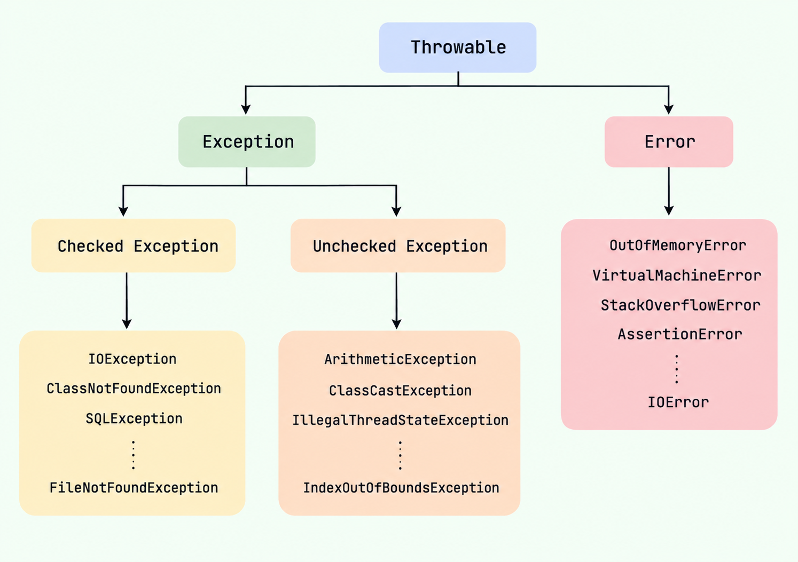

# 03 Java基础概念与常识-异常、泛型、反射等

## 1. Java 异常机制（Exception）



### 1.1 Exception 和 Error 的区别
Java 中所有异常和错误的共同父类是 `java.lang.Throwable`。

| 对比项 | Exception | Error |
| --- | --- | --- |
| 含义 | 程序运行过程中出现的异常 | JVM 或运行环境中的严重错误 |
| 能否捕获 | 可以通过 `try-catch` 捕获 | 技术上可以捕获，但通常不建议 |
| 是否可以恢复 | 很多异常可以处理或恢复 | 通常难以恢复 |
| 常见类型 | `IOException`、`SQLException`、`RuntimeException` | `OutOfMemoryError`、`StackOverflowError` |
| 处理方式 | 捕获处理或向上传播 | 通常定位根本原因，修复环境或程序 |

特别注意：`ClassNotFoundException` 属于 Checked Exception，常见于显式动态加载类失败；`NoClassDefFoundError` 属于 Error，常见于运行时类定义不可用，或类初始化失败后的再次使用。

### 1.2 Checked Exception 和 Unchecked Exception
| 对比项 | Checked Exception | Unchecked Exception |
| --- | --- | --- |
| 编译器是否强制处理 | 是 | 否 |
| 是否必须 `catch` 或 `throws` | 是（在可能抛出时） | 否 |
| 代表类型 | `IOException`、`SQLException` | `RuntimeException`、`Error` 及其子类 |
| 常见原因 | 文件不存在、数据库操作失败 | 空指针、非法参数、数组越界等 |
| 设计目的 | 强制调用方考虑可恢复的异常 | 允许异常向上传播 |

Checked Exception 示例：
```java
public void readFile() throws IOException {
    Files.readString(Path.of("test.txt"));
}
```

因为方法可能抛出 `IOException`，必须捕获或者声明 `throws`。

Unchecked Exception 示例：
```java
public void register(String username) {
    if (username == null) {
        throw new IllegalArgumentException("用户名不能为空");
    }
}
```

这里的 `IllegalArgumentException` 继承自 `RuntimeException`，不需要强制声明。

### 1.3 Throwable 的常用方法
| 方法 | 作用 |
| --- | --- |
| `getMessage()` | 返回异常详细信息 |
| `toString()` | 返回异常类名及描述 |
| `getLocalizedMessage()` | 返回本地化异常信息 |
| `printStackTrace()` | 打印异常堆栈信息 |

### 1.4 try-catch-finally
- `try`：执行可能抛出异常的代码。
- `catch`：捕获并处理指定异常。
- `finally`：执行资源清理等收尾逻辑。

```java
public static int test() {
    try {
        return 100;
    } catch (Exception e) {
        return -1;
    } finally {
        System.out.println("finally 执行");
    }
}
```

正常情况下输出：
```text
finally 执行
100
```

特别注意：`finally` 中不要使用 `return`。
```java
public static int test() {
    try {
        return 100;
    } finally {
        return 200;
    }
}
```

最终返回 `200`，因为 `finally` 的 `return` 覆盖了原本待执行的返回行为。

`finally` 也不是绝对会执行，例如 JVM 通过 `System.exit()` 终止时，可能不会执行。

### 1.5 try-with-resources（推荐）
JDK 7 引入，适用于实现 `AutoCloseable` 的资源。
```java
try (Scanner scanner =
         new Scanner(new File("test.txt"))) {

    while (scanner.hasNextLine()) {
        System.out.println(scanner.nextLine());
    }

} catch (FileNotFoundException e) {
    e.printStackTrace();
}
```

它与传统 `try-finally` 的主要区别：
| try-finally | try-with-resources |
| --- | --- |
| 手动调用 `close()` | 自动关闭资源 |
| 需要判断资源是否为 `null` | 不需要手动判断 |
| 多资源管理比较复杂 | 多个资源用分号分隔 |
| 容易覆盖原始异常 | 支持保留被抑制异常（Suppressed Exception） |

## 2. 泛型（Generics）
### 2.1 什么是泛型？
泛型是 JDK 5 引入的特性，允许在定义类、接口、方法时使用类型参数。

主要作用：
- 编译期类型检查，减少类型错误。
- 避免频繁强制类型转换。
- 提高代码复用性。
- 增强类型安全性与可读性。

### 2.2 泛型三种使用方式
| 分类 | 定义方式 | 示例 |
| --- | --- | --- |
| 泛型类 | 在类名后声明类型参数 | `class Box<T>` |
| 泛型接口 | 在接口名后声明类型参数 | `interface Generator<T>` |
| 泛型方法 | 在返回类型前声明类型参数 | `<T> T method(T value)` |

泛型类：
```java
public class Box<T> {
    private T value;

    public Box(T value) {
        this.value = value;
    }

    public T getValue() {
        return value;
    }
}
```

调用：
```java
Box<String> box = new Box<>("Hello");
String result = box.getValue();
```

泛型接口：
```java
public interface Generator<T> {
    T generate();
}

public class StringGenerator
        implements Generator<String> {

    @Override
    public String generate() {
        return "Hello";
    }
}
```

泛型方法：
```java
public static <T> void print(T value) {
    System.out.println(value);
}
```

这里的 `<T>` 是方法自己声明的类型参数，因此 `static` 方法也可以使用泛型。

### 2.3 实际开发应用
原文列举的应用包括：
- `CommonResult<T>`：统一 API 返回对象。
- `ExcelUtil<T>`：通用 Excel 导出工具。
- `Collections.sort()`：集合通用排序方法。

## 3. Java 反射（Reflection）
### 3.1 什么是反射？
反射允许 Java 程序在运行时动态获取类的信息，并在权限允许的情况下操作对象。

包括：
- 获取类信息：`Class`
- 获取构造方法：`Constructor`
- 获取成员变量：`Field`
- 获取成员方法：`Method`
- 动态创建对象及调用方法

### 3.2 普通调用和反射调用的区别
普通调用：
```java
UserService service = new UserService();
service.sayHello();
```

反射调用：
```java
Class<?> clazz =
    Class.forName("com.example.UserService");

Object obj = clazz
    .getDeclaredConstructor()
    .newInstance();

Method method = clazz.getMethod("sayHello");

method.invoke(obj);
```

区别在于：普通代码直接依赖具体类；反射能够在运行时根据类名、方法名进行动态操作。

### 3.3 反射的优缺点
| 优点 | 缺点 |
| --- | --- |
| 动态加载类 | 性能开销可能更高 |
| 降低部分模块之间的耦合 | 编译期类型检查能力减弱 |
| 支持通用框架开发 | 可能破坏封装性 |
| 支持注解扫描和依赖注入 | 调试和维护更加复杂 |

### 3.4 Spring / MyBatis 中的反射
**Spring：**通过类信息和注解元数据发现 Bean，实例化对象并进行依赖注入。

**MyBatis：**根据数据库查询结果及映射规则，将数据转换成 Java 对象。

例如：
```java
public class User {
    private Integer id;
    private String name;
}
```

数据库查询：
```sql
SELECT id, name FROM users;
```

MyBatis 可以根据映射规则将结果填充到 `User` 对象中，反射是它实现对象属性访问的重要手段之一。

## 4. Java 代理模式（Proxy）
### 4.1 什么是代理？
在不直接修改目标类业务逻辑的情况下，通过代理对象扩展方法行为。

例如：在银行转账方法执行前检查权限，执行后记录日志。

### 4.2 静态代理与动态代理
| 对比项 | 静态代理 | 动态代理 |
| --- | --- | --- |
| 代理类 | 手动编写 | 运行时生成 |
| 维护成本 | 较高 | 较低 |
| 灵活性 | 相对较低 | 较高 |
| 增强代码复用 | 通常需要分别实现 | 可以复用 Handler / Interceptor |
| 典型场景 | 简单固定代理 | Spring AOP、RPC |

### 4.3 JDK 与 CGLIB 动态代理
| 对比项 | JDK 动态代理 | CGLIB 动态代理 |
| --- | --- | --- |
| 实现原理 | 动态生成接口实现类 | 动态生成目标类子类 |
| 目标类是否需要接口 | 需要 | 不需要 |
| 核心接口 | `InvocationHandler` | `MethodInterceptor` |
| 核心方法 | `invoke()` | `intercept()` |
| 是否支持 `final` 类 | 接口代理不受目标类 `final` 限制 | 不支持继承 `final` 类 |
| 常见用途 | 基于接口的代理 | 基于类的代理 |

### 4.4 Spring AOP 的应用
Spring AOP 可以在方法前后加入横切逻辑，例如：
- 日志记录
- 事务管理
- 权限检查
- 方法调用监控

```java
@Service
public class TransferService {

    @Transactional
    public void transfer() {
        // 执行银行转账逻辑
    }
}
```

Spring 通过 AOP 代理实现事务管理等增强逻辑。

注意：原文中“有接口使用 JDK、无接口使用 CGLIB”是一种简化描述。实际选择还受 `proxyTargetClass` 等配置影响，Spring Boot 常见默认配置使用类代理。

## 5. Java 注解（Annotation）
### 5.1 什么是注解？
注解是 Java 5 引入的一种元数据机制，用于向编译器、框架或运行时程序提供信息。

常见注解：
| 注解 | 作用 |
| --- | --- |
| `@Override` | 检查方法是否正确重写 |
| `@Deprecated` | 标记已经弃用的元素 |
| `@Service` | 标记 Spring Service Bean |
| `@Autowired` | 声明依赖注入 |
| `@Transactional` | 声明事务行为 |

### 5.2 注解如何生效？
| 处理方式 | 示例 |
| --- | --- |
| 编译期扫描 | `@Override` |
| 运行期解析 | Spring 的 `@Component`、`@Value` |

注解本身只是元数据，真正的功能需要编译器、框架或其他处理器来实现。

## 6. SPI（Service Provider Interface）
### 6.1 什么是 SPI？
SPI 是服务提供者接口机制，允许框架定义扩展规范，由其他开发者提供具体实现。

例如：
```java
public interface PaymentService {
    void pay();
}
```

不同服务提供者：
```java
public class AlipayService
        implements PaymentService {

    @Override
    public void pay() {
        System.out.println("支付宝支付");
    }
}

public class WechatPayService
        implements PaymentService {

    @Override
    public void pay() {
        System.out.println("微信支付");
    }
}
```

框架可以通过 `ServiceLoader` 发现已经正确注册的实现类。

### 6.2 API 与 SPI 对比
| 对比项 | API | SPI |
| --- | --- | --- |
| 全称 | Application Programming Interface | Service Provider Interface |
| 主要目的 | 对外提供可调用功能 | 对外提供扩展能力 |
| 接口通常由谁定义 | 服务提供方 | 框架或调用方 |
| 谁实现接口 | 通常是服务提供方 | 第三方扩展提供者 |
| 典型使用方式 | 调用现有服务 | 实现接口接入框架 |

可以简单理解为：

API 侧重于“我能调用什么功能”；SPI 侧重于“我能为系统提供什么实现”。

### 6.3 SPI 的优缺点
优点：可扩展性强、实现与调用方解耦、便于替换实现。

缺点：提供者发现与加载需要一定成本；`ServiceLoader` 的单个实例不保证线程安全。

## 7. 序列化与反序列化
### 7.1 基本概念
| 序列化（Serialization） | 反序列化（Deserialization） |
| --- | --- |
| 对象或数据结构转换成可存储、可传输的表示 | 根据该表示恢复对象或数据结构 |
| 常用于数据发送、持久化 | 常用于数据接收、读取 |
| 例如对象转 JSON | 例如 JSON 转对象 |

常见应用：RPC 通信、文件持久化、缓存数据读写。

### 7.2 transient 关键字
对于 Java 原生对象序列化，`transient` 可以阻止指定实例字段参与默认序列化。
```java
public class User implements Serializable {

    private String username;

    private transient String password;
}
```

反序列化后，`password` 通常恢复为类型默认值 `null`。

注意，`static` 字段不属于某个对象的实例状态，因此不参与默认对象序列化。

### 7.3 常见序列化协议
| 类型 | 示例 | 特点 |
| --- | --- | --- |
| 文本 | JSON、XML | 易阅读、跨语言方便 |
| 二进制 | Protobuf、Kryo、Hessian | 常用于对体积和效率有要求的场景 |
| Java 原生 | `ObjectOutputStream` | Java 专用对象序列化机制 |

### 7.4 为什么不推荐 Java 原生序列化？
原文强调三个原因：
1. 跨语言兼容性差。
2. 相比许多专用协议，数据体积和性能通常不占优势。
3. 对不可信数据进行原生反序列化可能产生安全漏洞。

### 7.5 序列化属于 TCP/IP 哪一层？
应用层。

在 OSI 七层模型中，数据表示与编码通常归入表示层；TCP/IP 四层模型将这些职责归入应用层。

## 8. Java I/O
### 8.1 什么是 I/O？
I/O 即 Input / Output，表示数据的输入与输出。
- 输入：从文件、网络等外部来源读取数据。
- 输出：将内存中的数据写入文件、网络或其他目标。

### 8.2 Java I/O 四大抽象基类
| 抽象基类 | 类型 | 功能 |
| --- | --- | --- |
| `InputStream` | 字节输入流 | 读取字节 |
| `OutputStream` | 字节输出流 | 写入字节 |
| `Reader` | 字符输入流 | 读取字符 |
| `Writer` | 字符输出流 | 写入字符 |

### 8.3 字节流和字符流区别
| 对比项 | 字节流 | 字符流 |
| --- | --- | --- |
| 处理单位 | `byte` | `char` / 字符数据 |
| 适用场景 | 图片、视频、二进制文件 | 文本文件 |
| 是否涉及字符编码 | 不直接进行文本解码 | 涉及编码与解码 |
| 常见类 | `FileInputStream` | `FileReader` |

原文还提到 BIO、NIO、AIO，但未在这份材料中展开具体原理，因此暂不补充其内部模型。

## 9. Java 语法糖（Syntactic Sugar）
### 9.1 什么是语法糖？
语法糖是 Java 为简化编程提供的语法形式，本质上可以由其他基础语言结构实现。

### 9.2 常见语法糖
| 语法糖 | 示例 |
| --- | --- |
| 泛型 | `List<String>` |
| 自动装箱 / 拆箱 | `Integer n = 100` |
| 增强 for 循环 | `for (String s : list)` |
| 可变参数 | `void test(String... args)` |
| try-with-resources | `try (InputStream in = ...)` |
| Lambda 表达式 | `() -> System.out.println("Hi")` |
| 枚举 | `enum Status { ACTIVE, INACTIVE }` |

### 9.3 编译器解语法糖
例如增强 for 循环：
```java
List<String> list = List.of("A", "B");

for (String s : list) {
    System.out.println(s);
}
```

编译器会将它转换为基于迭代器的操作结构，JVM 执行的是对应的字节码。

关键点：负责解语法糖的是 Java 编译器，而不是 JVM。
