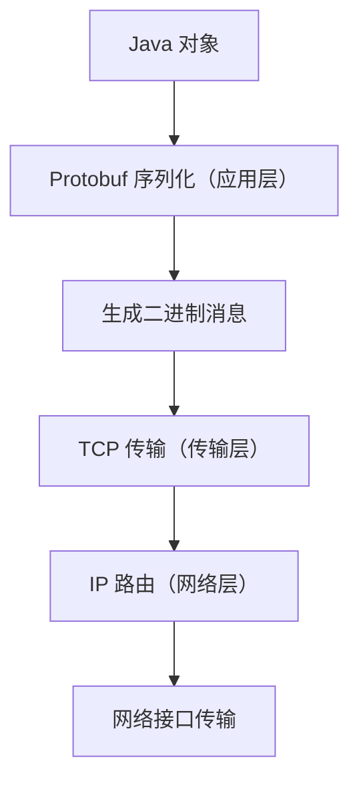

# 05 Java基础概念与常识-Java 序列化与反序列化详解

## 1. 什么是序列化和反序列化？
### 1.1 基本概念

序列化（Serialization）：把 Java 对象转换成适合存储或者网络传输的数据格式，例如二进制字节流、JSON 或 XML。


反序列化（Deserialization）：把保存或者接收到的数据重新转换成 Java 对象。

举个例子，程序中有一个 Person 对象：
```java
Person person = new Person("张三", 25);
```

这个对象存在于 JVM 内存中。如果想把它保存到文件，或者发送给另一台服务器，就需要把它转换成能够存储或传输的数据。

序列化和反序列化的基本流程（以二进制为例）

需要注意，反序列化一般是创建或恢复一个与原对象具有相应状态的新对象，并不是找回原来的内存地址。

### 1.2 为什么需要序列化？
Java 对象通常以 JVM 内部的数据结构存在于内存中，而文件系统、网络和缓存系统需要特定格式的数据。

| 场景 | 序列化的作用 | 反序列化的作用 |
| --- | --- | --- |
| 文件存储 | 将对象保存到文件 | 从文件恢复对象 |
| RPC 远程调用 | 将方法参数转成消息 | 接收端恢复参数 |
| Redis 缓存 | 将对象编码后写入 Redis | 将缓存数据恢复成对象 |
| 消息队列 | 将业务对象转成消息数据 | 消费者解析消息 |
| 数据传输 | 将对象变成跨进程可读取的格式 | 接收方重新构建数据 |

例如在 Spring Boot 项目中：
```java
// 创建一个对象
User user = new User(1L, "张三");
```

Spring Web 使用 Jackson 等组件可以将对象转换为 JSON：
```json
{
    "id": 1,
    "name": "张三"
}
```

前端拿到 JSON 之后，就可以解析其中的数据。

这里有一个很重要的区别：
- 广义序列化：包含 JSON、XML、Protobuf、JDK 对象序列化等形式。
- Java 原生序列化：专门指通过 `Serializable`、`ObjectOutputStream`、`ObjectInputStream` 等实现的 Java 对象序列化机制。

因此，对象转换成 JSON 不需要实现 `Serializable` 接口。

## 2. 序列化协议属于 TCP/IP 哪一层？
原文提到了一个非常典型的网络面试题。

### 2.1 TCP/IP 四层模型
| 层级 | 主要职责 | 常见协议或技术 |
| --- | --- | --- |
| 应用层 | 定义应用之间的数据交互与编码规则 | HTTP、DNS、JSON、Protobuf |
| 传输层 | 端到端数据传输 | TCP、UDP |
| 网络层 | IP 寻址和路由 | IPv4、IPv6、ICMP |
| 网络接口层 | 数据链路与物理传输 | Ethernet、Wi-Fi |

序列化协议属于 TCP/IP 模型中的应用层。

原因是它解决的问题不是如何发送数据，而是如何表示数据。

例如发送 RPC 请求时：


接收方收到数据后，再进行反序列化，恢复业务对象。

### 2.2 为什么有时说它属于表示层？
因为在 OSI 七层模型中，表示层负责数据编码、解码、格式转换等。

OSI 的应用层、表示层、会话层，在 TCP/IP 四层模型中通常合并到应用层。

面试回答： 序列化主要负责对象与数据格式之间的转换，在 OSI 七层模型中对应表示层的职责，在 TCP/IP 四层模型中则归属于应用层。

## 3. Java 原生序列化：Serializable
这是整篇文章的核心内容之一。

### 3.1 什么是 Serializable？
`Serializable` 是 Java 提供的一个标记接口（Marker Interface）。
```java
public interface Serializable {
}
```

你会发现它里面没有任何方法。

这是因为它的作用不是定义业务行为，而是告诉 Java 的序列化机制：

这个类的对象允许按照 Java 原生序列化规则进行处理。

例如：
```java
import java.io.Serializable;

public class Person implements Serializable {

    private static final long serialVersionUID = 1L;

    private String name;
    private int age;

    public Person(String name, int age) {
        this.name = name;
        this.age = age;
    }
}
```

这里：
- `implements Serializable`：声明当前类可被 Java 原生序列化机制处理。
- `serialVersionUID`：序列化版本标识符。
- `name`、`age`：默认情况下会参与序列化的实例字段。

### 3.2 完整代码：将对象写入文件，再读取回来
这个例子可以直接复制到 `SerializationDemo.java` 运行，不依赖 Spring Boot 或 Lombok。

```java
import java.io.*;

public class SerializationDemo {

    // 需要序列化的类
    static class Person implements Serializable {

        private static final long serialVersionUID = 1L;

        private String name;
        private int age;

        public Person(String name, int age) {
            this.name = name;
            this.age = age;
        }

        @Override
        public String toString() {
            return "Person{name='" + name
                    + "', age=" + age + "}";
        }
    }

    public static void main(String[] args) throws Exception {

        Person person = new Person("张三", 25);

        // ① 序列化：对象 -> 文件
        try (ObjectOutputStream oos =
                     new ObjectOutputStream(
                         new FileOutputStream("person.ser"))) {

            oos.writeObject(person);
            System.out.println("序列化完成");
        }

        // ② 反序列化：文件 -> 对象
        Person restored;

        try (ObjectInputStream ois =
                     new ObjectInputStream(
                         new FileInputStream("person.ser"))) {

            restored = (Person) ois.readObject();
        }

        // ③ 验证结果
        System.out.println("原始对象：" + person);
        System.out.println("恢复对象：" + restored);
        System.out.println("是否同一个对象：" + (person == restored));
    }
}
```

输出：
```text
序列化完成
原始对象：Person{name='张三', age=25}
恢复对象：Person{name='张三', age=25}
是否同一个对象：false
```

为什么结果是 false？

因为 `readObject()` 根据文件中的序列化数据恢复了一个新对象。

在这个例子中：
```java
person == restored  // false
```

比较的是两个引用是否指向同一个对象。

虽然两个对象的字段值相同，但是它们不是同一个对象实例。
### 3.3 核心 API
| API | 作用 |
| --- | --- |
| `Serializable` | 标记类支持 Java 原生序列化 |
| `ObjectOutputStream` | 将对象写入序列化输出流 |
| `writeObject()` | 执行对象序列化 |
| `ObjectInputStream` | 从序列化输入流读取数据 |
| `readObject()` | 执行对象反序列化 |
| `FileOutputStream` | 向文件输出字节 |
| `FileInputStream` | 从文件读取字节 |

注意，`writeObject()` 既可以配合文件流，也可以配合内存字节流、网络流等。

## 4. serialVersionUID 有什么作用？
`serialVersionUID` 是 Java 序列化中非常重要的一个知识点，也是面试高频问题。

### 4.1 serialVersionUID 的定义
```java
private static final long serialVersionUID = 1L;
```

它是序列化类的版本标识符，用来辅助判断序列化数据与当前类定义是否兼容。

可以把它理解为：
- 序列化时，保存对象数据以及所属类的版本标识。
- 反序列化时，Java 会比较数据流中的版本标识和本地类的版本标识。
- 对普通 `Serializable` 类，如果两者不匹配，就会抛出 `InvalidClassException`。

### 4.2 serialVersionUID 的工作原理
版本号相同只代表通过这一步检查，不保证类结构一定兼容

### 4.3 举例：修改 serialVersionUID 会发生什么？
第一次：序列化对象。
```java
public class User implements Serializable {

    private static final long serialVersionUID = 1L;

    private String name;
}
```

假设我们把 `User` 对象序列化保存成 `user.ser`。

第二次：修改类。
```java
public class User implements Serializable {

    // 将 1L 修改成 2L
    private static final long serialVersionUID = 2L;

    private String name;
}
```

重新编译后，使用新版本的类读取之前保存的 `user.ser`。

此时会抛出异常：
```text
java.io.InvalidClassException:
User; local class incompatible:
stream classdesc serialVersionUID = 1,
local class serialVersionUID = 2
```

因为保存的数据版本是 `1L`，当前类的版本是 `2L`。

### 4.4 为什么推荐手动指定 serialVersionUID？
如果没有显式声明：
```java
public class User implements Serializable {
    private String name;
}
```

Java 序列化运行时会根据类的某些结构信息计算默认 `serialVersionUID`。

假如你增加字段、修改方法或重新编译，在某些情况下，计算结果可能发生变化，导致旧数据无法读取。

因此推荐：
```java
private static final long serialVersionUID = 1L;
```

如果使用 Java 14 及以上版本，还可以添加 `@Serial` 注解：
```java
@Serial
private static final long serialVersionUID = 1L;
```

`@Serial` 可以帮助编译器检查序列化相关成员的声明是否正确。

### 4.5 添加字段一定会导致反序列化失败吗？
不一定。

假设旧版本：
```java
public class User implements Serializable {
    private static final long serialVersionUID = 1L;
    private String name;
}
```

新版本：
```java
public class User implements Serializable {
    private static final long serialVersionUID = 1L;
    private String name;
    private int age;
}
```

如果保持版本号一致，旧数据通常可以被新版本读取，而新增的 `age` 字段会获得默认值 `0`。

| 情况 | 典型结果 |
| --- | --- |
| UID 从 `1L` 改成 `2L` | `InvalidClassException` |
| UID 相同，新增普通字段 | 通常兼容，新增字段取默认值 |
| UID 相同，删除普通字段 | 通常兼容，旧字段数据被忽略 |
| UID 相同，修改字段类型 | 可能反序列化失败 |
| UID 相同，改变类的继承或序列化结构 | 可能不兼容 |

注意：`serialVersionUID` 并不是完整的版本兼容解决方案。它只是序列化兼容性检查的一部分。

## 5. static 为什么不参与序列化？
这是原文特别强调、也容易产生误解的地方。

### 5.1 static 属于类，而不是对象实例
例如：
```java
public class User implements Serializable {

    private static final long serialVersionUID = 1L;

    private String name = "张三";

    private static String company = "ABC公司";
}
```

其中：
```java
private String name;
```

是实例字段，每个对象都可以拥有不同的 `name`。

而：
```java
private static String company;
```

是类变量，同一个类的对象共享这一变量。

Java 默认对象序列化只保存符合规则的实例字段，不会把普通 `static` 字段作为对象状态保存。

### 5.2 完整案例
```java
import java.io.*;

public class StaticDemo {

    static class User implements Serializable {

        private static final long serialVersionUID = 1L;

        String name = "张三";

        static String company = "ABC公司";
    }

    public static void main(String[] args) throws Exception {

        User user = new User();

        ByteArrayOutputStream bos = new ByteArrayOutputStream();

        try (ObjectOutputStream oos =
                     new ObjectOutputStream(bos)) {
            oos.writeObject(user);
        }

        // 序列化之后，修改 static 变量
        User.company = "XYZ公司";

        User restored;

        try (ObjectInputStream ois =
                     new ObjectInputStream(
                         new ByteArrayInputStream(bos.toByteArray()))) {

            restored = (User) ois.readObject();
        }

        System.out.println(restored.name);
        System.out.println(User.company);
        System.out.println(restored.company);
    }
}
```

输出：
```text
张三
XYZ公司
XYZ公司
```

最后一句虽然通过 `restored.company` 访问，但实际上读取的还是 `User.company`，不推荐这样写。

这证明普通的 `static` 字段没有被序列化，而是读取当前类的共享变量值。

### 5.3 serialVersionUID 也是 static，为什么它会被写入数据流？
这是一个非常好的面试追问。
```java
private static final long serialVersionUID = 1L;
```

虽然它也是 `static` 字段，但是 Java 序列化机制对它进行了特殊处理：

它不会作为对象的普通实例字段保存，而是作为类描述信息中的版本标识被记录到序列化流中。

因此：
| 字段 | 是否写入对象状态 | 说明 |
| --- | --- | --- |
| `String name` | 是 | 普通实例字段 |
| `static String company` | 否 | 类变量 |
| `static final long serialVersionUID` | 不作为实例字段写入 | 版本值存入序列化类描述信息 |

记住：`serialVersionUID` 是一种序列化元数据，不是普通对象状态。

## 6. transient 关键字有什么作用？
### 6.1 基本概念
`transient` 的作用是：

在 Java 默认对象序列化过程中，排除某个实例字段，使其不被持久化。

例如一个用户对象：
```java
public class User implements Serializable {

    private String username;

    private transient String password;
}
```

序列化时，`username` 会被保存，而 `password` 不会按照默认规则写入。

### 6.2 完整代码示例
```java
import java.io.*;

public class TransientDemo {

    static class User implements Serializable {

        private static final long serialVersionUID = 1L;

        String username;
        transient String password;
        transient int loginCount;
        transient boolean authenticated;

        User(String username, String password) {
            this.username = username;
            this.password = password;
            this.loginCount = 5;
            this.authenticated = true;
        }
    }

    public static void main(String[] args) throws Exception {

        User user = new User("admin", "123456");

        ByteArrayOutputStream bos = new ByteArrayOutputStream();

        try (ObjectOutputStream oos = new ObjectOutputStream(bos)) {
            oos.writeObject(user);
        }

        User restored;

        try (ObjectInputStream ois = new ObjectInputStream(
                new ByteArrayInputStream(bos.toByteArray()))) {
            restored = (User) ois.readObject();
        }

        System.out.println(restored.username);
        System.out.println(restored.password);
        System.out.println(restored.loginCount);
        System.out.println(restored.authenticated);
    }
}
```

输出：
```text
admin
null
0
false
```

为什么是这些结果？

因为反序列化时，没有从数据流恢复的 `transient` 字段会保留对应的默认值。

| 字段类型 | 默认值 |
| --- | --- |
| `int`、`short`、`byte`、`long` | `0` |
| `float`、`double` | `0.0` |
| `boolean` | `false` |
| `char` | `'\u0000'` |
| 引用类型，如 `String` | `null` |

### 6.3 transient 使用注意事项
- `transient` 只能修饰字段，不能修饰类和方法。
- 普通 Java 原生默认序列化会跳过 `transient` 字段。
- `static` 字段本来就不会作为实例状态被序列化，不需要额外加 `transient`。
- `transient` 影响的是 Java 原生序列化规则，不代表 Jackson 等 JSON 框架一定会排除这个字段。
- 如果类自定义了 `writeObject()` 等序列化逻辑，仍然有可能主动写入这些字段的数据。

面试中特别容易考：
```java
private transient int age = 18;
```

反序列化之后通常不是 `18`，而是 `0`。

因为对于实现 `Serializable` 的类，正常反序列化并不会执行该类的构造器以及实例字段初始化逻辑。

### 6.4 static、final、transient 对比
| 关键字 | 主要作用 | 对默认序列化的影响 |
| --- | --- | --- |
| `static` | 字段属于类 | 不作为实例状态序列化 |
| `final` | 限制赋值或重新赋值 | 本身不阻止序列化 |
| `transient` | 排除默认序列化字段 | 不保存该实例字段 |
| `serialVersionUID` | 类的序列化版本标识 | 特殊的版本元数据 |

## 7. 为什么实现 Serializable 之后，依然可能序列化失败？
这部分原文没有深入展开，但在 Java 面试中非常重要。

### 7.1 NotSerializableException 异常
先看代码：
```java
import java.io.*;

class Address {
    String city = "东京";
}

class User implements Serializable {

    private static final long serialVersionUID = 1L;

    String name = "张三";

    Address address = new Address();
}
```

执行：
```java
User user = new User();

ObjectOutputStream oos =
        new ObjectOutputStream(
                new FileOutputStream("user.ser"));

oos.writeObject(user);
```

会抛出：
```text
java.io.NotSerializableException: Address
```

为什么 `User` 已经实现了 `Serializable`，还是报错？

因为 Java 原生序列化不仅仅处理 `User` 本身，还需要处理它所引用的、必须序列化的对象。

在这个例子中：
```text
User implements Serializable
  |
  +-- name: String
  |      └── 可序列化
  |
  +-- address: Address
         └── 未实现 Serializable
                    |
                    v
          NotSerializableException
```

### 7.2 如何解决？
有两种常见处理方法。

方法一：让 `Address` 也实现 `Serializable`。
```java
class Address implements Serializable {

    private static final long serialVersionUID = 1L;

    String city = "东京";
}
```

这样 `User` 和它所引用的 `Address` 都可以正常序列化。

方法二：使用 `transient` 排除不需要保存的对象。
```java
class User implements Serializable {

    private static final long serialVersionUID = 1L;

    String name = "张三";

    transient Address address = new Address();
}
```

这样 `address` 不会参与默认序列化，反序列化后的值为 `null`。

### 7.3 什么是对象图序列化？
Java 原生序列化会沿着对象引用关系处理整个对象图（Object Graph）。

例如：
```java
class Order implements Serializable {
    User user;
    Product product;
    List<OrderItem> items;
}
```

不仅 `Order` 需要能够序列化，其需要保存的字段引用到的对象也必须满足序列化要求。

Java 原生序列化还能够保留同一对象图内的共享引用关系和循环引用关系，而不是无限递归复制对象。

## 8. 为什么不推荐使用 JDK 自带的序列化？
JavaGuide 原文主要从三个方面解释。

### 8.1 不支持通用的跨语言调用
JDK 原生序列化使用 Java 特有的对象序列化格式。

例如：
```text
Java 服务 A
     |
     | JDK 对象序列化
     v
Java 服务 B
```

双方都使用 Java 时，可以按约定恢复数据。

但如果接收端是 Python、Go、JavaScript，就不能直接依赖这些语言的常规序列化组件解析 Java 对象流。

因此跨语言系统更常采用 JSON 或 Protobuf 等格式。
### 8.2 性能和数据体积问题
与专门优化过的二进制编码格式相比，JDK 原生序列化往往存在：
- 数据中包含较多类描述信息，传输体积可能较大。
- 对象图处理、类型信息及恢复过程会带来额外开销。
- 不适合所有高吞吐、低延迟 RPC 场景。

但这里要注意：不能绝对地说 JDK 序列化永远最慢。实际性能需要结合对象结构、数据规模、序列化器配置和测试环境判断。

### 8.3 反序列化安全问题
这是最需要重视的一点。

假设一个服务直接反序列化外部用户提交的数据：
```java
ObjectInputStream ois =
        new ObjectInputStream(inputStream);

Object obj = ois.readObject();
```

如果数据可以被攻击者控制，反序列化过程可能触发非预期的对象构造、回调或方法执行行为。

在具备特定危险依赖和执行路径的情况下，可能造成严重的反序列化漏洞。

并不是所有恶意数据都能够触发远程代码执行，但反序列化不可信输入确实具有重大安全风险。

生产环境通常应避免对不可信数据使用 Java 原生反序列化；如果受历史系统限制必须使用，应考虑类型白名单、`ObjectInputFilter`、输入大小与深度限制等措施。

| 比较项目 | JDK 原生序列化 |
| --- | --- |
| 开发使用 | 简单，实现 `Serializable` 即可 |
| 跨语言能力 | 不适合通用跨语言交互 |
| 性能 | 可能存在较大开销 |
| 数据体积 | 通常不够紧凑 |
| 版本兼容 | 受 Java 类结构和 UID 规则影响 |
| 安全性 | 不可信输入反序列化风险较高 |
| 典型场景 | 历史 Java 系统、特定内部需求 |

## 9. 常见序列化协议有哪些？
JavaGuide 主要介绍了五类方案：
- JDK 原生序列化
- Kryo
- Protobuf
- ProtoStuff
- Hessian

此外，还有 JSON、XML、Avro、Thrift 等。

### 9.1 序列化协议总览
| 协议或格式 | 数据形式 | 跨语言 | 主要特点 |
| --- | --- | --- | --- |
| JDK 原生 | 二进制 | 有限 | Java 自带，使用方便 |
| Kryo | 二进制 | 主要针对 JVM | 性能较好、编码紧凑 |
| Protobuf | 二进制 | 支持 | Schema 明确、体积较小 |
| ProtoStuff | 二进制 | 取决于模式 | Java 生态使用方便 |
| Hessian / Hessian2 | 二进制 | 支持 | RPC 场景常用 |
| JSON | 文本 | 支持 | 可读性高、Web 开发常见 |
| XML | 文本 | 支持 | 自描述能力强，但通常较冗长 |
| Avro | 二进制等 | 支持 | Schema 演进与数据处理 |
| Thrift | 多种编码 | 支持 | 跨语言 RPC 和数据结构定义 |

这里要修正原文的一处表述：JSON 并不因为是文本格式就不推荐使用。它仍然是 Web API 中非常实用的选择，只是在特定高吞吐场景，Protobuf 等二进制格式可能更有优势。

### 9.2 Kryo：高性能 Java 序列化
重点：性能、线程安全、使用场景

Kryo 是专门面向 Java/JVM 对象的高性能序列化框架。

它的特点是：
- 序列化速度通常较快。
- 生成的数据通常较紧凑。
- 支持对象图处理。
- 适合 Java 内部的数据处理及部分 RPC 场景。

原文使用的 RPC 示例：
```java
private final ThreadLocal<Kryo> kryoThreadLocal =
        ThreadLocal.withInitial(() -> {
    Kryo kryo = new Kryo();
    kryo.register(RpcRequest.class);
    kryo.register(RpcResponse.class);

    return kryo;
});
```

为什么使用 `ThreadLocal`？

因为 Kryo 实例不是线程安全的。

如果多个线程同时操作同一个 Kryo 实例，可能产生状态冲突。

`ThreadLocal<Kryo>` 可以为不同线程维护独立的实例。
```text
Thread-1  →  Kryo实例A
Thread-2  →  Kryo实例B
Thread-3  →  Kryo实例C
```

原文代码里还使用了：
```java
kryo.writeObject(output, obj);
```

把对象写入 Kryo 输出流。

反序列化时：
```java
Object obj = kryo.readObject(input, clazz);
```

从二进制数据恢复对象。

补充两个实际开发注意点：

第一，使用 `ThreadLocal.remove()` 清理资源时，最好放在 `finally` 中，避免序列化抛出异常导致清理逻辑被跳过。

第二，`ThreadLocal` 并非所有场景下的最佳方案，特别是大量短生命周期的虚拟线程。Kryo 官方也建议根据线程模型考虑实例池等方式。

### 9.3 Protobuf：Google 的二进制序列化协议
重点：跨语言、IDL、字段编号

Protobuf（Protocol Buffers）是 Google 开发的数据序列化格式及相关工具体系。

相比 JSON，它通常具有较小的数据体积和较高的编解码效率。

Protobuf 的重要特点是：需要通过 `.proto` 文件定义消息结构。

例如：
```proto
syntax = "proto3";

message Person {

    string name = 1;

    int32 age = 2;
}
```

逐行解释：
| 代码 | 含义 |
| --- | --- |
| `syntax = "proto3"` | 使用 proto3 语法 |
| `message Person` | 声明消息类型 |
| `string name` | 字符串字段 |
| `int32 age` | 32 位整数类型 |
| `= 1` | 字段编号 1 |
| `= 2` | 字段编号 2 |

这里的 1 和 2 不是字段的值，而是字段编号（Field Number）。

它们参与消息的二进制编码，也是兼容性设计的重要依据。

通过 Protobuf 编译器，可以生成 Java、Go、Python 等语言对应的消息类型。

Protobuf 的优势包括：
- 支持跨语言。
- 相比很多文本格式更紧凑。
- Schema 明确，便于管理数据结构。
- 可以通过合理维护字段编号和类型实现版本演进。

缺点是需要维护 `.proto` 文件以及相关的代码生成流程。

另外，原文将 Protobuf 的结构约束与安全性联系起来，这个方向是合理的，但不能理解成 Protobuf 完全没有反序列化风险。恶意输入、资源消耗和实现漏洞仍然需要防范。
### 9.4 ProtoStuff：简化 Java 侧对象编码
ProtoStuff 是一个 Java 序列化工具库，支持 Protobuf 相关的编码能力，并提供对 Java 对象更方便的序列化方式。

它与 Protobuf 的主要区别可以这样理解：
| 比较项目 | Protobuf | ProtoStuff |
| --- | --- | --- |
| 使用方式 | 通常编写 `.proto` | 可基于 Java 类构建 Schema |
| 开发体验 | Schema 优先 | Java 对象使用较方便 |
| 跨语言 | 官方生态成熟 | 依赖编码模式和兼容方案 |
| 版本管理 | 显式字段编号 | 需要关注字段映射稳定性 |
| 典型用途 | 跨语言 RPC、协议定义 | Java 服务内部对象编码 |

要特别注意：ProtoStuff 的某些运行时 Schema 模式并不意味着与所有标准 Protobuf 客户端天然兼容。
### 9.5 Hessian：RPC 中常见的二进制协议
Hessian 是一个二进制远程调用协议，也常用来指 Hessian 的二进制序列化格式。

Hessian2 是其改进版本，Java RPC 框架中比较常见。

特点包括：
- 二进制编码。
- 支持一定程度的跨语言通信。
- 对 Java 对象使用较方便。
- 在 Dubbo 生态中有长期应用。

关于原文 Dubbo 版本的补充：

不同 Dubbo 版本的默认序列化方式并不完全一样。

| Dubbo 版本 | 默认序列化方式的变化 |
| --- | --- |
| Dubbo 2.x | Dubbo 协议传统上默认使用 Hessian2 |
| Dubbo 3.2 | 默认从 Hessian2 切换为 Fastjson2 |
| Dubbo 3.3 | 官方兼容性文档说明默认切回 Hessian2 |

具体项目还要结合通信协议、配置和所使用的版本判断，不能笼统认为所有 Dubbo 3.x 都默认 Fastjson2。


## 10. 实际 Spring Boot 项目如何选择序列化方案？
这里结合 Java 后端开发，把原文知识放到实际项目中。

### 10.1 Spring Boot REST API
普通前后端分离项目，通常使用 JSON。
```java
@RestController
@RequestMapping("/users")
public class UserController {

    @GetMapping("/{id}")
    public User getUser(@PathVariable Long id) {
        return new User(id, "张三");
    }
}
```

Spring MVC 可以通过配置好的 HTTP 消息转换器将 Java 对象转成 JSON。

例如：
```json
{
  "id": 1,
  "name": "张三"
}
```

这种情况下，`User` 类通常不需要实现 `Serializable`。

### 10.2 Redis 缓存
假设使用 Spring Boot 和 Redis：
```java
@Autowired
private StringRedisTemplate redisTemplate;

@Autowired
private ObjectMapper objectMapper;

public void saveUser(User user) throws Exception {

    // Java 对象 -> JSON
    String json = objectMapper.writeValueAsString(user);

    // JSON -> Redis
    redisTemplate.opsForValue().set("user:1", json);
}
```

读取时：
```java
public User getUser() throws Exception {

    String json = redisTemplate.opsForValue()
                               .get("user:1");

    if (json == null) {
        return null;
    }

    // JSON -> Java 对象
    return objectMapper.readValue(json, User.class);
}
```

这说明 Redis 缓存并不意味着一定要用 JDK 原生序列化。

具体采用 JSON、字符串、二进制格式，还是其他 Redis 序列化器，取决于系统设计。

### 10.3 不同后端场景的选择
| 业务场景 | 常见选择 | 原因 |
| --- | --- | --- |
| Spring Boot REST API | JSON | 易调试、兼容前端 |
| Redis 缓存 | JSON 或其他编码 | 依据可读性、性能与兼容性 |
| gRPC | Protobuf | 明确的接口契约和跨语言能力 |
| Dubbo RPC | Hessian2、Fastjson2 等 | 根据框架版本和配置 |
| 高性能 JVM 内部通信 | Kryo 等 | 编码效率与性能需求 |
| 大数据与数据交换 | Avro、Protobuf 等 | Schema 管理与数据处理 |
| 传统 Java 对象文件存储 | JDK 序列化 | 可用于兼容既有系统，不宜轻易用于新系统 |
